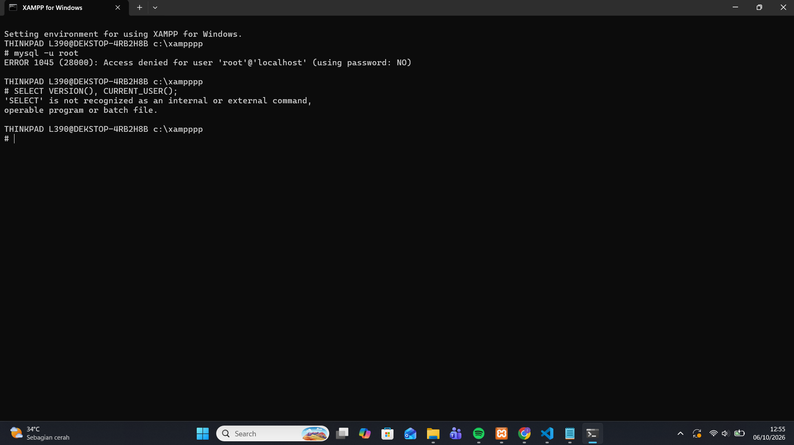
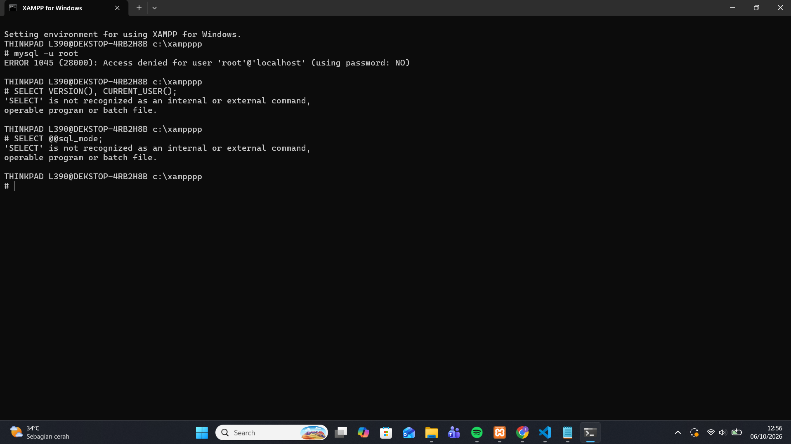
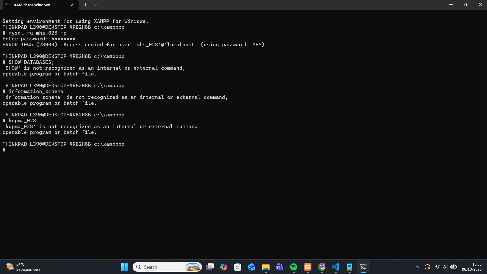
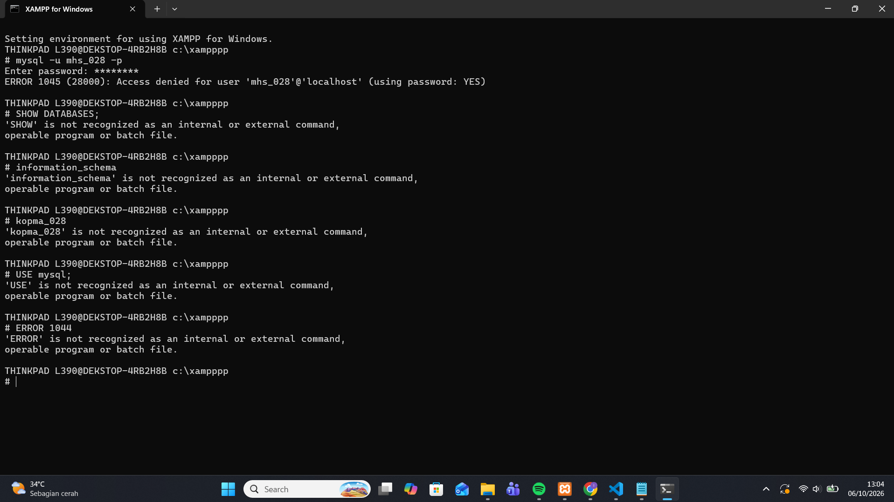
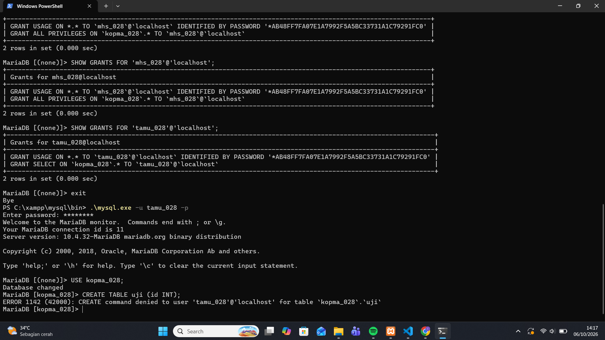
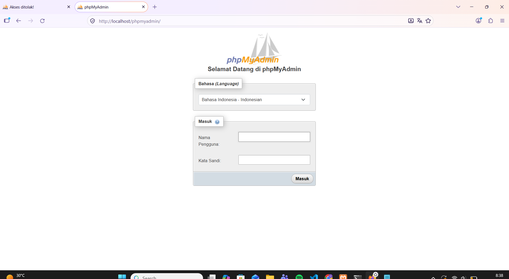
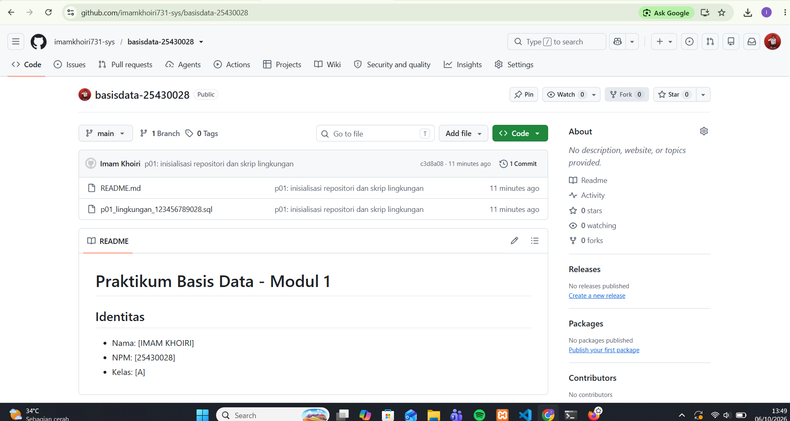

# Laporan Praktikum Basis Data - Pertemuan 01

**Nama:** Imam Khoiri
**NIM:** 25430028
**Kelas:** A
**Tanggal:** 6 Oktober 2026
**Dosen/Asisten:** Dedi Irawan, S.Kom., M.T.I.
**Tema proyek:** Klinik
**Organisasi:** Klinik IK Sehat

---

## 1. Tujuan Praktikum

Praktikum ini bertujuan menyiapkan MariaDB di XAMPP, membuat akun dengan hak akses berbeda, mencoba phpMyAdmin dengan autentikasi cookie, serta mengelola berkas praktikum dengan Git dan GitHub.

---

## 2. Ringkasan Dasar Teori

MariaDB adalah server basis data yang dijalankan XAMPP, walaupun tombolnya bertuliskan MySQL. Setiap akun diberi hak akses sesuai kebutuhan kerja agar kesalahan atau penyalahgunaan dapat dibatasi. Git mencatat setiap perubahan berkas, dan GitHub menyimpan salinan repositori sehingga dosen dapat memeriksa pekerjaan langsung dari sana.

---

## 3. Hasil Langkah Percobaan

### 3.1 Pemeriksaan MariaDB

Perintah yang digunakan:

```sql
SELECT VERSION(), CURRENT_USER();
```



Keterangan: hasil pemeriksaan versi dan akun MariaDB.

### 3.2 Pemeriksaan SQL Mode

Perintah yang digunakan:

```sql
SELECT @@sql_mode;
```



Keterangan: hasil SQL mode MariaDB.

### 3.3 Pemeriksaan Database

Perintah yang digunakan:

```sql
SHOW DATABASES;
```



Keterangan: daftar database yang terlihat oleh akun mhs_028.

### 3.4 Pengujian Akun dev_028

Perintah yang digunakan:

```sql
USE kopma_028;
```

Hasil:

```text
ERROR 1044
```

Galat ini terjadi karena akun dev_028 tidak mempunyai akses ke database kopma_028.



Keterangan: penolakan akses database untuk akun dev_028.

### 3.5 Pengujian Akun tamu_028

Perintah yang digunakan:

```sql
CREATE TABLE uji (id INT);
```

Hasil:

```text
ERROR 1142
```

Galat ini terjadi karena akun tamu_028 tidak mempunyai izin CREATE.



Keterangan: penolakan perintah CREATE untuk akun tamu_028.

### 3.6 Konfigurasi phpMyAdmin

Konfigurasi phpMyAdmin diubah menjadi mode autentikasi cookie.


Keterangan: konfigurasi auth_type cookie pada config.inc.php.



Keterangan: formulir login phpMyAdmin yang meminta nama pengguna dan kata sandi.

### 3.7 GitHub

Repositori GitHub yang digunakan: `basisdata-25430028`

Commit awal: `p01: inisialisasi repositori dan skrip lingkungan`



Keterangan: bukti repositori di GitHub dan git push pertama.

---

## 4. Jawaban Titik Analisis

### 4.1 Titik Analisis 1

Walaupun tombol di XAMPP bertuliskan MySQL, server yang berjalan adalah MariaDB. Akibatnya, hasil pencarian solusi galat di internet sering merujuk ke MySQL dan belum tentu cocok untuk MariaDB, terutama pada versi, nilai bawaan seperti `sql_mode`, pesan galat, dan fitur khusus. Dokumentasi MySQL masih relevan untuk sintaks SQL dasar yang sama di keduanya. Dokumentasi MariaDB harus dirujuk bila persoalannya menyangkut perilaku server, konfigurasi, versi, atau fitur yang berbeda.

### 4.2 Titik Analisis 2

Perintah `mysql -u root` tidak mengirim password, sedangkan `mysql -u root -p` meminta password. Pada pesan galat, bagian `(using password: NO)` menunjukkan bahwa klien tidak mengirim password. *(Cocokkan dengan pesan galat yang muncul di komputer Anda dan bandingkan dengan Gambar 1.10 pada buku.)*

### 4.3 Titik Analisis 3

`information_schema` tetap terlihat oleh mhs_028 karena database itu menyediakan metadata, dan setiap akun boleh melihat metadata objek yang memang berhak diaksesnya. Database `mysql` berisi data sistem, sehingga akun tanpa hak akses ditolak dengan ERROR 1044.

Perbedaan kode galat:

- **ERROR 1044**: akun berhasil masuk, tetapi tidak memiliki akses ke database tertentu.
- **ERROR 1045**: proses autentikasi gagal, misalnya password salah atau tidak dikirim.
- **ERROR 1142**: akun tidak memiliki izin menjalankan perintah tertentu pada suatu tabel, misalnya CREATE.

### 4.4 Titik Analisis 4

Mode cookie meminta pengguna mengetik password setiap kali masuk, sehingga password tidak tersimpan di komputer. Mode config menyimpan password di berkas konfigurasi, sehingga siapa pun yang dapat membuka berkas itu atau mengakses phpMyAdmin langsung masuk tanpa verifikasi. Hak akses juga dibatasi supaya setiap akun hanya dapat melakukan pekerjaan yang diperlukan.

---

## 5. Hasil Latihan dan Modifikasi

- Database praktik: `kopma_028`
- Database proyek: `klinik_028`
- Akun kerja: `mhs_028`
- Akun tamu: `tamu_028`
- Akun proyek: `dev_028`
- Pengujian hak akses berhasil dilakukan (ERROR 1044 dan ERROR 1142 muncul sesuai harapan).

---

## 6. Tugas Mandiri: Milestone Proyek 1

- Tema: Klinik
- Organisasi: Klinik IK Sehat
- Database proyek: `klinik_028`
- Akun proyek: `dev_028`
- README berisi identitas dan identitas proyek sudah dibuat.
- `.gitignore` sudah dibuat.
- Repositori GitHub `basisdata-25430028` sudah dibuat dan push pertama berhasil.

Keputusan desain: *Keputusan desain: Saya memilih tema Klinik karena alurnya jelas, mulai dari pendaftaran pasien sampai pembayaran. Akun dev_028 dipisah dari mhs_028 supaya pekerjaan proyek tidak bercampur dengan latihan dan hanya mendapat akses ke klinik_028.*

---

## 7. Pembahasan dan Kendala

Kendala yang ditemukan adalah pengaturan password root dan login phpMyAdmin setelah password ditambahkan. phpMyAdmin menampilkan galat akses karena konfigurasi bawaan masuk otomatis tanpa password. Masalah diselesaikan dengan mengubah autentikasi phpMyAdmin menjadi mode cookie.

---

## 8. Kesimpulan

Praktikum ini membantu saya memahami penggunaan MariaDB, pembuatan akun dengan hak akses berbeda, penggunaan phpMyAdmin, serta penggunaan Git dan GitHub untuk menyimpan pekerjaan.

---

## 9. Pernyataan Penggunaan AI

AI digunakan sebagai bantuan untuk memahami materi dan langkah praktikum serta merapikan penulisan laporan. Pelaksanaan, pengujian, pengambilan tangkapan layar, dan pengelolaan repositori dilakukan oleh mahasiswa. *(Sesuaikan dengan yang sebenarnya Anda lakukan.)*

---

## 10. Bukti Git

- Tautan repositori: https://github.com/imamkhoiri731-sys/basisdata-25430028
- Branch: `main`
- Commit awal: `p01: inisialisasi repositori dan skrip lingkungan` (hash: `c3d8a08`)
- Berkas wajib: `README.md`, `.gitignore`, `p01_lingkungan_<NIM>.sql`

*(Cara melihat hash: jalankan `git log --oneline` di terminal, lalu salin 7 karakter di depan pesan commit.)*

---

## Checklist Pertemuan 1

| No. | Yang harus ada | Status |
|---|---|---|
| 1 | Berkas SQL lingkungan tersedia | ☑ |
| 2 | README.md tersedia | ☑ |
| 3 | .gitignore tersedia | ☑ |
| 4 | SS SELECT VERSION(), CURRENT_USER(); | ☑ |
| 5 | SS SELECT @@sql_mode; | ☑ |
| 6 | SS SHOW DATABASES sebagai mhs_028 | ☑ |
| 7 | SS ERROR 1044 | ☑ |
| 8 | SS ERROR 1142 | ☑ |
| 9 | SS login phpMyAdmin mode cookie | ☑ |
| 10 | SS Git push pertama | ☑ |
| 11 | Jawaban Titik Analisis 1 sampai 4 | ☑ |
| 12 | Database proyek klinik_028 | ☑ |
| 13 | Akun proyek dev_028 | ☑ |
| 14 | README Identitas Proyek | ☑ |
| 15 | .gitignore | ☑ |
| 16 | Repositori GitHub | ☑ |
