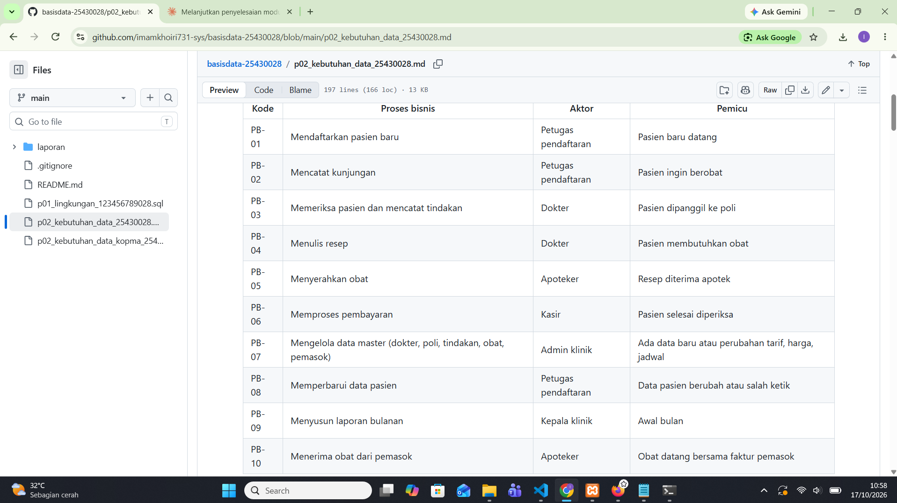
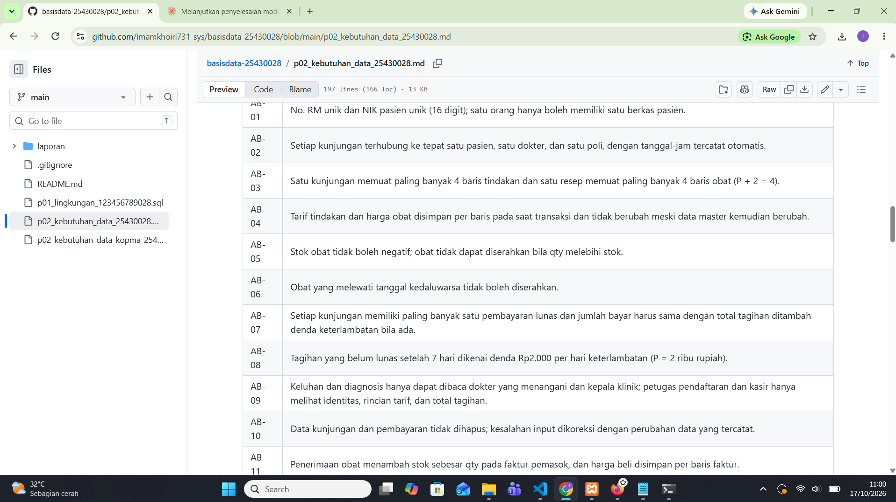
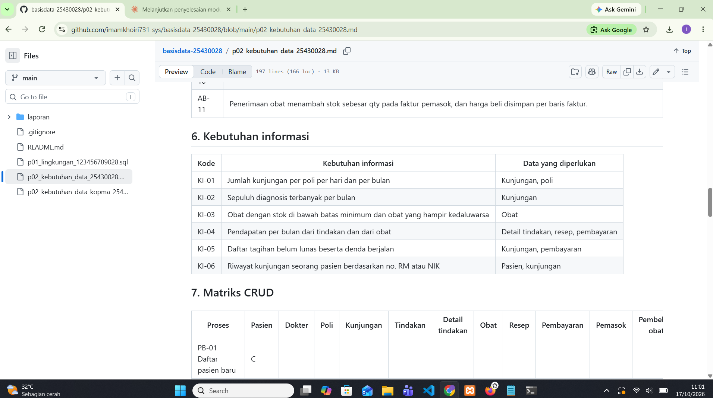

# Laporan Praktikum Basis Data - Pertemuan 02

**Nama:** Imam Khoiri  
**NIM:** 25430028  
**Kelas:** A  
**Pertemuan:** 2 - Analisis Kebutuhan Pengelolaan Data  
**Tanggal pelaksanaan:** 17 Oktober 2026  
**Dosen/Asisten:** Dedi Irawan, S.Kom., M.T.I.  
**Tema proyek:** Klinik (Klinik IK Sehat)  

---

## 1. Tujuan Praktikum

Praktikum ini bertujuan untuk melatih kemampuan dalam mengidentifikasi proses bisnis, entitas, aturan bisnis, dan kebutuhan informasi dari dokumen transaksi/sumber operasional. Selain itu, praktikum ini bertujuan agar mahasiswa mampu menyusun matriks CRUD serta kamus data awal untuk memastikan tidak ada entitas yang terisolasi, yang kemudian diterapkan secara terstruktur pada studi kasus sistem pengelolaan Klinik IK Sehat.

---

## 2. Ringkasan Dasar Teori

Analisis kebutuhan data dilakukan sebelum merancang tabel untuk memastikan sistem yang dibangun benar-benar mencakup seluruh alur operasional dan mencegah redundansi serta hilangnya informasi penting. Dalam proses ini, **proses bisnis** menggambarkan urutan aktivitas operasional organisasi, **entitas** merupakan objek atau konsep utama yang datanya perlu disimpan, **aturan bisnis** mendefinisikan batasan atau kebijakan operasional (seperti batasan nilai atau keunikan ID), dan **kebutuhan informasi** menentukan laporan atau luaran yang diharapkan pengguna. 

Untuk memvalidasi kelengkapan rancangan, **matriks CRUD** digunakan guna memetakan hubungan antara proses bisnis dan entitas, sehingga entitas yang tidak pernah dibuat (*Create*) atau dibaca (*Read*) dapat terdeteksi lebih awal. Sementara itu, **kamus data** berfungsi mendefinisikan atribut, tipe data, serta deskripsi tiap elemen secara konsisten. Dalam pengolahan data, penting membedakan **data yang disimpan** (data mentah/historis transaksi seperti harga saat transaksi) dengan **data turunan** (data hasil kalkulasi seperti subtotal/total) agar penyimpanan database efisien dan tetap konsisten.

---

## 3. Hasil Langkah Percobaan

Langkah percobaan dikerjakan pada studi kasus Koperasi Mahasiswa Sejahtera (Kopma). Hasil lengkap ada di `p02_kebutuhan_data_kopma_25430028.md`.

### 3.1 Proses bisnis Kopma

| Kode | Proses bisnis | Aktor |
|---|---|---|
| PB-01 | Mendaftarkan anggota | Kasir |
| PB-02 | Mencatat penjualan | Kasir |
| PB-03 | Memesan barang ke pemasok | Petugas gudang |
| PB-04 | Menerima barang dari pemasok | Petugas gudang |
| PB-05 | Menyusun laporan bulanan | Ketua koperasi |
| PB-06 | Mengelola data pemasok (ditambahkan) | Petugas gudang |
| PB-07 | Mengelola status keanggotaan (ditambahkan) | Ketua koperasi |
| PB-08 | Mengelola data barang (ditambahkan) | Petugas gudang |
| PB-09 | Menukar poin loyalitas (Latihan E1) | Kasir |
| PB-10 | Mengelola data petugas (ditambahkan) | Ketua koperasi |

### 3.2 Pembedahan nota penjualan

Nota contoh `PJ-2609-0142`: tiga barang dengan jumlah Rp29.000, diskon anggota 5% sebesar Rp1.450, total Rp27.550, bayar Rp30.000, kembali Rp2.450. Nomor nota, tanggal-jam, kasir, anggota, barang, qty, harga saat transaksi, dan jumlah bayar adalah data yang disimpan. Subtotal, jumlah, diskon, total, dan kembalian adalah nilai turunan.

### 3.3 Entitas, aturan bisnis, dan matriks CRUD

Entitas kandidat: Anggota, Barang, Penjualan, Detail penjualan, Petugas, Pemasok, Pembelian. Aturan bisnis AB-01 sampai AB-06 mengatur nomor nota, anggota opsional, stok tidak negatif, harga disimpan per baris, NIM unik, dan pemesanan saat stok di bawah batas minimum. Matriks CRUD lengkap ada di berkas Kopma (bagian 7).

Tabel proses bisnis, aturan bisnis, dan matriks CRUD Kopma telah diselaraskan pada berkas repositori `p02_kebutuhan_data_kopma_25430028.md`.

---

## 4. Jawaban Titik Analisis

### 4.1 Titik Analisis 1

Harga barang pada nota transaksi tetap harus disimpan secara terpisah (*snapshot price*) meskipun sudah ada master data barang. Hal ini karena harga master barang bersifat dinamis dan dapat berubah sewaktu-waktu akibat inflasi atau penyesuaian modal. Jika nota lama hanya mengacu pada master barang, maka saat harga master diubah, riwayat transaksi masa lalu ikut berubah, yang memicu ketidaksesuaian laporan keuangan seperti yang dikeluhkan oleh ketua koperasi.

### 4.2 Titik Analisis 2

Alasan tidak menyimpan nilai subtotal atau total adalah untuk menjaga prinsip normalisasi dan menghindari redundansi data yang berpotensi memicu ketidakkonsistenan jika salah satu item transaksi diubah. Namun, total transaksi kadang tetap disimpan untuk mempercepat performa *query* pencetakan/laporan tanpa perlu menghitung ulang agregasi baris detail transaksi secara berulang.

### 4.3 Titik Analisis 3

Kolom entitas Pemasok yang awalnya tidak memiliki aksi *Create* (C) menandakan adanya proses bisnis yang terlewat dalam pengumpulan kebutuhan awal. Untuk mengatasinya, ditambahkan proses bisnis baru yaitu PB-06 (Mengelola Data Pemasok oleh Petugas Gudang). Sedangkan untuk perubahan status keanggotaan (aktif/nonaktif), wewenang tersebut diberikan kepada Ketua Koperasi melalui proses PB-07 untuk menjaga keabsahan data anggota.

---

## 5. Hasil Latihan dan Modifikasi

### 5.1 Latihan E1: Poin loyalitas

Elemen data baru: saldo poin anggota, entitas Mutasi poin, dan potongan poin pada penjualan. Aturan baru (pada dokumen Kopma): AB-07 (1 poin per kelipatan Rp10.000), AB-08 (tukar 50 poin menjadi potongan Rp5.000), AB-09 (setiap mutasi poin dicatat sebagai riwayat). Kebutuhan informasi baru: KI-05 (saldo poin) dan KI-06 (poin diterbitkan dan ditukar per bulan). Pada nota contoh Rp27.550, anggota memperoleh 2 poin.

### 5.2 Latihan E2: Memperbaiki pernyataan kabur

| Pernyataan kabur | Versi terukur |
|---|---|
| "Data anggota harus aman" | Nomor HP hanya terlihat oleh akun ketua; kasir hanya menerima no. anggota, nama, dan status. Uji: login sebagai kasir lalu coba menampilkan nomor HP. |
| "Sistem harus cepat mencari barang" | Pencarian berdasarkan kode atau sebagian nama menampilkan hasil dalam ≤ 2 detik untuk data hingga 1.000 barang. Uji: 10 pencarian acak. |
| "Laporan stok harus akurat" | Stok pada laporan sama dengan stok awal + penerimaan − penjualan dan tidak ada stok negatif. Uji: bandingkan 10 barang sampel dengan hitungan fisik tiap akhir bulan. |

Tiga pernyataan kabur di atas disesuaikan dengan memberikan batasan indikator performa serta mekanisme pengujian yang terukur. Asumsi angka pencarian (≤ 2 detik) dan batas toleransi selisih stok (0%) digunakan sebagai standar pengujian.

---

## 6. Tugas Mandiri: Milestone Proyek 2

Berkas: `p02_kebutuhan_data_25430028.md` (proyek Klinik IK Sehat).

### 6.1 Perhitungan parameter P

- NIM 25430028, dua digit terakhir = 28
- 28 mod 9 = 1 (28 = 3 × 9 + 1)
- P = 1 + 1 = **2**
- Batas item per transaksi = P + 2 = **4**
- Denda keterlambatan = P ribu rupiah = **Rp2.000 per hari**
- Volume harian = 40 + 5 × P = **50 kunjungan per hari**

### 6.2 Ringkasan isi dokumen proyek

Dokumen spesifikasi kebutuhan data Klinik IK Sehat mencakup:
- **Proses Bisnis:** 10 proses (PB-01 s.d. PB-10)
- **Entitas:** 11 entitas
- **Aturan Bisnis:** 11 aturan (AB-01 s.d. AB-11)
- **Kebutuhan Informasi:** 6 laporan/luaran (KI-01 s.d. KI-06)
- **Elemen Kamus Data:** 39 elemen data

### 6.3 Bukti tangkapan layar

  
Keterangan: Tampilan tabel proses bisnis PB-01 sampai PB-10 pada dokumen proyek Klinik IK Sehat di GitHub.

  
Keterangan: Tampilan daftar aturan bisnis AB-01 sampai AB-11 yang berlaku pada Klinik IK Sehat.

  
Keterangan: Tampilan ringkasan kebutuhan informasi KI-01 hingga KI-06 beserta data yang diperlukan.

  
Keterangan: Tampilan pemetaan matriks CRUD antara 10 proses bisnis dan 11 entitas proyek Klinik IK Sehat.

  
Keterangan: Tampilan struktur kamus data awal yang memuat 39 elemen data spesifikasi Klinik IK Sehat.

---

### 6.4 Keputusan desain

Dalam merancang kebutuhan data Klinik IK Sehat, beberapa keputusan penting telah ditetapkan:
1. Tarif tindakan medis dan harga obat disimpan pada baris detail rekam medis/pembayaran (AB-04) untuk mengantisipasi perubahan harga master tanpa merusak riwayat transaksi lama.
2. Akses ke data diagnosis serta keluhan pasien dibatasi hanya untuk dokter yang menangani dan kepala klinik (AB-09) guna menjaga kerahasiaan rekam medis pasien.
3. Entitas Pemasok Obat dan proses pengelolaan pasokan obat ditambahkan agar alur pencatatan stok tidak hanya mencakup pengurangan obat tetapi juga penambahan inventaris secara valid.
4. Denda keterlambatan pembayaran rekam medis dihitung setelah hari ke-7 (AB-08), di mana denda dihitung berdasarkan tarif harian sebesar Rp2.000 per hari.

---

## 7. Pembahasan dan Kendala

1. **Entitas tanpa operasi Create pada matriks CRUD.**  
   *Gejala:* Entitas Pemasok dan Pembelian obat tidak punya proses yang membuatnya, dan stok obat hanya berkurang. Saya mengenalinya saat memeriksa kolom matriks CRUD dan mencari huruf C, dibantu analisis dari Claude saat pemeriksaan kelengkapan berkas.  
   *Solusi:* PB-07 diperluas sehingga mencakup data pemasok, dan ditambahkan PB-10 (Menerima obat dari pemasok) oleh Apoteker.
2. **Konflik antara aturan pembayaran dan denda.**  
   *Gejala:* AB-07 mengharuskan jumlah bayar sama dengan total tagihan, padahal AB-08 mengenakan denda keterlambatan. Saya menyadarinya saat mereview interaksi aturan pembayaran dan denda keterlambatan bersama AI.  
   *Solusi:* AB-07 diubah menjadi "jumlah bayar harus sama dengan total tagihan ditambah denda keterlambatan bila ada".
3. **Aturan akses diagnosis bertabrakan dengan lembar kunjungan.**  
   *Gejala:* Kasir seharusnya tidak membaca diagnosis, tetapi lembar kunjungan memuat diagnosis. Masalah ini terdeteksi saat mencocokkan batasan privasi data rekam medis dengan alur kasir, dibantu pemeriksaan oleh Claude.  
   *Solusi:* AB-09 dipertegas bahwa petugas pendaftaran dan kasir hanya melihat identitas, rincian tarif, dan total tagihan.

---

## 8. Kesimpulan

Dari praktikum analisis kebutuhan data ini, dapat disimpulkan bahwa tahap identifikasi proses bisnis, entitas, dan aturan bisnis sangat penting sebelum masuk ke tahap perancangan fisik database. Langkah awal ini memastikan seluruh kebutuhan sistem terakomodasi secara terstruktur, mencegah ketidakselarasan data transaksi, serta menghindari adanya entitas terisolasi melalui pemetaan matriks CRUD dan kamus data.

---

## 9. Pernyataan Penggunaan AI

Saya menggunakan Claude (Anthropic) untuk memahami isi buku modul, membantu menyusun draf dokumen Kopma, memeriksa kelengkapan dokumen proyek (menemukan celah entitas Pemasok, konflik aturan AB-07, dan akses AB-09), membantu menyusun kerangka laporan, serta memecahkan masalah Git, PowerShell, dan konfigurasi phpMyAdmin. Pemilihan tema Klinik, rancangan dokumen sumber, perhitungan parameter P, pengambilan tangkapan layar, dan pengelolaan repositori saya lakukan sendiri.

---

## 10. Bukti Git

- Tautan repositori: https://github.com/imamkhoiri731-sys/basisdata-25430028
- Branch: `main`
- Commit dokumen Kopma (awal): `p02: dokumen kebutuhan data kopma` (hash: `e92cb98`)
- Commit dokumen proyek: `p02: lengkapi dokumen kebutuhan data kopma dan proyek` (hash: `1136342`)
- Commit dokumen Kopma (lengkap): `p02: lengkapi dokumen kebutuhan data kopma` (hash: `68a28b1`)
- Commit laporan: `p02: laporan pertemuan 2` (hash: cb983fd )

---

## Checklist Pertemuan 2

| Jenis | Yang harus ada | Status |
|---|---|---|
| Berkas wajib | `p02_kebutuhan_data_kopma_25430028.md` dan `p02_kebutuhan_data_25430028.md` | ☑ |
| Bukti tangkapan layar | Tabel PB, AB, KI, matriks CRUD, dan kamus data di berkas proyek (tampilan GitHub) | ☑ |
| Analisis wajib | Titik Analisis 1 sampai 3; perhitungan P; perbaikan tiga pernyataan kabur | ☑ |