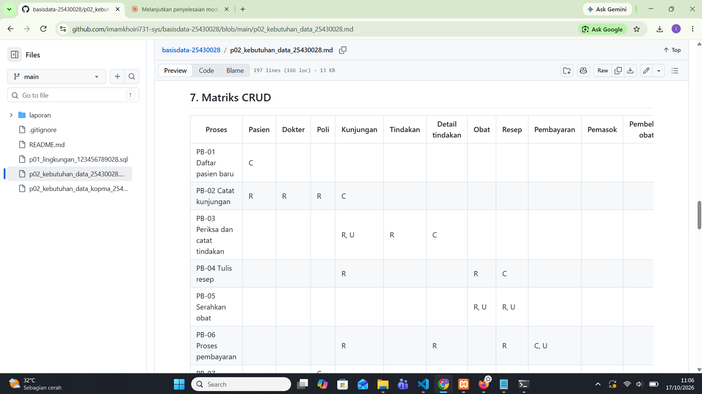
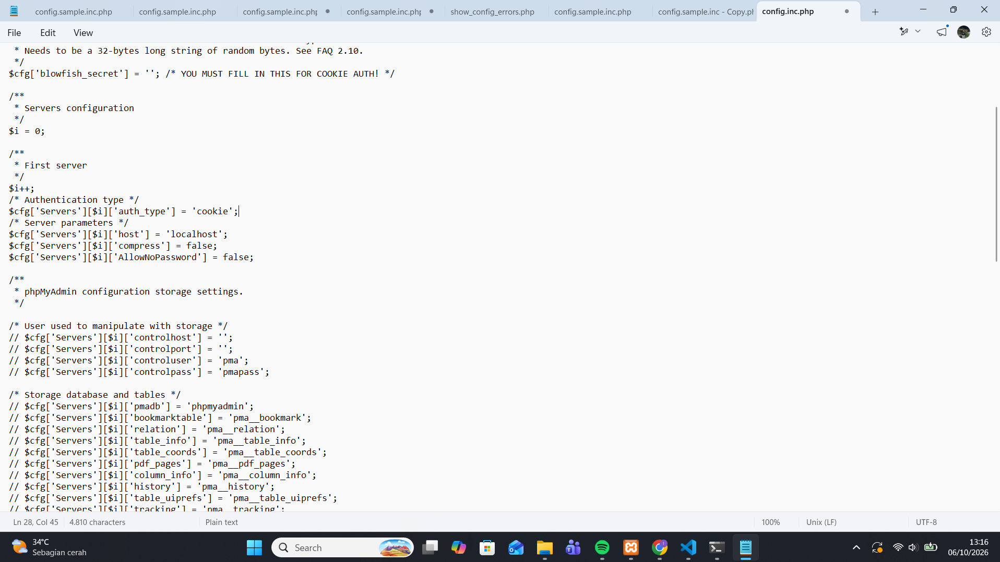

# Laporan Praktikum Basis Data - Pertemuan 02

**Nama:** IMAM KHOIRI  **NIM:** 25430028  **Kelas:** A  **Tanggal:** 12-10-2026  **Asisten/Dosen:** Dedi Irawan,S.Kom.,M.T.I.

## 1. Tujuan Praktikum

Pada pertemuan ini saya belajar menggali kebutuhan data sebelum merancang basis data. Saya mengidentifikasi aktor dan proses bisnis dari narasi studi kasus, menurunkan entitas dan aturan bisnis dari dokumen sumber, menyusun matriks CRUD dan kamus data, serta menulis pernyataan kebutuhan yang spesifik dan dapat diuji.

## 2. Ringkasan Dasar Teori

Perancangan basis data dimulai dari analisis kebutuhan, lalu desain konseptual, logis, dan fisik. Kesalahan di tahap analisis paling mahal akibatnya, misalnya harga lama yang hilang karena tidak disimpan per transaksi. Kebutuhan digali dari wawancara, observasi, dokumen sumber, dan sistem lama, lalu dikelompokkan menjadi kebutuhan data, kebutuhan informasi, aturan bisnis, dan kebutuhan non-fungsional. Matriks CRUD memeriksa kelengkapan proses terhadap data: entitas yang tidak pernah di-create menandakan proses yang terlewat. Kamus data mencatat arti, contoh, aturan, dan penanggung jawab tiap elemen, sehingga data diperlakukan sebagai aset yang punya pemilik. Pernyataan kebutuhan yang baik spesifik, terukur, dan dapat diuji.

## 3. Hasil Langkah Percobaan

Keterangan: tabel PB dan AB pada dokumen kebutuhan data proyek di GitHub, dengan akun dan jam sistem terlihat.

Keterangan: tabel KI dan matriks CRUD proyek.

Keterangan: kamus data awal proyek dengan kolom penanggung jawab.

Keterangan: berkas dokumen kebutuhan data Kopma di repositori.
- Tabel proses bisnis (PB) dokumen proyek: ...
- Tabel aturan bisnis (AB) dokumen proyek: ...
- Tabel kebutuhan informasi (KI) dokumen proyek: ...
- Matriks CRUD dokumen proyek: ...
- Kamus data dokumen proyek: ...

## 4. Jawaban Titik Analisis

**Titik Analisis 1: mengapa nota tetap menyimpan harga saat transaksi?**

Harga di data barang adalah harga terkini dan bisa naik kapan saja. Jika nota hanya menunjuk ke data barang, nota lama akan ikut menampilkan harga baru sehingga jumlah yang dibayar pembeli tidak bisa dicek ulang. Inilah yang dikeluhkan ketua: ia bingung saat melihat nota lama karena harga barang sering naik. Dengan menyimpan harga satuan pada setiap baris nota (aturan AB-04), nota lama tetap menampilkan harga yang berlaku saat transaksi terjadi.

**Titik Analisis 2: subtotal dan total sebagai nilai turunan**

Alasan tidak disimpan: subtotal dan total dapat dihitung ulang dari qty, harga, dan diskon. Jika disimpan, ada risiko selisih bila salah satu data dasarnya dikoreksi sementara nilai tersimpannya tidak ikut berubah. Alasan yang mungkin membuat total tetap disimpan: nilai yang sudah tercetak di nota harus tetap sama walaupun aturan diskon atau pembulatan berubah di kemudian hari, dan laporan omzet menjadi lebih cepat karena tidak perlu menghitung ulang ribuan baris. Keputusan akhirnya dibahas di Modul 4.

**Titik Analisis 3: kolom Pemasok tanpa huruf C**

Tidak adanya huruf C pada kolom Pemasok berarti tidak ada proses yang membuat data pemasok, padahal data itu dibaca oleh proses pemesanan dan penerimaan barang. Ini menandakan ada proses yang terlewat. Saya menambahkan PB-06 "Mengelola data pemasok" yang dilakukan petugas gudang (C, R, U pada Pemasok). Untuk pemeriksaan kedua: status aktif anggota hanya dibuat saat pendaftaran (PB-01) dan tidak ada proses yang mengubahnya. Karena itu saya menambahkan PB-07 "Mengelola status keanggotaan" oleh ketua, yang membaca dan mengubah (R, U) data Anggota.

## 5. Hasil Latihan dan Modifikasi

### E.1 Poin loyalitas

**Elemen data baru**

| Elemen | Arti | Aturan |
|---|---|---|
| saldo_poin_anggota | Jumlah poin yang dimiliki anggota | Bilangan bulat >= 0 |
| poin_didapat | Poin yang diperoleh dari satu nota | 1 poin per kelipatan Rp10.000 belanja |
| poin_ditukar | Poin yang dipakai pada penukaran | Kelipatan 50 |
| tanggal_penukaran | Waktu penukaran poin | Diisi otomatis saat penukaran |

Karena satu anggota dapat memiliki banyak catatan poin, saya menambahkan entitas kandidat **Riwayat poin** (anggota, tanggal, jenis: dapat/tukar, jumlah poin, nomor nota terkait).

**Aturan bisnis baru**

| Kode | Aturan bisnis |
|---|---|
| AB-07 | Setiap kelipatan Rp10.000 belanja anggota aktif bernilai 1 poin; pembeli umum tidak mendapat poin. |
| AB-08 | 50 poin dapat ditukar dengan potongan Rp5.000. |
| AB-09 | Saldo poin tidak boleh negatif; penukaran ditolak bila saldo kurang dari 50 poin. |

**Asumsi:** poin dihitung dari total belanja setelah diskon 5%, karena itulah jumlah uang yang benar-benar dibayar anggota.

**Kebutuhan informasi baru**

| Kode | Kebutuhan informasi | Data yang diperlukan |
|---|---|---|
| KI-05 | Saldo poin setiap anggota | Anggota, riwayat poin |
| KI-06 | Jumlah poin ditukar dan total potongan per bulan | Riwayat poin |

**Matriks CRUD yang diperbarui** (kolom dan baris yang berubah/ditambah)

| Proses | Anggota | Penjualan | Detail | Riwayat poin |
|---|---|---|---|---|
| PB-02 Catat penjualan | R, U | C | C | C |
| PB-08 Menukar poin | R, U | C (potongan) | | C |
| PB-05 Laporan bulanan | R | R | R | R |

PB-08 "Menukar poin" adalah proses baru yang dilakukan kasir saat anggota menukar poin pada transaksi.

### E.2 Memperbaiki pernyataan kebutuhan kabur

| Pernyataan kabur | Pernyataan yang dapat diuji |
|---|---|
| (a) Data anggota harus aman | Nomor HP anggota hanya dapat dibaca oleh akun ketua. Jika akun kasir atau petugas gudang menjalankan SELECT pada kolom nomor HP, permintaan harus ditolak. |
| (b) Sistem harus cepat mencari barang | Pencarian barang berdasarkan kode atau nama menampilkan hasil dalam paling lama 2 detik pada data 5.000 barang. |
| (c) Laporan stok harus akurat | Stok di sistem sama dengan hasil hitung fisik pada pemeriksaan sore untuk setiap barang, tidak pernah bernilai negatif (AB-03), dan setiap perubahan stok memiliki rujukan nomor nota atau nomor faktur. |

## 6. Tugas Mandiri: Milestone Proyek 02

Dokumen kebutuhan data proyek Klinik disimpan dalam berkas [kebutuhan_data_25430028].

Ringkasan isi: Dokumen ini memuat [tujuan sistem klinik, mis. mencatat pasien, dokter, jadwal, kunjungan, dan pembayaran]. Entitas utama yang teridentifikasi: [daftar entitas].

Hitungan P: [tulis hasil hitunganmu dan rumus/cara menghitungnya sesuai petunjuk modul, mis. P = ...]

Keputusan desain:

[Keputusan 1, mis. memisahkan data dokter dan pasien menjadi entitas berbeda, karena ...]
[Keputusan 2 dan alasannya]

## 7. Pembahasan dan Kendala

(Isi kendala yang benar-benar kamu alami, misalnya salah menjalankan `git init` di folder induk `D:\praktikum` sehingga muncul repo baru di tempat yang salah. Jelaskan cara membacanya dan cara memperbaikinya.)

## 8. Kesimpulan

(Tulis 2-4 kalimat dengan bahasamu sendiri.)

## 9. Pernyataan Penggunaan AI

(Tulis jujur: alat apa yang dipakai, untuk apa, dan bagian mana.)

## 10. Bukti Git

- Repositori: https://github.com/<akun>/basisdata-25430028
- Commit dokumen Kopma: `<hash>` - p02: dokumen kebutuhan data kopma
- Commit dokumen proyek: `<hash>` - p02: dokumen kebutuhan data proyek
- Commit laporan: `<hash>` - p02: laporan pertemuan 2

## Checklist

(Salin Tabel 2.9 dari buku dan centang.)

| | Jenis | Yang harus ada |
|---|---|---|
| ☐ | Berkas wajib | p02_kebutuhan_data_kopma_25430028.md dan p02_kebutuhan_data_25430028.md (proyek) |
| ☐ | Bukti tangkapan layar | Tabel PB, AB, KI, matriks CRUD, dan kamus data di berkas proyek (tangkapan tampilan GitHub) |
| ☐ | Analisis wajib | Titik Analisis 1-3; perhitungan parameter P; perbaikan tiga pernyataan kebutuhan kabur |