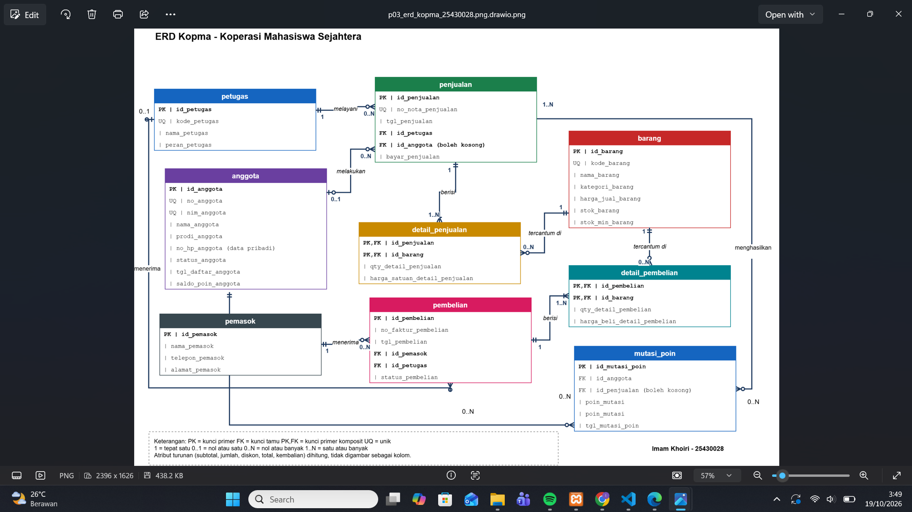
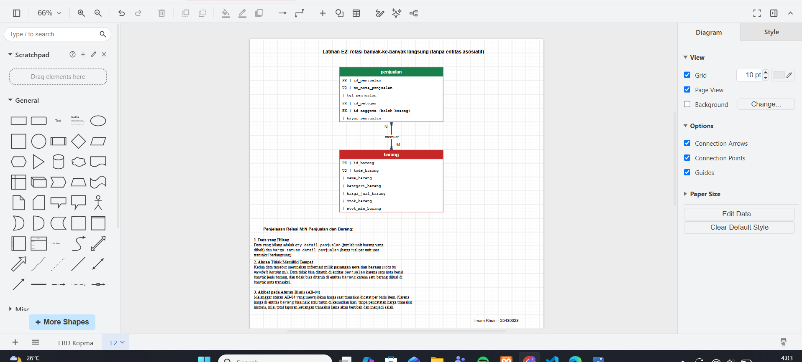
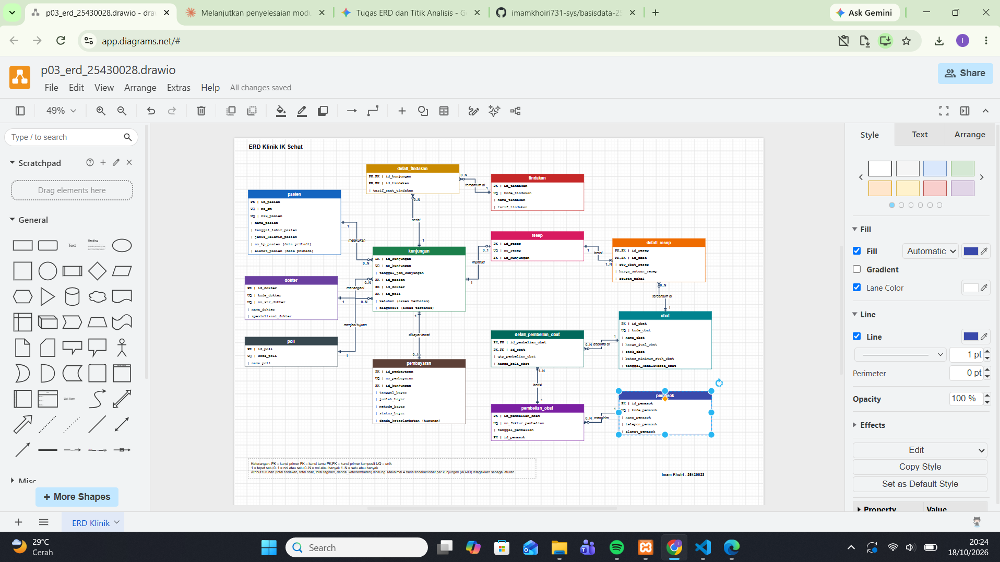

F# Laporan Praktikum Basis Data - Pertemuan 03

**Nama:** Imam Khoiri  
**NIM:** 25430028  
**Kelas:** A  
**Pertemuan:** 3 - Pemodelan Data dengan Entity-Relationship Diagram  
**Tanggal pelaksanaan:** 18 Oktober 2026  
**Dosen/Asisten:** Dedi Irawan, S.Kom., M.T.I.  
**Tema proyek:** Klinik (Klinik IK Sehat)  

---

## 1. Tujuan Praktikum

Mengubah dokumen kebutuhan data hasil analisis Pertemuan 2 menjadi pemodelan logis berupa Entity-Relationship Diagram (ERD). Praktikum ini bertujuan untuk menentukan entitas, atribut, kunci (primer, alternatif, dan tamu), relasi, serta kardinalitas secara tepat berdasarkan aturan bisnis yang terukur, lalu menerapkannya pada studi kasus Kopma dan proyek mandiri Klinik IK Sehat.

---

## 2. Ringkasan Dasar Teori

1. **Pengertian ERD:** ERD adalah diagram konseptual yang menggambarkan struktur basis data melalui entitas, atribut, dan hubungan antarentitas. Diagram ini dibuat sebelum perancangan tabel fisik agar kebutuhan data dan hubungan antarentitas terlihat jelas sebelum tabel dirancang.
2. **Entitas dan Kunci:** Entitas merepresentasikan objek nyata atau abstrak yang datanya dicatat. *Primary Key* (PK) adalah identitas unik tiap baris, *Alternate Key* (UQ) adalah kandidat kunci unik pendamping, sedangkan *Foreign Key* (FK) menghubungkan entitas anak ke entitas induk.
3. **Kardinalitas Crow's Foot:** Menunjukkan batasan jumlah instansi relasi. Notasi yang digunakan meliputi tepat satu (`1`), nol atau satu (`0..1`), nol atau banyak (`0..N`), dan satu atau banyak (`1..N`).
4. **Entitas Asosiatif:** Entitas perantara yang dibentuk untuk memecah relasi banyak-ke-banyak (*many-to-many*) langsung, sekaligus menjadi tempat menyimpan atribut spesifik transaksi (seperti kuantitas dan harga saat transaksi).
5. **Atribut Turunan:** Atribut yang nilainya dapat dihitung dari kombinasi atribut lain (seperti subtotal dan total harga). Atribut ini tidak digambar sebagai kolom biasa di ERD guna mencegah ketidakselarasan data.

---

## 3. Hasil Langkah Percobaan

Langkah percobaan dikerjakan pada studi kasus Koperasi Mahasiswa Sejahtera (Kopma). Berkas hasil: `p03_erd_kopma_25430028.drawio` dan `p03_erd_kopma_25430028.png`.

### 3.1 Entitas dan kunci Kopma (langkah D.1)

| Tabel | Kunci primer | Kunci alternatif | Kunci tamu |
|---|---|---|---|
| petugas | id_petugas | kode_petugas | - |
| anggota | id_anggota | no_anggota, nim_anggota | - |
| penjualan | id_penjualan | no_nota_penjualan | id_petugas, id_anggota (boleh kosong) |
| detail_penjualan | (id_penjualan, id_barang) | - | id_penjualan, id_barang |
| barang | id_barang | kode_barang | - |
| pemasok | id_pemasok | - | - |
| pembelian | id_pembelian | - | id_pemasok, id_petugas |
| detail_pembelian | (id_pembelian, id_barang) | - | id_pembelian, id_barang |
| mutasi_poin *(Latihan E1)* | id_mutasi_poin | - | id_anggota, id_penjualan (boleh kosong) |

Atribut turunan (tidak digambar sebagai kolom): subtotal, jumlah, diskon, total, kembalian.

### 3.2 Relasi dan kardinalitas Kopma (langkah D.2)

| Relasi | Sisi kiri | Sisi kanan | Dasar |
|---|---|---|---|
| petugas melayani penjualan | 1 | 0..N | wawancara kasir |
| anggota melakukan penjualan | 0..1 | 0..N | AB-02 |
| penjualan berisi detail_penjualan | 1 | 1..N | AB-01 |
| barang tercantum di detail_penjualan | 1 | 0..N | AB-04 |
| pemasok menerima pembelian | 1 | 0..N | AB-06 |
| pembelian berisi detail_pembelian | 1 | 1..N | faktur pemasok |
| barang tercantum di detail_pembelian | 1 | 0..N | faktur pemasok |
| petugas menerima pembelian *(Titik Analisis 3)* | 0..1 | 0..N | AB-10 |
| anggota memiliki mutasi_poin *(E1)* | 1 | 0..N | AB-09 pada dokumen Kopma |
| penjualan menghasilkan mutasi_poin *(E1)* | 0..1 | 0..N | AB-09 pada dokumen Kopma |

### 3.3 Gambar ERD Kopma (langkah D.3)

Keterangan: Diagram ERD Kopma digambar lengkap dengan 9 entitas serta kardinalitas Crow's Foot di setiap relasinya.

### 3.4 Validasi terhadap kebutuhan informasi (langkah D.4)

| KI | Kebutuhan informasi | Jalur di ERD |
|---|---|---|
| KI-01 | Omzet dan jumlah nota per hari/bulan | penjualan → detail_penjualan |
| KI-02 | Barang terlaris per bulan | detail_penjualan → barang |
| KI-03 | Barang stok di bawah minimum | barang |
| KI-04 | Anggota dengan belanja terbesar | anggota → penjualan → detail_penjualan |
| KI-05 | Saldo poin anggota *(E1)* | anggota (saldo_poin_anggota), mutasi_poin |
| KI-06 | Poin diterbitkan dan ditukar per bulan *(E1)* | mutasi_poin |

### 3.5 Tinjauan klien (ERD Kopma)

| No | Peninjau | Tanggal | Umpan balik | Keputusan | Alasan |
|---|---|---|---|---|---|
| 1 | Rian Hidayat | 18 Oktober 2026 | Perjelas keterhubungan antara entitas penjualan dan mutasi_poin agar penukaran poin saat belanja tercatat langsung pada transaksi terkait. | Diterima | Menghubungkan entitas penjualan ke mutasi_poin dengan kardinalitas 0..1 ke 0..N sesuai aturan AB-09. |
| 2 | Siti Rahma | 18 Oktober 2026 | Pastikan kolom id_petugas pada entitas pembelian mencakup penjelasan fungsional petugas gudang yang menerima barang. | Diterima | Menambahkan aturan bisnis AB-10 untuk mempertegas akuntabilitas petugas penerima barang di gudang. |

---

## 4. Jawaban Titik Analisis

### 4.1 Titik Analisis 1
`id_anggota` dipilih sebagai kunci primer karena bersifat kunci buatan (*surrogate key*) bertipe numerik yang tidak akan pernah berubah sepanjang waktu. Jika NIM dijadikan kunci primer, terdapat risiko integritas data apabila mahasiswa melakukan perbaikan kesalahan ketik NIM atau terdapat perubahan format NIM dari pihak kampus. Selain itu, menyebarkan NIM (yang merupakan data pribadi) sebagai kunci tamu di tabel-tabel transaksi meningkatkan risiko kebocoran data pribadi.

### 4.2 Titik Analisis 2
Sisi relasi `penjualan` ke `detail_penjualan` bernilai satu atau banyak (`1..N`) karena dipaksakan oleh aturan bisnis **AB-01** (setiap nota penjualan yang sah harus memiliki minimal satu baris item barang). Batasan struktur tabel (*Foreign Key* dan *Composite Primary Key*) pada entitas detail hanya menjamin bahwa setiap baris detail merujuk pada sebuah nota, namun aturan minimal satu baris barang pada nota tetap harus divalidasi oleh logika aplikasi saat transaksi dibuat.

### 4.3 Titik Analisis 3
Pada ERD awal, entitas `pembelian` hanya terhubung ke `pemasok` sehingga tidak ada catatan petugas mana yang menerima fisik barang di gudang. Perbaikannya dilakukan dengan menambahkan kolom `id_petugas` sebagai kunci tamu pada tabel `pembelian` dengan kardinalitas `petugas (0..1)` ke `pembelian (0..N)`. Kardinalitas `0..1` digunakan karena saat nota pesanan baru dibuat (berstatus dipesan), petugas penerima belum dicatat sampai barang tiba di gudang. Aturan bisnis baru yang dicatat adalah **AB-10**: *"Pembelian berstatus diterima wajib memiliki petugas penerima; pembelian berstatus dipesan boleh belum memilikinya."*

---

## 5. Hasil Latihan dan Modifikasi

### 5.1 Latihan E1: Poin loyalitas
Riwayat poin dibuat sebagai entitas terpisah (`mutasi_poin`) dan bukan hanya satu kolom saldo akhir di tabel `anggota`. Hal ini diputuskan untuk memenuhi aturan bisnis **AB-09 pada dokumen Kopma**, yang mewajibkan setiap perubahan poin (penambahan dari belanja maupun pengurangan dari penukaran) memiliki jejak audit per transaksi. Dengan adanya entitas ini, selisih saldo poin dapat dengan mudah direkonsiliasi dan diverifikasi kapan saja.

### 5.2 Latihan E2: Relasi banyak-ke-banyak langsung

Keterangan: Diagram menunjukkan relasi M:N langsung antara Penjualan dan Barang sebelum diperbaiki.

Jika `penjualan` dan `barang` dihubungkan secara langsung tanpa entitas perantara, data kuantitas (`qty_detail_penjualan`) dan harga jual saat transaksi (`harga_satuan_detail_penjualan`) tidak memiliki tempat penyimpanan. Data tersebut tidak bisa disimpan di tabel `penjualan` karena satu transaksi memuat banyak barang, dan tidak bisa ditaruh di tabel `barang` karena satu jenis barang dijual di banyak transaksi nota. Hal ini melanggar aturan bisnis **AB-04** dan menyebabkan laporan omzet historis (KI-01 & KI-02) menjadi salah ketika harga master barang berubah di masa depan.

---

## 6. Tugas Mandiri: Milestone Proyek 3

Berkas: `p03_erd_25430028.drawio` dan `p03_erd_25430028.png` (proyek Klinik IK Sehat).

### 6.1 Ringkasan ERD proyek

- Jumlah tabel: 13 (pasien, dokter, poli, kunjungan, tindakan, detail_tindakan, resep, detail_resep, obat, pembayaran, pemasok, pembelian_obat, detail_pembelian_obat)
- Jumlah relasi: 12
- Entitas asosiatif dengan atribut sendiri: detail_tindakan (`tarif_saat_tindakan`), detail_resep (`qty_obat_resep`, `harga_satuan_resep`, `aturan_pakai`), detail_pembelian_obat (`qty_pembelian_obat`, `harga_beli_obat`)
- Atribut turunan: total tindakan, total obat, total tagihan, denda_keterlambatan

### 6.2 Relasi dan kardinalitas proyek

| Relasi | Sisi kiri | Sisi kanan | Dasar |
|---|---|---|---|
| pasien melakukan kunjungan | 1 | 0..N | AB-02 |
| dokter menangani kunjungan | 1 | 0..N | AB-02 |
| poli menjadi tujuan kunjungan | 1 | 0..N | AB-02 |
| kunjungan berisi detail_tindakan | 1 | 0..N | AB-03 (Pasien yang berkunjung untuk konsultasi awal belum tentu menerima tindakan medis bertarif) |
| tindakan tercantum di detail_tindakan | 1 | 0..N | AB-04 |
| kunjungan memiliki resep | 1 | 0..1 | Keputusan desain: satu kunjungan paling banyak menghasilkan satu resep; kunjungan boleh tidak memiliki resep (0) bila pasien tidak memerlukan obat. |
| resep berisi detail_resep | 1 | 1..N | AB-03 |
| obat tercantum di detail_resep | 1 | 0..N | AB-04, AB-05 |
| kunjungan dibayar lewat pembayaran | 1 | 0..1 | AB-07 (Satu kunjungan memiliki paling banyak satu pembayaran. Baris pembayaran baru terbentuk saat tagihan terbit setelah pemeriksaan selesai, sehingga kunjungan yang belum selesai diperiksa belum memilikinya.) |
| pemasok mengirim pembelian_obat | 1 | 0..N | AB-11 |
| pembelian_obat berisi detail_pembelian_obat | 1 | 1..N | faktur pemasok |
| obat diterima di detail_pembelian_obat | 1 | 0..N | AB-11 |

### 6.3 Penelusuran kebutuhan informasi proyek

| KI | Kebutuhan informasi | Jalur di ERD |
|---|---|---|
| KI-01 | Jumlah kunjungan per poli per hari dan bulan | poli → kunjungan |
| KI-02 | Sepuluh diagnosis terbanyak per bulan | kunjungan (diagnosis) |
| KI-03 | Obat stok di bawah batas minimum dan hampir kedaluwarsa | obat |
| KI-04 | Pendapatan per bulan dari tindakan dan obat | kunjungan → detail_tindakan; kunjungan → resep → detail_resep; pembayaran |
| KI-05 | Tagihan belum lunas beserta denda berjalan | kunjungan → pembayaran (status_bayar = 'Belum lunas', tanggal_jam_kunjungan) |
| KI-06 | Riwayat kunjungan pasien lewat no. RM atau NIK | pasien → kunjungan |

### 6.4 Gambar ERD proyek

Keterangan: Hasil perancangan ERD proyek Klinik IK Sehat yang terdiri dari 13 entitas, kardinalitas Crow's Foot, dan atribut kunci sesuai aturan bisnis.

### 6.5 Tinjauan klien (ERD proyek)

| No | Peninjau | Tanggal | Umpan balik | Keputusan | Alasan |
|---|---|---|---|---|---|
| 1 | Rian Hidayat | 18 Oktober 2026 | Perjelas penanganan kunjungan pasien yang belum melunasi pembayaran agar dapat teridentifikasi di sistem. | Diterima | Memanfaatkan atribut status_bayar pada entitas pembayaran (dengan nilai 'Belum lunas' atau 'Lunas'). |
| 2 | Siti Rahma | 18 Oktober 2026 | Pastikan kolom keluhan dan diagnosis diberikan penanda keamanan khusus karena merupakan rekam medis. | Diterima | Menambahkan penanda (akses terbatas) pada atribut keluhan dan diagnosis di entitas kunjungan sesuai AB-09. |

### 6.6 Keputusan desain

1. Tarif tindakan dan harga obat sengaja diletakkan pada entitas asosiatif (`detail_tindakan` dan `detail_resep`) guna memenuhi aturan bisnis **AB-04**, yaitu mengunci harga saat transaksi terjadi agar perubahan harga master tidak merusak data keuangan historis.
2. Kolom keluhan dan diagnosis pada entitas `kunjungan` ditandai khusus sebagai data medis sensitif dengan akses terbatas (AB-09).
3. **Penerbitan Baris Pembayaran:** Baris pada entitas `pembayaran` dibuat langsung ketika tagihan kunjungan terbit dengan nilai awal `status_bayar = 'Belum lunas'`. Saat pasien melakukan pembayaran di kasir, baris tersebut diperbarui menjadi `status_bayar = 'Lunas'`. Keputusan ini diambil agar tagihan yang belum dibayar beserta denda keterlambatannya dapat dengan mudah ditelusuri untuk memenuhi kebutuhan informasi **KI-05**. Akibatnya, kolom `tanggal_bayar`, `jumlah_bayar`, dan `metode_bayar` masih kosong sampai pembayaran benar-benar terjadi.

### 6.7 Perubahan pada kamus data

Enam elemen ditambahkan ke kamus data proyek agar sesuai dengan ERD: `spesialisasi_dokter`, `no_resep`, `no_pembayaran`, `status_bayar`, `tanggal_pembelian`, `alamat_pemasok`.

Perubahan ini dicatat pada commit `p03: lengkapi kamus data proyek` (lihat bagian 10).

---

## 7. Pembahasan dan Kendala

1. **Kendala Kardinalitas Faktur Obat:** Pada awalnya sketsa awal relasi `pembelian_obat` ke `detail_pembelian_obat` terbalik kardinalitasnya. Kendala dikenali saat memeriksa kesesuaian faktur, lalu diperbaiki menjadi `1` ke `1..N`.
2. **Atribut Terpisah di Kamus Data:** Beberapa atribut baru seperti `status_bayar` belum masuk di kamus data modul 2. Solusinya adalah memperbarui berkas kamus data proyek dan memasukkannya dalam commit Git terpisah.
3. **Penyimpanan Berkas Diagram:** Berkas `.drawio` sempat tersimpan di subfolder `laporan/` sehingga memicu pesan kesalahan `pathspec did not match` saat menjalankan perintah `git add`. Masalah ini diselesaikan dengan memindahkan berkas `.drawio` ke folder utama repositori.

---

## 8. Kesimpulan

Pemodelan ERD merupakan tahapan krusial untuk memvisualisasikan aturan bisnis menjadi struktur basis data yang solid. Penentuan kunci primer buatan, pemisahan relasi M:N melalui entitas asosiatif, serta penerapan kardinalitas yang tepat terbukti efektif mencegah redundansi data dan menjaga validitas laporan keuangan historis.

---

## 9. Pernyataan Penggunaan AI

Saya menggunakan Claude (Anthropic) untuk membantu membuat kerangka berkas draw.io ERD Kopma dan ERD proyek dari dokumen kebutuhan data saya, menyusun lembar kerja tabel relasi dan penelusuran KI, memeriksa kelengkapan atribut terhadap kamus data, menyusun draf kerangka laporan, serta memecahkan masalah Git dan draw.io. Saya juga menggunakan Gemini (Google) untuk membantu menyusun dan memperhalus kalimat laporan serta memeriksa konsistensi tabel relasi. Keputusan kardinalitas, penyesuaian diagram, tinjauan klien, Latihan E1 dan E2, dan jawaban Titik Analisis saya kerjakan dan periksa sendiri.

---

## 10. Bukti Git

- Tautan repositori: https://github.com/imamkhoiri731-sys/basisdata-25430028
- Branch: `main`
- Commit ERD Kopma: `p03: erd kopma` (hash: `3dfe307`)
- Commit ERD proyek: `p03: erd proyek klinik` (hash: `589fb30`)
- Commit kamus data proyek: `p03: lengkapi kamus data proyek` (hash: `HASH_KAMUS`)
- Commit AB-10 pada dokumen Kopma: `p03: tambah AB-10 pada dokumen kopma` (hash: `HASH_AB10`)
- Commit laporan: `p03: laporan pertemuan 3` (hash: `ISI_SETELAH_COMMIT`)

---

## Checklist Pertemuan 3

| Jenis | Yang harus ada | Status |
|---|---|---|
| Berkas wajib | `p03_erd_kopma_25430028` dan `p03_erd_25430028` (gambar dan berkas sumber diagram) | ☑ |
| Bukti tangkapan layar | ERD di draw.io dengan kardinalitas terbaca; catatan tinjauan klien | ☑ |
| Analisis wajib | Pemetaan setiap entitas ke PB/KI dari Pertemuan 2; alasan kardinalitas relasi utama | ☑ |

### Pemetaan entitas ke PB dan KI (analisis wajib)

**Kopma**

| Entitas | Dibuat atau diubah oleh | Dipakai oleh KI |
|---|---|---|
| anggota | PB-01, PB-07 | KI-04, KI-05 |
| petugas | PB-10 | (lewat penjualan dan pembelian) |
| barang | PB-08, PB-02, PB-04 | KI-02, KI-03 |
| penjualan, detail_penjualan | PB-02 | KI-01, KI-02, KI-04 |
| pemasok | PB-06 | - |
| pembelian, detail_pembelian | PB-03, PB-04 | - |
| mutasi_poin | PB-02, PB-09 | KI-05, KI-06 |

**Proyek Klinik**

| Entitas | Dibuat atau diubah oleh | Dipakai oleh KI |
|---|---|---|
| pasien | PB-01, PB-08 | KI-06 |
| dokter, poli | PB-07 | KI-01 |
| kunjungan | PB-02, PB-03 | KI-01, KI-02, KI-05, KI-06 |
| tindakan, detail_tindakan | PB-07, PB-03 | KI-04 |
| obat | PB-07, PB-05, PB-10 | KI-03, KI-04 |
| resep, detail_resep | PB-04, PB-05 | KI-04 |
| pembayaran | PB-06 | KI-04, KI-05 |
| pemasok, pembelian_obat, detail_pembelian_obat | PB-07, PB-10 | - |

### Alasan kardinalitas relasi utama

- **penjualan ke detail_penjualan (`1` ke `1..N`):** Setiap baris detail transaksi wajib menginduk pada tepat satu nota (`1`), sedangkan satu nota penjualan minimal memuat satu baris barang dan bisa memuat banyak barang (`1..N`) berdasarkan aturan bisnis **AB-01**.
- **kunjungan ke pembayaran (`1` ke `0..1`):** Satu pembayaran selalu berasal dari tepat satu kunjungan (`1`). Sisi kanan bernilai `0..1` karena baris pembayaran dibuat saat tagihan terbit setelah pemeriksaan selesai, jadi kunjungan yang baru dicatat belum punya pembayaran (`0`). Setelah tagihan terbit, tepat satu baris pembayaran terhubung ke kunjungan itu (`1`), dan statusnya berubah dari Belum lunas menjadi Lunas saat dibayar (AB-07).
