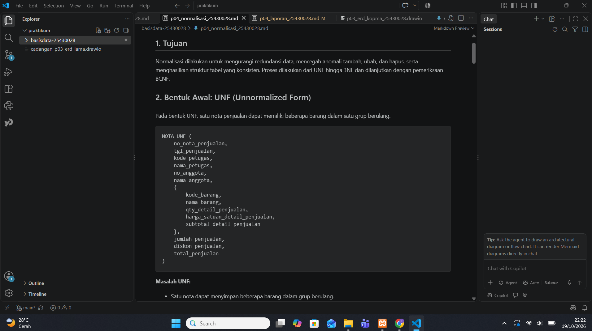
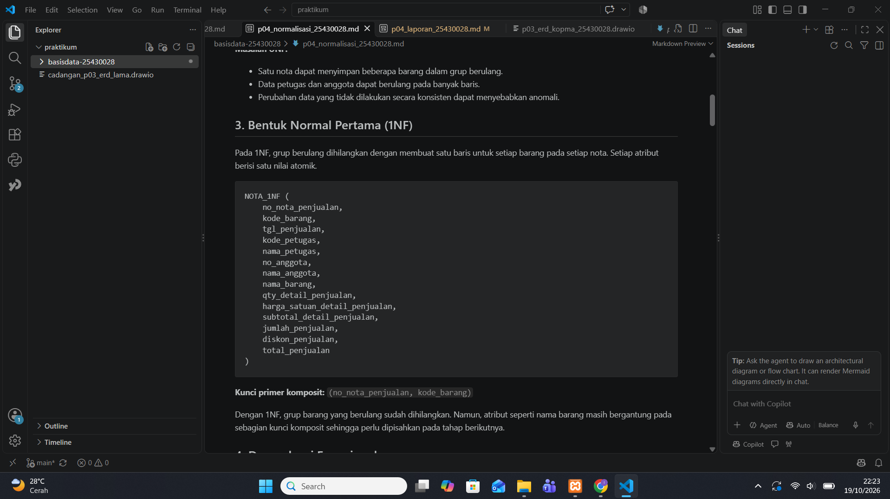
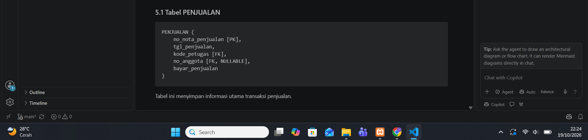
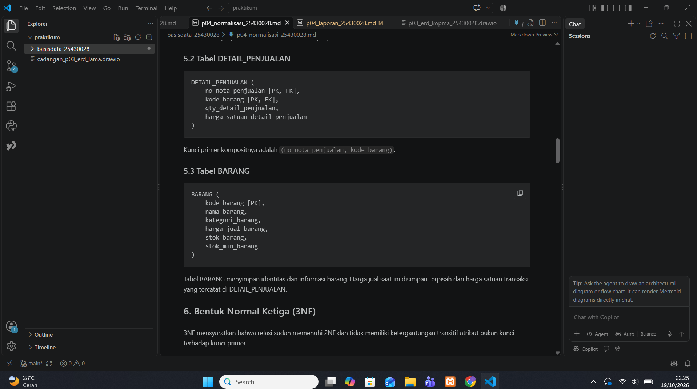
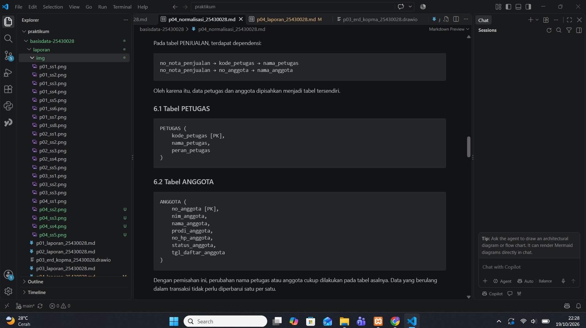
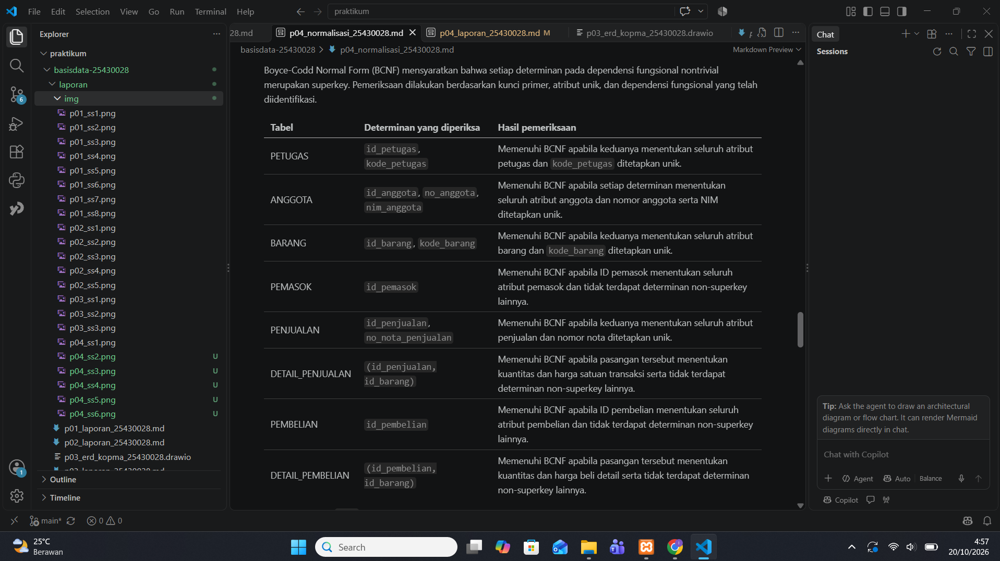
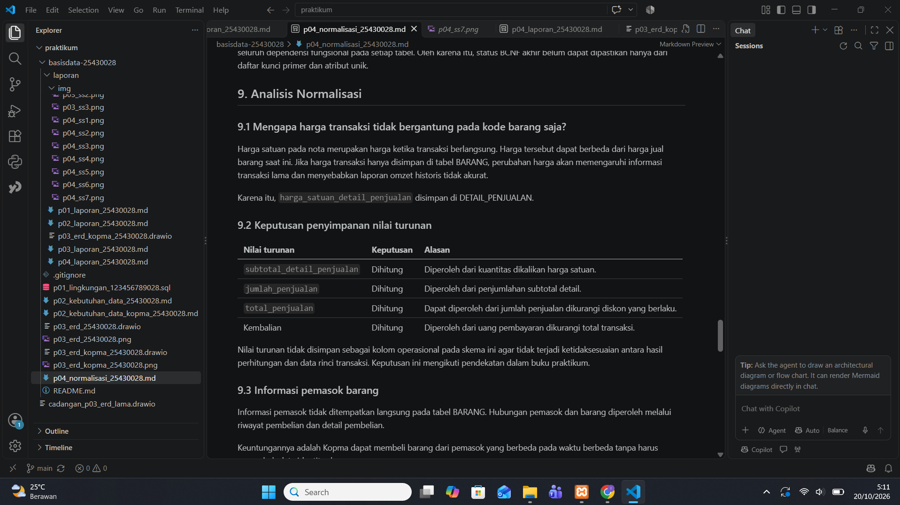

# Laporan Praktikum Basis Data — Pertemuan 04

**Nama:** Imam Khoiri  
**NIM:** 25430028  
**Kelas:** A  
**Pertemuan:** 04  
**Tanggal:** 19 Oktober 2026  
**Dosen Pengampu:** Dedi Irawan, S.Kom., M.T.I.  
**Tema:** Normalisasi Basis Data Kopma

---

## 1. Tujuan Praktikum

Praktikum ini bertujuan memahami proses normalisasi basis data dari Unnormalized Form (UNF), First Normal Form (1NF), Second Normal Form (2NF), hingga Third Normal Form (3NF), serta melakukan pemeriksaan Boyce-Codd Normal Form (BCNF). Proses ini digunakan untuk mengurangi redundansi data, mencegah anomali penyisipan, pembaruan, dan penghapusan, serta menghasilkan skema relasional yang konsisten dan dapat dijadikan dasar pembuatan basis data.

## 2. Ringkasan Dasar Teori

Normalisasi merupakan proses penyusunan relasi berdasarkan dependensi fungsional dan aturan bisnis agar data tersimpan secara terstruktur.

1. **UNF:** Relasi masih dapat memiliki grup atribut berulang.
2. **1NF:** Setiap atribut memiliki nilai atomik dan grup berulang dihilangkan.
3. **2NF:** Relasi memenuhi 1NF dan setiap atribut bukan kunci bergantung secara penuh pada setiap kunci kandidat, sehingga tidak terdapat dependensi parsial.
4. **3NF:** Untuk setiap dependensi fungsional nontrivial X → A, X merupakan superkey atau A merupakan atribut prima.
5. **BCNF:** Setiap determinan pada dependensi fungsional nontrivial harus merupakan superkey.

Kunci primer mengidentifikasi setiap baris secara unik. Kunci unik mencegah nilai tertentu berulang, sedangkan kunci tamu menjaga hubungan antartabel. Penambahan kunci pengganti tidak otomatis membuat sebuah relasi memenuhi 3NF atau BCNF; dependensi fungsional tetap harus diperiksa.

## 3. Hasil Langkah Percobaan

### 3.1 Identifikasi relasi awal (UNF)

Dokumen sumber yang digunakan dalam analisis adalah nota penjualan Kopma sebagaimana dipetakan dalam dokumen kebutuhan data Pertemuan 2. Satu nota dapat memuat beberapa barang, sehingga informasi barang muncul sebagai grup berulang.

Struktur konseptual awal:

`NOTA_UNF(no_nota_penjualan, tgl_penjualan, kode_petugas, nama_petugas, no_anggota, nama_anggota, {kode_barang, nama_barang, qty_detail_penjualan, harga_satuan_detail_penjualan, subtotal_detail_penjualan}, jumlah_penjualan, diskon_penjualan, total_penjualan, bayar_penjualan)`

Tanda `{...}` menunjukkan grup barang yang dapat berulang pada satu nota. Struktur ini masih bersifat konseptual dan digunakan untuk menjelaskan proses normalisasi, bukan sebagai definisi tabel siap dijalankan.

Masalah yang mungkin timbul meliputi pengulangan nama anggota dan petugas, kesulitan menambahkan data transaksi secara konsisten, serta risiko ketidaksesuaian apabila informasi yang sama diperbarui pada sebagian baris saja.

### 3.2 Bentuk Normal Pertama (1NF)

Pada tahap 1NF, grup barang berulang diubah menjadi baris detail. Setiap baris mewakili satu jenis barang pada satu nota dan setiap kolom menyimpan satu nilai.

Struktur analisis:

`NOTA_1NF(no_nota_penjualan, kode_barang, tgl_penjualan, kode_petugas, nama_petugas, no_anggota, nama_anggota, nama_barang, qty_detail_penjualan, harga_satuan_detail_penjualan, subtotal_detail_penjualan)`

Kunci kandidat sementara yang digunakan adalah `(no_nota_penjualan, kode_barang)`, dengan asumsi satu jenis barang hanya dicatat satu kali pada setiap nota. Jika barang yang sama dapat muncul pada beberapa baris, diperlukan `no_baris` atau identitas detail sebagai pembeda. Asumsi ini perlu dikonfirmasi dengan aturan transaksi yang berlaku.

Contoh konseptual:

| no_nota_penjualan | kode_barang | qty | harga_satuan |
|---|---|---:|---:|
| PJ-001 | BRG-01 | 2 | 4000 |
| PJ-001 | BRG-02 | 1 | 7000 |
| PJ-002 | BRG-01 | 3 | 4000 |

Data di atas hanya ilustrasi struktur, bukan data transaksi aktual Kopma.

### 3.3 Dependensi fungsional

Dependensi fungsional ditetapkan berdasarkan aturan bisnis dan keunikan atribut, bukan hanya karena nilai dalam contoh data terlihat sama.

| Kode | Dependensi atau aturan | Dasar dan batasan |
|---|---|---|
| FD1 | `no_nota_penjualan → tgl_penjualan, kode_petugas, no_anggota` | Setiap nomor nota mengidentifikasi satu transaksi; terkait aturan nomor nota unik (AB-01) dan aturan penjualan (AB-02). |
| FD2 | `kode_petugas → nama_petugas` | Berlaku jika `kode_petugas` unik dan mengidentifikasi satu petugas. |
| FD3 | `no_anggota → nama_anggota` | Berlaku jika nomor anggota mengidentifikasi satu anggota; aturan identitas anggota perlu mengacu pada AB-05. |
| FD4 | `kode_barang → nama_barang` | Berlaku jika `kode_barang` unik dan mengidentifikasi satu barang. |
| FD5 | `(no_nota_penjualan, kode_barang) → qty_detail_penjualan, harga_satuan_detail_penjualan` | Berlaku dengan asumsi kombinasi nota dan barang mengidentifikasi satu detail. Harga historis mengikuti AB-04. |
| AT1 | `subtotal_detail_penjualan = qty_detail_penjualan × harga_satuan_detail_penjualan` | Aturan perhitungan, bukan dependensi fungsional mandiri untuk dekomposisi. |

FD2 dan FD4 didasarkan pada keunikan kode petugas dan kode barang dalam rancangan data. Keduanya perlu dikonfirmasi dengan kamus data serta aturan proyek, bukan disimpulkan hanya dari sampel.

Aturan stok (AB-03), pembelian (AB-06), poin anggota (AB-07 dan AB-08), pencatatan mutasi poin (AB-09), serta petugas penerima pembelian (AB-10) perlu dipertahankan pada rancangan proyek. Aturan-aturan tersebut tidak otomatis menghasilkan dependensi fungsional tambahan tanpa analisis lebih lanjut.

### 3.4 Bentuk Normal Kedua (2NF)

Pada relasi 1NF, beberapa atribut bergantung hanya pada sebagian kunci komposit. Contohnya, `nama_barang` bergantung pada `kode_barang`, sedangkan tanggal dan petugas transaksi bergantung pada nomor nota. Karena itu, relasi diuraikan menjadi:

**PENJUALAN_ANALISIS**

`PENJUALAN_ANALISIS(no_nota_penjualan PK, tgl_penjualan, kode_petugas, nama_petugas, no_anggota, nama_anggota)`

**BARANG_ANALISIS**

`BARANG_ANALISIS(kode_barang PK, nama_barang)`

**DETAIL_PENJUALAN_ANALISIS**

`DETAIL_PENJUALAN_ANALISIS(no_nota_penjualan PK/FK, kode_barang PK/FK, qty_detail_penjualan, harga_satuan_detail_penjualan)`

Dekomposisi ini menghilangkan ketergantungan atribut transaksi terhadap sebagian kunci komposit. Atribut `nama_petugas` dan `nama_anggota` masih perlu dipisahkan pada tahap berikutnya karena bergantung pada identitas petugas dan anggota, bukan langsung pada nomor nota.

### 3.5 Bentuk Normal Ketiga (3NF)

Pada tahap 3NF, atribut deskriptif petugas dan anggota ditempatkan pada tabel masing-masing. Struktur analisisnya menjadi:

- `PETUGAS_ANALISIS(kode_petugas PK, nama_petugas)`
- `ANGGOTA_ANALISIS(no_anggota PK, nama_anggota)`
- `PENJUALAN_ANALISIS(no_nota_penjualan PK, tgl_penjualan, kode_petugas FK, no_anggota FK NULL)`
- `BARANG_ANALISIS(kode_barang PK, nama_barang)`
- `DETAIL_PENJUALAN_ANALISIS(no_nota_penjualan PK/FK, kode_barang PK/FK, qty_detail_penjualan, harga_satuan_detail_penjualan)`

Pemisahan ini mengurangi pengulangan nama anggota dan petugas. Jika nama anggota berubah, pembaruan dilakukan pada tabel ANGGOTA, bukan pada setiap transaksi anggota tersebut.

Tahapan analisis menggunakan kunci alami untuk memperlihatkan dependensi fungsional. Selanjutnya, rancangan proyek menggunakan kunci pengganti `id_*` seperti pada skema kanonik buku praktikum. Kunci alami tetap perlu dipertahankan sebagai kunci unik jika aturan bisnis mensyaratkannya.

### 3.6 Skema relasional proyek

Skema inti Kopma yang menjadi acuan terdiri atas delapan tabel berikut.

1. `PETUGAS(id_petugas PK, kode_petugas UNIQUE, nama_petugas, peran_petugas)`
2. `ANGGOTA(id_anggota PK, no_anggota UNIQUE, nim_anggota UNIQUE, nama_anggota, prodi_anggota, no_hp_anggota, status_anggota, tgl_daftar_anggota)`
3. `BARANG(id_barang PK, kode_barang UNIQUE, nama_barang, kategori_barang, harga_jual_barang, stok_barang, stok_min_barang)`
4. `PEMASOK(id_pemasok PK, nama_pemasok, telepon_pemasok, alamat_pemasok)`
5. `PENJUALAN(id_penjualan PK, no_nota_penjualan UNIQUE, tgl_penjualan, id_petugas FK, id_anggota FK NULL, bayar_penjualan)`
6. `DETAIL_PENJUALAN(id_penjualan PK/FK, id_barang PK/FK, qty_detail_penjualan, harga_satuan_detail_penjualan)`
7. `PEMBELIAN(id_pembelian PK, no_faktur_pembelian, id_pemasok FK, tgl_pembelian, status_pembelian)`
8. `DETAIL_PEMBELIAN(id_pembelian PK/FK, id_barang PK/FK, qty_detail_pembelian, harga_beli_detail_pembelian)`

Pada DETAIL_PENJUALAN, kunci primer komposit adalah `(id_penjualan, id_barang)`. Pada DETAIL_PEMBELIAN, kunci primer komposit adalah `(id_pembelian, id_barang)`. Kedua atribut pada masing-masing tabel detail juga menjadi kunci tamu ke tabel induknya.

`id_anggota` pada PENJUALAN dapat bernilai NULL karena transaksi dapat dilakukan oleh pembeli umum. Kode alami seperti `kode_petugas`, `no_anggota`, `nim_anggota`, `kode_barang`, dan `no_nota_penjualan` tetap harus dijaga keunikannya sesuai aturan yang berlaku.

Tabel proyek tambahan `MUTASI_POIN` digunakan untuk mencatat perubahan poin anggota. Tabel ini bukan bagian dari delapan tabel inti pada skema kanonik, tetapi tetap diperlukan oleh kebutuhan proyek, khususnya pencatatan mutasi poin (AB-09). Struktur dan constraint finalnya harus mengikuti dokumen kebutuhan data proyek.

Catatan: AB-10 menyatakan bahwa pembelian yang sudah diterima harus memiliki petugas penerima, sedangkan pembelian yang masih berupa pesanan dapat belum memiliki petugas penerima. Jika atribut penerima disimpan sebagai `id_petugas` pada PEMBELIAN, atribut tersebut perlu memperhitungkan kondisi status pembelian tersebut.

### 3.7 Pemeriksaan BCNF

Pemeriksaan BCNF dilakukan dengan mengidentifikasi dependensi fungsional nontrivial pada setiap tabel, kemudian memeriksa apakah determinannya merupakan superkey.

| Tabel | Pemeriksaan yang diperlukan |
|---|---|
| PETUGAS | Periksa bahwa `id_petugas` dan kode petugas unik mengidentifikasi satu petugas. |
| ANGGOTA | Periksa `id_anggota`, `no_anggota`, dan `nim_anggota` berdasarkan aturan keunikan. |
| BARANG | Periksa `id_barang` dan `kode_barang` sebagai pengenal barang. |
| PEMASOK | Periksa `id_pemasok` sebagai pengenal pemasok dan atribut lain berdasarkan aturan bisnis. |
| PENJUALAN | Periksa `id_penjualan` dan `no_nota_penjualan`, serta hubungan atribut transaksi. |
| DETAIL_PENJUALAN | Periksa kunci komposit dan aturan bahwa satu barang hanya muncul satu kali per nota. |
| PEMBELIAN | Periksa `id_pembelian` dan semua dependensi yang berlaku. |
| DETAIL_PEMBELIAN | Periksa kunci komposit dan dependensi atribut detail. |
| MUTASI_POIN | Periksa kunci primer serta aturan identifikasi setiap mutasi poin. |

Tabel di atas adalah daftar pemeriksaan, bukan bukti bahwa semua tabel telah lolos BCNF. Status akhir BCNF baru dapat dinyatakan setelah seluruh dependensi fungsional dan aturan keunikan diverifikasi. Kunci pengganti saja tidak cukup untuk menyatakan sebuah tabel memenuhi BCNF.

### 3.8 Keputusan penyimpanan nilai turunan

| Nilai | Keputusan | Alasan |
|---|---|---|
| `subtotal_detail_penjualan` | Dihitung dari kuantitas × harga satuan | Menghindari penyimpanan hasil hitung yang dapat berbeda dari komponennya. |
| `jumlah_penjualan` | Dihitung dari penjumlahan subtotal detail | Menghindari ketidaksesuaian antara total detail dan jumlah transaksi. |
| `total_penjualan` | Dihitung dari jumlah penjualan dikurangi diskon yang berlaku | Perhitungan harus mengikuti aturan diskon, termasuk diskon anggota jika syaratnya terpenuhi (AB-02). |
| Kembalian | Dihitung dari pembayaran dikurangi total transaksi | Nilai berasal dari dua nilai transaksi yang sudah diketahui. |

Nilai turunan tidak perlu disimpan secara terpisah apabila dapat dihitung dengan konsisten. Namun, keputusan penyimpanan tetap harus mempertimbangkan kebutuhan audit, riwayat transaksi, dan aturan bisnis. Harga satuan saat transaksi tetap disimpan pada DETAIL_PENJUALAN karena merepresentasikan harga historis (AB-04), bukan harga jual barang saat ini.

### 3.9 Informasi pemasok barang

Informasi pemasok tidak ditempatkan sebagai satu atribut pemasok pada BARANG. Hubungan barang yang dibeli dan pemasok dapat ditelusuri melalui PEMBELIAN dan DETAIL_PEMBELIAN.

Pendekatan ini memungkinkan barang yang sama dibeli dari pemasok berbeda pada waktu berbeda. Menyimpan satu nama pemasok langsung pada BARANG dapat membatasi informasi hanya pada satu pemasok dan menyulitkan pencatatan riwayat pembelian.

## 4. Jawaban Titik Analisis

### 4.1 Mengapa harga transaksi disimpan pada DETAIL_PENJUALAN?

Harga transaksi disimpan pada DETAIL_PENJUALAN karena harga saat penjualan berlangsung dapat berbeda dari harga jual terkini pada BARANG. Dengan menyimpan harga historis, laporan transaksi lama tetap akurat meskipun harga barang berubah kemudian.

### 4.2 Mengapa data anggota dan petugas dipisahkan?

Data anggota dan petugas dipisahkan untuk mengurangi redundansi serta menghindari anomali pembaruan. Perubahan nama dilakukan pada tabel asal sehingga tidak perlu mengubah semua transaksi yang terkait.

### 4.3 Di mana informasi pemasok barang disimpan?

Informasi hubungan pemasok dan barang dapat ditelusuri melalui PEMBELIAN dan DETAIL_PEMBELIAN. Struktur tersebut menyimpan riwayat barang yang dibeli dari pemasok tertentu tanpa menjadikan satu pemasok sebagai atribut tetap pada barang.

### 4.4 Apakah seluruh tabel sudah memenuhi BCNF?

Belum dapat dinyatakan terkonfirmasi. Seluruh dependensi fungsional dan aturan keunikan harus diperiksa untuk memastikan bahwa setiap determinan pada dependensi fungsional nontrivial merupakan superkey.

## 5. Hasil Latihan dan Modifikasi

### 5.1 Latihan 1: Beberapa nomor telepon pemasok

Jika satu pemasok dapat memiliki lebih dari satu nomor telepon, atribut telepon sebaiknya dipisahkan ke relasi baru:

`TELEPON_PEMASOK(id_pemasok PK/FK, no_telepon_pemasok PK)`

Kunci primer komposit `(id_pemasok, no_telepon_pemasok)` memungkinkan satu pemasok mempunyai beberapa nomor telepon, sekaligus mencegah pasangan pemasok dan nomor telepon yang sama dicatat berulang. `id_pemasok` merupakan kunci tamu yang mengacu pada PEMASOK.

Perubahan ini merupakan usulan hasil latihan. Tabel tersebut baru dianggap diterapkan jika skema dan ERD proyek benar-benar diperbarui.

### 5.2 Latihan 2: Anomali pembaruan nama anggota

Jika `nama_anggota` disimpan berulang di PENJUALAN, perubahan nama dapat menimbulkan ketidakkonsistenan apabila hanya sebagian baris diperbarui. Ketergantungan nama anggota pada identitas anggota menunjukkan bahwa atribut nama seharusnya diletakkan pada tabel ANGGOTA.

Contoh berikut hanya menggambarkan skema lama yang belum dinormalisasi dan tidak boleh dijalankan pada skema final jika kolom `nama_anggota` tidak ada di PENJUALAN.

```sql
-- Ilustrasi anomali pembaruan pada skema lama.
UPDATE penjualan
SET nama_anggota = 'Nama Baru'
WHERE no_anggota = 'AG001';
```

Jika anggota tersebut memiliki beberapa transaksi, pembaruan harus mengenai semua baris yang relevan agar tidak terjadi perbedaan nama. Pada skema hasil normalisasi, nama diperbarui pada tabel ANGGOTA berdasarkan identitas anggota sehingga tidak perlu mengubah setiap transaksi.

## 6. Dokumentasi Perubahan ERD

ERD Kopma yang diperiksa memuat PETUGAS, ANGGOTA, BARANG, PEMASOK, PENJUALAN, DETAIL_PENJUALAN, PEMBELIAN, DETAIL_PEMBELIAN, dan MUTASI_POIN.

Pemeriksaan awal mencatat hal-hal berikut:

1. DETAIL_PENJUALAN menggunakan kunci komposit `(id_penjualan, id_barang)`.
2. DETAIL_PEMBELIAN menggunakan kunci komposit `(id_pembelian, id_barang)`.
3. MUTASI_POIN memiliki `id_mutasi_poin` sebagai kunci primer dan `id_penjualan` sebagai kunci tamu yang dapat kosong sesuai rancangan yang diperiksa.
4. PEMASOK masih memuat atribut `telepon_pemasok`.
5. Relasi TELEPON_PEMASOK belum terdapat pada diagram yang diperiksa.

Karena TELEPON_PEMASOK merupakan usulan latihan, tabel tersebut tidak boleh dinyatakan telah diterapkan pada ERD sebelum diagram benar-benar diubah. ERD final juga perlu dicocokkan dengan skema relasional dan aturan bisnis AB-01 sampai AB-10. Jika diagram diubah, perubahan tersebut harus disimpan dalam berkas sumber draw.io dan dijelaskan pada dokumen normalisasi proyek.

## 7. Kesimpulan

Normalisasi basis data Kopma dilakukan dengan menghilangkan grup berulang pada UNF, menyusun atribut atomik pada 1NF, menghilangkan ketergantungan parsial pada 2NF, dan memisahkan atribut yang memiliki ketergantungan transitif pada 3NF. Skema relasional kemudian disusun dengan kunci primer, kunci unik, dan kunci tamu berdasarkan kebutuhan data.

Harga satuan transaksi dipertahankan pada detail penjualan untuk menjaga riwayat harga. Nilai turunan diputuskan untuk dihitung berdasarkan komponen transaksi, sedangkan informasi pemasok ditelusuri melalui transaksi pembelian. Pemeriksaan BCNF dan penyelarasan ERD harus dituntaskan berdasarkan dependensi fungsional serta aturan bisnis yang benar-benar berlaku sebelum rancangan dinyatakan final.

## 8. Bukti Pengerjaan

Bukti pengerjaan harus menunjukkan proses normalisasi dan pemeriksaan ERD yang benar-benar dilakukan. Screenshot yang dicantumkan harus sesuai dengan isi dan tahap yang dijelaskan.

### 8.1 Diagram ERD Kopma


## 8. Bukti Pengerjaan

Bukti pengerjaan berikut menunjukkan proses normalisasi dan pemeriksaan ERD. Setiap screenshot harus sesuai dengan tahap yang ditampilkan.

### 8.2 Bukti Tahapan Normalisasi

#### a. Unnormalized Form (UNF)


#### b. First Normal Form (1NF)


#### c. Second Normal Form (2NF)




#### d. Third Normal Form (3NF)


#### e. Pemeriksaan BCNF


#### f. Analisis Nilai Turunan



### 8.2 Bukti Tahapan Normalisasi

Tambahkan screenshot nyata yang memperlihatkan hasil analisis UNF, 1NF, 2NF, dan 3NF. Screenshot ERD saja tidak membuktikan seluruh tahap normalisasi. Jangan menambahkan gambar placeholder atau menyatakan bukti sudah lengkap sebelum file screenshot tersedia.

## 9. Referensi

1. Buku Praktikum Basis Data, Modul 4: Normalisasi dan Skema Relasional.
2. Dokumen kebutuhan data proyek: `p02_kebutuhan_data_kopma_25430028.md`.
3. Dokumen analisis normalisasi proyek: `p04_normalisasi_25430028.md`.
