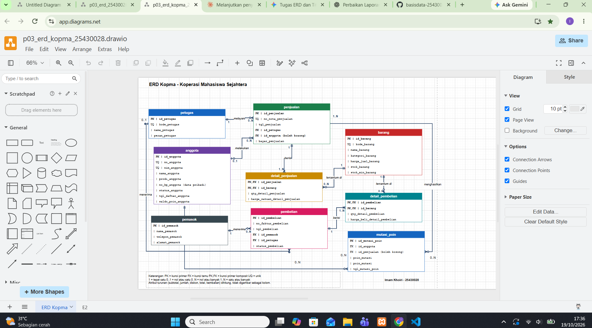

# Laporan Praktikum Basis Data - Pertemuan 04

**Nama:** Imam Khoiri  
**NIM:** 25430028  
**Kelas:** A  
**Pertemuan:** 04  
**Tanggal:** 19 Oktober 2026  
**Dosen Pengampu:** Dedi Irawan, S.Kom.,M.T.I 
**Tema:** Normalisasi Basis Data Kopma

---

## 1. Tujuan Praktikum

Praktikum ini bertujuan memahami proses normalisasi basis data, mulai dari Unnormalized Form (UNF), First Normal Form (1NF), Second Normal Form (2NF), Third Normal Form (3NF), hingga pemeriksaan Boyce-Codd Normal Form (BCNF). Normalisasi dilakukan untuk mengurangi redundansi data, mencegah anomali penyisipan, pembaruan, dan penghapusan, serta menghasilkan struktur tabel yang konsisten.

## 2. Ringkasan Dasar Teori

Normalisasi merupakan proses penyusunan struktur relasi agar data tersimpan secara terorganisasi dan ketergantungan antaratribut dapat dikelola dengan baik.

- **UNF:** Struktur data masih dapat memiliki grup atribut berulang.
- **1NF:** Setiap atribut berisi nilai atomik dan grup berulang dihilangkan.
- **2NF:** Relasi memenuhi 1NF dan tidak memiliki ketergantungan parsial atribut bukan kunci terhadap sebagian kunci komposit.
- **3NF:** Relasi memenuhi 2NF dan tidak memiliki ketergantungan transitif atribut bukan kunci terhadap kunci.
- **BCNF:** Setiap determinan dalam dependensi fungsional nontrivial harus merupakan superkey.

Dependensi fungsional digunakan untuk menjelaskan hubungan antara atribut penentu dan atribut yang nilainya ditentukan. Kunci primer mengidentifikasi setiap baris, sedangkan kunci tamu menghubungkan tabel yang saling berelasi.

## 3. Hasil Langkah Percobaan

### 3.1 Bentuk awal UNF

Data penjualan Kopma pada bentuk awal dapat memuat beberapa barang dalam satu nota. Struktur tersebut memiliki grup berulang yang berisi kode barang, nama barang, kuantitas, harga satuan, dan subtotal.

Struktur awal yang digunakan dalam analisis adalah `NOTA_UNF`, yang juga memuat nomor nota, tanggal penjualan, petugas, anggota, jumlah penjualan, diskon, dan total penjualan.

Masalah utama pada UNF adalah kemungkinan pengulangan data petugas dan anggota serta kesulitan menjaga konsistensi apabila data yang berulang mengalami perubahan.

### 3.2 Bentuk Normal Pertama (1NF)

Pada tahap 1NF, grup barang berulang diubah menjadi baris terpisah sehingga setiap baris merepresentasikan satu barang pada satu nota. Setiap atribut berisi nilai atomik.

Kunci komposit yang digunakan dalam analisis awal adalah `(no_nota_penjualan, kode_barang)`. Penggunaan kunci tersebut mengasumsikan bahwa satu jenis barang hanya muncul sekali dalam satu nota. Apabila barang yang sama boleh muncul pada beberapa baris nota yang berbeda, diperlukan atribut nomor baris atau identitas detail sebagai pembeda.

### 3.3 Dependensi fungsional

Dependensi fungsional yang diidentifikasi dalam dokumen normalisasi meliputi:

| Kode | Dependensi fungsional |
|---|---|
| FD1 | `no_nota_penjualan → tgl_penjualan, kode_petugas, no_anggota` |
| FD2 | `kode_petugas → nama_petugas` |
| FD3 | `no_anggota → nama_anggota` |
| FD4 | `kode_barang → nama_barang` |
| FD5 | `(no_nota_penjualan, kode_barang) → qty_detail_penjualan, harga_satuan_detail_penjualan` |
| FD6 | Subtotal dihitung dari kuantitas dikalikan harga satuan. |

FD1 didasarkan pada asumsi bahwa setiap nomor nota mengidentifikasi satu transaksi. FD2 dan FD4 bergantung pada keunikan kode petugas dan kode barang. FD3 berkaitan dengan identitas anggota. FD5 mengikuti aturan bahwa harga transaksi disimpan pada detail agar riwayat harga tidak berubah ketika harga barang saat ini diperbarui.

FD6 merupakan aturan perhitungan nilai turunan, bukan dasar utama untuk menentukan pemisahan tabel.

### 3.4 Bentuk Normal Kedua (2NF)

Pada tahap 2NF, data penjualan dipisahkan menjadi tabel PENJUALAN, DETAIL_PENJUALAN, dan BARANG.

Tabel PENJUALAN menyimpan informasi utama transaksi, seperti nomor nota, tanggal, petugas, anggota, dan pembayaran. Tabel DETAIL_PENJUALAN menyimpan barang yang dijual, kuantitas, dan harga satuan saat transaksi berlangsung. Tabel BARANG menyimpan identitas barang, kategori, harga jual saat ini, stok, dan stok minimum.

Pemisahan ini mengurangi ketergantungan atribut detail pada sebagian kunci komposit dan membedakan harga jual terkini dari harga historis transaksi.

### 3.5 Bentuk Normal Ketiga (3NF)

Pada tahap 3NF, data petugas dan anggota dipisahkan ke tabel masing-masing untuk mengurangi ketergantungan transitif.

Tabel PETUGAS menyimpan identitas serta informasi petugas. Tabel ANGGOTA menyimpan nomor anggota, NIM, nama, program studi, nomor telepon, status, dan tanggal pendaftaran.

Dengan pemisahan tersebut, perubahan nama petugas atau anggota cukup dilakukan pada tabel asal tanpa memperbarui setiap transaksi yang terkait.

### 3.6 Skema relasional hasil normalisasi

Skema inti yang digunakan mengacu pada delapan tabel kanonik Kopma:

1. `PETUGAS(id_petugas PK, kode_petugas UNIQUE, nama_petugas, peran_petugas)`
2. `ANGGOTA(id_anggota PK, no_anggota UNIQUE, nim_anggota UNIQUE, nama_anggota, prodi_anggota, no_hp_anggota, status_anggota, tgl_daftar_anggota)`
3. `BARANG(id_barang PK, kode_barang UNIQUE, nama_barang, kategori_barang, harga_jual_barang, stok_barang, stok_min_barang)`
4. `PEMASOK(id_pemasok PK, nama_pemasok, telepon_pemasok, alamat_pemasok)`
5. `PENJUALAN(id_penjualan PK, no_nota_penjualan UNIQUE, tgl_penjualan, id_petugas FK, id_anggota FK NULL, bayar_penjualan)`
6. `DETAIL_PENJUALAN(id_penjualan PK/FK, id_barang PK/FK, qty_detail_penjualan, harga_satuan_detail_penjualan)`
7. `PEMBELIAN(id_pembelian PK, no_faktur_pembelian, id_pemasok FK, tgl_pembelian, status_pembelian)`
8. `DETAIL_PEMBELIAN(id_pembelian PK/FK, id_barang PK/FK, qty_detail_pembelian, harga_beli_detail_pembelian)`

`PK` adalah kunci primer, `FK` adalah kunci tamu, dan `UNIQUE` menunjukkan nilai yang tidak boleh berulang. `id_anggota` pada PENJUALAN dapat kosong karena transaksi bisa dilakukan oleh pembeli umum.

ERD proyek juga memuat MUTASI_POIN untuk mencatat perubahan poin anggota. Entitas tersebut merupakan bagian dari kebutuhan proyek, tetapi tidak termasuk delapan tabel inti yang digunakan dalam pembahasan normalisasi penjualan.

### 3.7 Pemeriksaan BCNF

BCNF mensyaratkan bahwa setiap determinan pada dependensi fungsional nontrivial merupakan superkey. Pemeriksaan dilakukan dengan mempertimbangkan kunci primer, atribut unik, serta dependensi fungsional yang berlaku pada masing-masing tabel.

Berdasarkan dokumen normalisasi yang tersedia, pemeriksaan BCNF masih memerlukan verifikasi seluruh dependensi fungsional pada setiap tabel. Oleh sebab itu, status akhir BCNF belum dinyatakan terkonfirmasi hanya berdasarkan keberadaan kunci primer dan atribut unik.

### 3.8 Analisis nilai turunan

| Nilai | Keputusan | Alasan |
|---|---|---|
| `subtotal_detail_penjualan` | Dihitung | Diperoleh dari kuantitas dikalikan harga satuan. |
| `jumlah_penjualan` | Dihitung | Diperoleh dari penjumlahan subtotal detail. |
| `total_penjualan` | Dihitung | Diperoleh dari jumlah penjualan dikurangi diskon yang berlaku. |
| Kembalian | Dihitung | Diperoleh dari pembayaran dikurangi total transaksi. |

Nilai turunan dihitung agar tidak terjadi ketidaksesuaian antara nilai yang disimpan dengan hasil perhitungan detail transaksi.

### 3.9 Informasi pemasok barang

Informasi pemasok tidak ditempatkan langsung pada tabel BARANG. Hubungan pemasok dan barang dapat ditelusuri melalui PEMBELIAN dan DETAIL_PEMBELIAN. Dengan cara tersebut, satu barang dapat dibeli dari pemasok berbeda pada waktu berbeda tanpa mengubah identitas barang.

## 4. Jawaban Titik Analisis

### 4.1 Mengapa harga transaksi disimpan pada DETAIL_PENJUALAN?

Harga transaksi perlu disimpan pada DETAIL_PENJUALAN karena harga saat barang dijual dapat berbeda dari harga jual terkini pada tabel BARANG. Jika hanya mengacu pada harga terkini, perubahan harga dapat merusak informasi transaksi lama dan menyebabkan laporan omzet historis tidak akurat.

### 4.2 Mengapa data anggota dan petugas dipisahkan?

Data anggota dan petugas dipisahkan untuk menghindari pengulangan informasi dan mengurangi ketergantungan transitif. Perubahan nama cukup dilakukan pada tabel ANGGOTA atau PETUGAS tanpa memperbarui seluruh transaksi yang terkait.

### 4.3 Apakah seluruh tabel sudah dipastikan memenuhi BCNF?

Belum. Dokumen normalisasi yang tersedia menyatakan bahwa seluruh dependensi fungsional masih perlu diverifikasi. Status BCNF harus ditentukan setelah setiap determinan diperiksa untuk memastikan bahwa determinan tersebut merupakan superkey.

## 5. Hasil Latihan dan Modifikasi

### 5.1 Latihan E1: Beberapa nomor telepon pemasok

Jika satu pemasok dapat memiliki beberapa nomor telepon, nomor telepon dapat dipisahkan ke dalam relasi `TELEPON_PEMASOK`.

Struktur yang diusulkan:

```text
TELEPON_PEMASOK (
    id_pemasok [PK, FK],
    no_telepon_pemasok [PK]
)
```

Kunci primer komposit `(id_pemasok, no_telepon_pemasok)` membedakan nomor telepon pada masing-masing pemasok. Atribut `id_pemasok` menjadi kunci tamu yang mengacu pada tabel PEMASOK.

Perubahan ini masih berupa usulan dan belum dinyatakan diterapkan pada ERD final.

### 5.2 Latihan E2: Anomali pembaruan nama anggota

Apabila `nama_anggota` disimpan berulang pada tabel PENJUALAN, perubahan nama dapat menimbulkan ketidakkonsistenan jika tidak semua baris diperbarui.

Contoh SQL berikut hanya menggambarkan struktur sebelum normalisasi dan bukan perintah untuk dijalankan pada skema akhir:

```sql
UPDATE penjualan
SET nama_anggota = 'Nama Baru'
WHERE no_anggota = 'AG001';
```

Pada skema hasil normalisasi, `nama_anggota` disimpan di tabel ANGGOTA. Pembaruan nama dilakukan pada tabel tersebut sehingga tidak perlu memperbarui setiap transaksi anggota.

## 6. Dokumentasi Perubahan ERD

ERD Kopma yang diperiksa memuat entitas PETUGAS, ANGGOTA, BARANG, PEMASOK, PENJUALAN, DETAIL_PENJUALAN, PEMBELIAN, DETAIL_PEMBELIAN, dan MUTASI_POIN.

Hal yang telah dicatat dalam dokumen normalisasi:

1. DETAIL_PENJUALAN menggunakan pasangan kunci `(id_penjualan, id_barang)`.
2. DETAIL_PEMBELIAN menggunakan pasangan kunci `(id_pembelian, id_barang)`.
3. MUTASI_POIN menggunakan `id_mutasi_poin` sebagai kunci primer dan `id_penjualan` sebagai kunci tamu yang dapat kosong.
4. PEMASOK masih memiliki atribut `telepon_pemasok`.
5. Relasi TELEPON_PEMASOK belum ditemukan pada diagram yang diperiksa.

Penyesuaian ERD berdasarkan seluruh hasil normalisasi masih perlu diputuskan dan diterapkan. Karena itu, dokumentasi perubahan ERD belum dinyatakan final.

## 7. Kesimpulan

Normalisasi basis data Kopma dilakukan dari UNF hingga 3NF untuk menghilangkan grup berulang, mengurangi ketergantungan parsial, dan mengurangi ketergantungan transitif. Hasilnya memisahkan data petugas, anggota, barang, pemasok, transaksi, dan detail transaksi. Harga satuan transaksi disimpan pada detail penjualan agar riwayat harga tetap terjaga, sedangkan nilai turunan dihitung berdasarkan data transaksi.

Pemeriksaan BCNF dan penyesuaian ERD masih memerlukan verifikasi lanjutan sebelum rancangan dapat dinyatakan final.

## 8. Bukti Pengerjaan

Bukti pengerjaan Modul 4 akan dilengkapi menggunakan tangkapan layar nyata dari proses analisis normalisasi dan pemeriksaan ERD. Gambar hanya dicantumkan setelah file screenshot tersedia pada folder `laporan/img`.

### 8.1 Diagram ERD Kopma



## 9. Referensi

- Buku Praktikum Basis Data, Modul 4: Normalisasi Basis Data.
- Dokumen proyek `p02_kebutuhan_data_kopma_25430028.md`.
- Dokumen analisis `p04_normalisasi_25430028.md`.
