# Laporan Praktikum Basis Data - Pertemuan 5

**Nama:** Imam Khoiri
**NIM:** 25430028
**Kelas:** A
**Tanggal:** 26-27 Oktober 2026
**Dosen/Asisten:** Dedi Irawan, S.Kom., M.T.I.

## 1. Tujuan Praktikum

1. Membangun struktur basis data dengan DDL (`CREATE TABLE`, `ALTER TABLE`, `DROP TABLE`).
2. Menerapkan constraint (PRIMARY KEY, FOREIGN KEY, UNIQUE, NOT NULL, DEFAULT, CHECK) agar aturan bisnis dijaga oleh struktur.
3. Membuktikan constraint bekerja dengan menjalankan perintah yang melanggarnya dan membaca pesan galat.
4. Menyusun DDL dan ERD fisik proyek (Klinik IK Sehat) dari dokumen kebutuhan data.

## 2. Ringkasan Dasar Teori

`ON DELETE CASCADE` digunakan pada kunci tamu yang menghubungkan tabel detail dengan nota induknya, yaitu `fk_detail_penjualan` pada tabel `detail_penjualan` ke `penjualan` dan `fk_dbeli_pembelian` pada tabel `detail_pembelian` ke `pembelian`. Jika nota induk dihapus, detail transaksinya ikut dihapus karena tidak lagi memiliki nota yang menjadi acuan. Namun, kunci tamu `fk_detail_barang` dari `detail_penjualan` ke `barang` tidak menggunakan `CASCADE`, sehingga penghapusan barang yang masih digunakan dalam transaksi akan ditolak (`RESTRICT`). Hal ini penting agar riwayat transaksi tetap terjaga dan laporan omzet tidak terganggu. Jadi, `CASCADE` digunakan untuk detail yang bergantung pada nota induk, sedangkan `RESTRICT` digunakan untuk menjaga data induk yang masih dirujuk oleh transaksi.
Hanya detail_pembelian_obat yang memakainya, sedangkan jalur kunjungan memakai RESTRICT karena AB-10 (data kunjungan dan pembayaran tidak dihapus). Ini menunjukkan Anda memilih aksi ON DELETE berdasarkan aturan bisnis, bukan kebiasaan.

## 3. Hasil Langkah Percobaan

Basis data praktik: `kopma_028` (Koperasi Mahasiswa). Skrip: `p05_ddl_25430028.sql`. Seluruh perintah dijalankan pada MariaDB 10.4.32 (XAMPP).

### 3.1 Tabel induk (D.1)

Empat tabel induk dibuat tanpa kunci tamu: `petugas`, `anggota`, `barang`, `pemasok`.

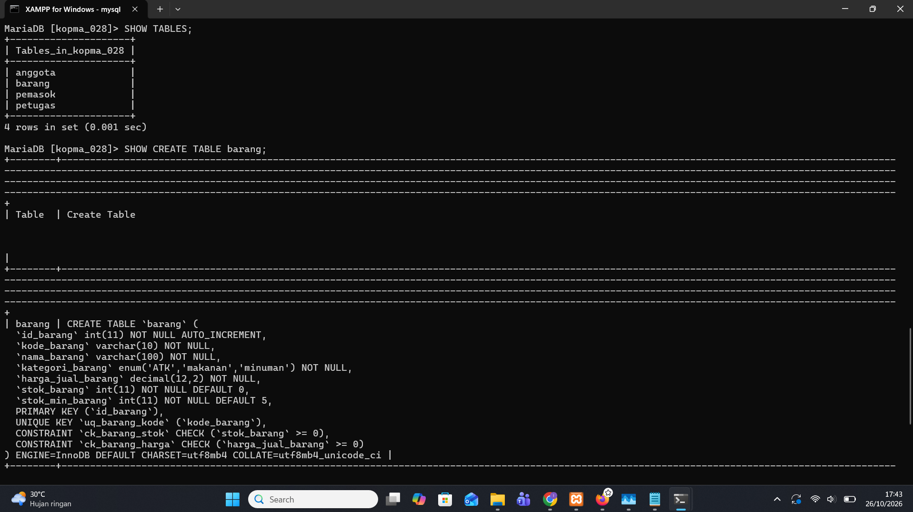

Hasil `SHOW CREATE TABLE barang` (disalin sebagai teks):

```sql
CREATE TABLE `barang` (
  `id_barang` int(11) NOT NULL AUTO_INCREMENT,
  `kode_barang` varchar(10) NOT NULL,
  `nama_barang` varchar(100) NOT NULL,
  `kategori_barang` enum('ATK','makanan','minuman') NOT NULL,
  `harga_jual_barang` decimal(12,2) NOT NULL,
  `stok_barang` int(11) NOT NULL DEFAULT 0,
  `stok_min_barang` int(11) NOT NULL DEFAULT 5,
  PRIMARY KEY (`id_barang`),
  UNIQUE KEY `uq_barang_kode` (`kode_barang`),
  CONSTRAINT `ck_barang_stok` CHECK (`stok_barang` >= 0),
  CONSTRAINT `ck_barang_harga` CHECK (`harga_jual_barang` >= 0)
) ENGINE=InnoDB DEFAULT CHARSET=utf8mb4 COLLATE=utf8mb4_unicode_ci
```

### 3.2 Tabel dengan kunci tamu (D.2)

Empat tabel berikutnya dibuat setelah induknya: `penjualan`, `detail_penjualan`, `pembelian`, `detail_pembelian`. Total 8 tabel.

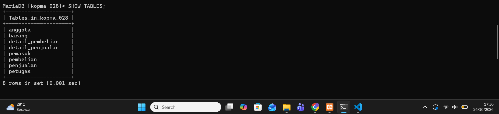

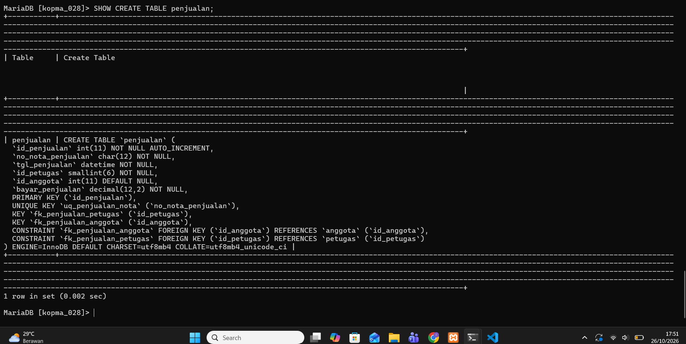

### 3.3 Pembuktian constraint (D.3)

Data uji: 2 petugas dan 2 barang. Tiga pelanggaran dijalankan dan seluruhnya ditolak server.

**Pelanggaran kunci tamu** (petugas nomor 99 tidak ada):

```sql
INSERT INTO penjualan (no_nota_penjualan, tgl_penjualan, id_petugas, id_anggota, bayar_penjualan)
VALUES ('PJ-2609-0199', NOW(), 99, NULL, 5000);
-- ERROR 1452 (23000): Cannot add or update a child row: a foreign key constraint fails
-- (`kopma_028`.`penjualan`, CONSTRAINT `fk_penjualan_petugas` FOREIGN KEY (`id_petugas`) REFERENCES `petugas` (`id_petugas`))
```

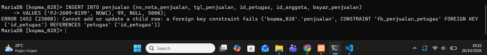

**Pelanggaran CHECK** (stok negatif, AB-03):

```sql
UPDATE barang SET stok_barang = -1 WHERE id_barang = 1;
-- ERROR 4025 (23000): CONSTRAINT `ck_barang_stok` failed for `kopma_028`.`barang`
```

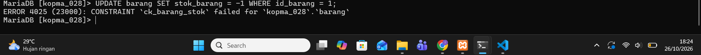

**Pelanggaran UNIQUE** (kode barang kembar):

```sql
INSERT INTO barang (kode_barang, nama_barang, kategori_barang, harga_jual_barang)
VALUES ('ATK-001', 'Duplikat', 'ATK', 1000);
-- ERROR 1062 (23000): Duplicate entry 'ATK-001' for key 'uq_barang_kode'
```

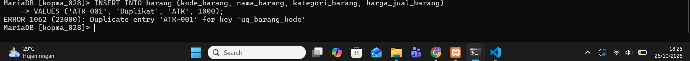

### 3.4 ALTER TABLE (D.4)

Kolom `tgl_kedaluwarsa` ditambahkan ke `barang`, diperiksa dengan `DESCRIBE`, lalu dihapus kembali.

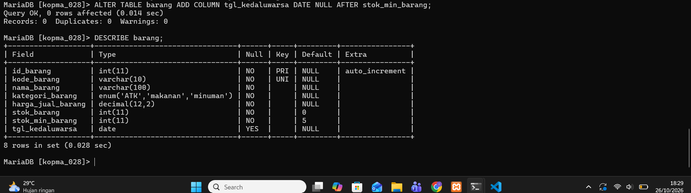

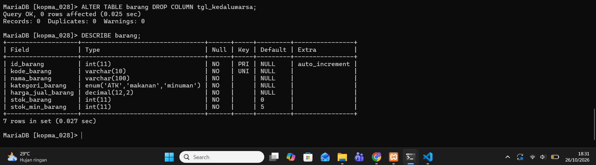

### 3.5 Designer phpMyAdmin dan ERD fisik (D.4)

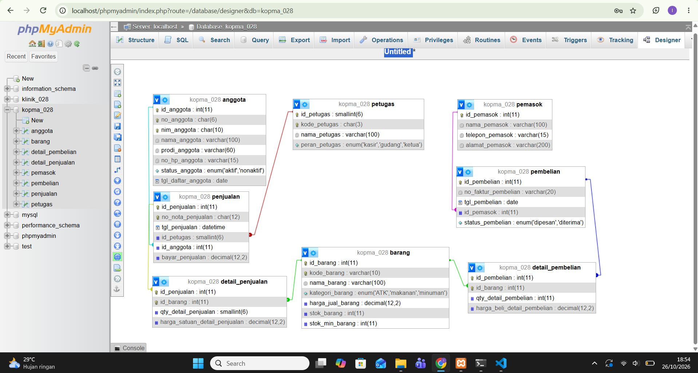

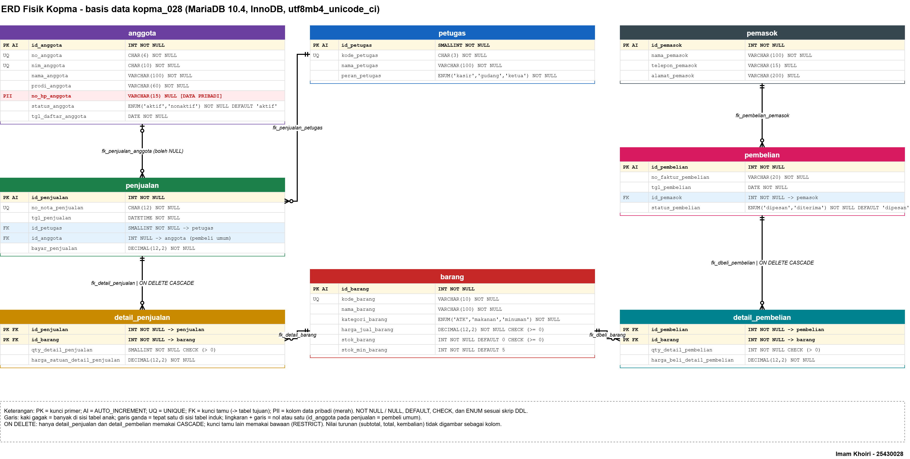

Perbandingan Designer dengan ERD konseptual Modul 3 (Kopma):

| Aspek | ERD konseptual (Modul 3) | Designer / ERD fisik |
|---|---|---|
| Jumlah tabel | 9 entitas (termasuk `mutasi_poin`) | 8 tabel (skema kanonik) |
| `anggota.saldo_poin_anggota` | ada | tidak ada |
| `pembelian.id_petugas` | ada | tidak ada |
| Tipe data dan constraint | belum ada | ada |
| Kardinalitas | digambar | tidak tampak di Designer, hanya garis |

**[ISI DENGAN KATA SENDIRI]** - tulis keputusan Anda terhadap tiga perbedaan di atas (ditambahkan nanti atau di luar cakupan praktik). Di ERD Modul 3, kolom `poin_mutasi` tertulis dua kali; periksa dan perbaiki.

### 3.6 Skrip dapat dijalankan ulang (D.4 no. 9)

Pada skrip, blok `DROP TABLE IF EXISTS` ditulis dengan urutan anak ke induk. Skrip diimpor ulang lewat phpMyAdmin tanpa galat.

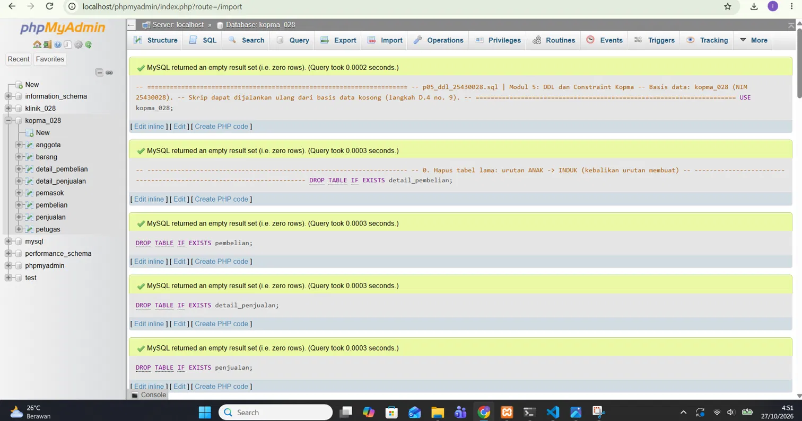

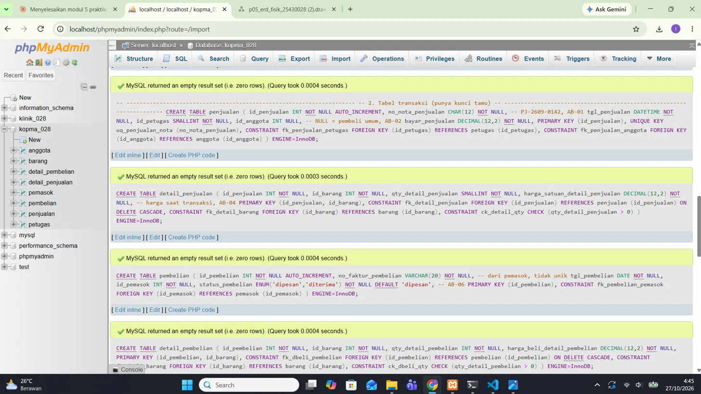

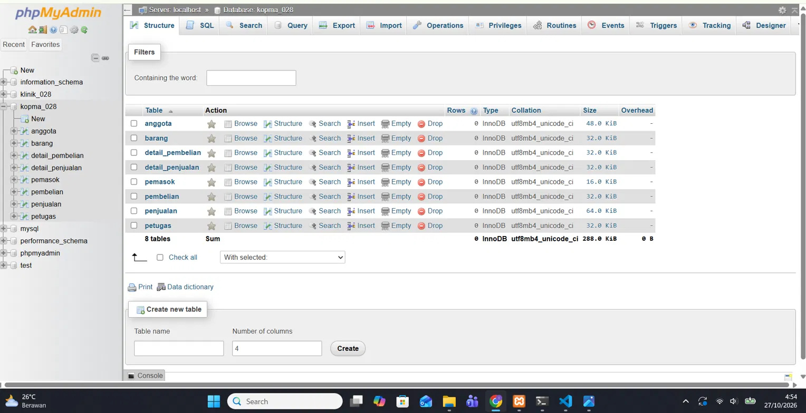

## 4. Jawaban Titik Analisis

**Titik Analisis 1 - ON DELETE CASCADE hanya pada tabel detail.**

`ON DELETE CASCADE` digunakan pada detail penjualan dan detail pembelian karena data detail bergantung pada nota induknya. Jika nota dihapus, detail yang berhubungan dengannya ikut terhapus. Namun, barang yang masih digunakan dalam transaksi tidak boleh dihapus sembarangan karena bisa membuat riwayat transaksi dan laporan omzet menjadi terganggu. Oleh karena itu, hubungan detail dengan nota menggunakan `CASCADE`, sedangkan hubungan detail dengan barang menggunakan `RESTRICT`.

**Titik Analisis 2 - Peta galat ke aturan bisnis.**

| Kode galat | Constraint | Aturan yang dijaga |
|---|---|---|
| 1452 | `fk_penjualan_petugas` | Nota `PJ-2609-0199` ditolak karena menggunakan `id_petugas = 99`, sedangkan petugas yang terdaftar hanya memiliki ID 1 dan 2. Jadi, setiap penjualan harus menggunakan ID petugas yang sudah terdaftar. |
| 4025 | `ck_barang_stok` | AB-03 (stok tidak boleh negatif) |
| 1062 | `uq_barang_kode` | Kode barang `ATK-001` ditolak karena sudah digunakan oleh `Pulpen Gel 0.5`. Setiap barang harus memiliki kode yang berbeda supaya tidak tertukar saat transaksi dan pencatatan stok. |

Aturan stok yang belum bisa dijaga hanya dengan constraint adalah jumlah barang yang dijual (`qty_detail_penjualan`) tidak boleh melebihi stok yang tersedia (`stok_barang`). Kedua data tersebut berada di tabel yang berbeda, sedangkan `CHECK` hanya memeriksa data pada baris tabelnya sendiri. Karena itu, database perlu memeriksa stok sebelum penjualan dilakukan dan mengurangi stok setelah transaksi berhasil. Aturan ini akan dipelajari lebih lanjut pada Modul 14.

**Titik Analisis 3 - Urutan DROP.**

Tabel `petugas` tidak bisa dihapus lebih dulu karena masih menjadi tabel induk yang dirujuk oleh tabel transaksi melalui foreign key. Jika tabel induk dihapus saat masih digunakan, database akan menolak perintah tersebut agar hubungan data tetap terjaga. Oleh karena itu, tabel detail seperti `detail_pembelian` dan `detail_penjualan` dihapus terlebih dahulu karena bergantung pada tabel transaksi induknya. Setelah tabel yang bergantung dihapus, tabel induk dapat dihapus sesuai urutan dependensinya.

## 5. Hasil Latihan dan Modifikasi

### E.1 CHECK pada stok_min_barang

```sql
ALTER TABLE barang ADD CONSTRAINT ck_barang_stokmin CHECK (stok_min_barang >= 0);
UPDATE barang SET stok_min_barang = -1 WHERE id_barang = 1;
-- ERROR 4025 (23000): CONSTRAINT `ck_barang_stokmin` failed for `kopma_028`.`barang`
```

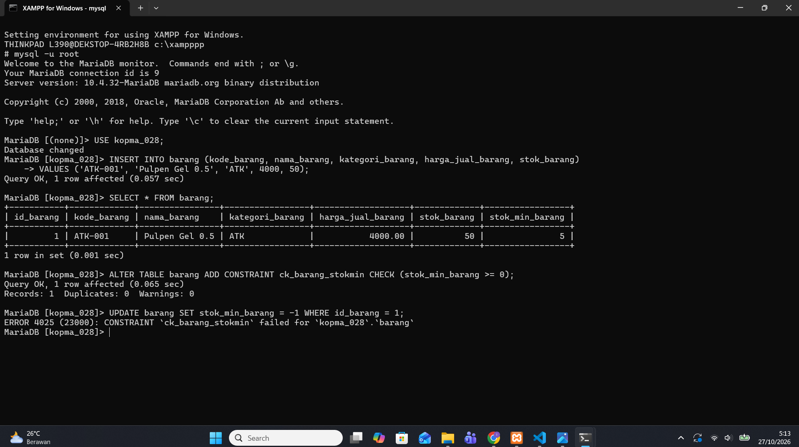

### E.2 ON DELETE SET NULL pada fk_penjualan_anggota

```sql
ALTER TABLE penjualan DROP FOREIGN KEY fk_penjualan_anggota;
ALTER TABLE penjualan
  ADD CONSTRAINT fk_penjualan_anggota FOREIGN KEY (id_anggota)
  REFERENCES anggota (id_anggota) ON DELETE SET NULL;
```

Hasil pemeriksaan aturan hapus:

```text
+----------------------+-------------+
| CONSTRAINT_NAME      | DELETE_RULE |
+----------------------+-------------+
| fk_penjualan_anggota | SET NULL    |
| fk_penjualan_petugas | RESTRICT    |
+----------------------+-------------+
```

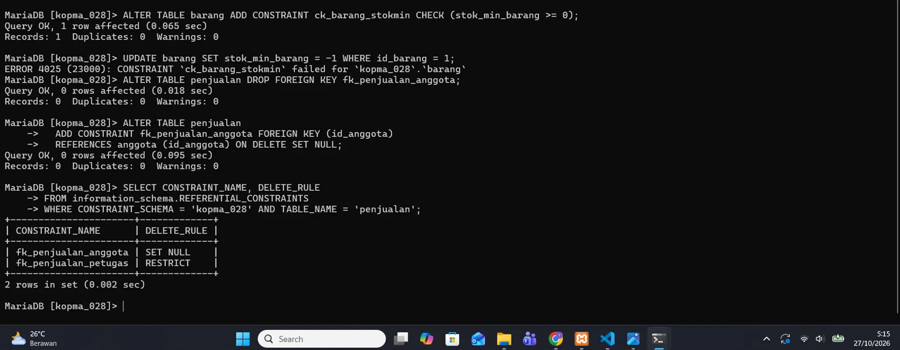

Bukti perilaku: anggota uji dihapus, nota tetap ada dengan `id_anggota` menjadi `NULL`.

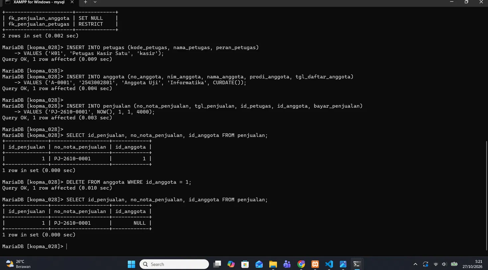

**[ISI DENGAN KATA SENDIRI]** - apakah `SET NULL` sesuai AB-02 (nota tanpa anggota dianggap pembeli umum) dan UU PDP? Arah: sisi positif (identitas hilang, nota tetap) dan sisi negatif (riwayat belanja anggota, poin, dan audit tidak lagi dapat ditelusuri).

Perintah latihan tersimpan di `p05_latihan_25430028.sql`.

## 6. Tugas Mandiri: Milestone Proyek 5

Proyek: **Klinik IK Sehat** (tema klinik), basis data `klinik_028`. Skrip: `p05_ddl_klinik_25430028.sql`. ERD fisik: `p05_erd_fisik_klinik_25430028.png` dan sumbernya `p05_erd_fisik_klinik_25430028.drawio`.

Parameter dari dokumen kebutuhan data: NIM 25430028, dua digit terakhir 28, 28 mod 9 = 1, **P = 2**, batas baris per transaksi **P + 2 = 4** (AB-03), denda keterlambatan P ribu rupiah (AB-08).

### 6.1 Skema yang dibangun (13 tabel)

`pasien`, `dokter`, `poli`, `tindakan`, `obat`, `pemasok`, `kunjungan`, `detail_tindakan`, `resep`, `detail_resep`, `pembayaran`, `pembelian_obat`, `detail_pembelian_obat`. Terdapat 12 kunci tamu; seluruh tipe kolom FK sama dengan kolom yang dirujuk.

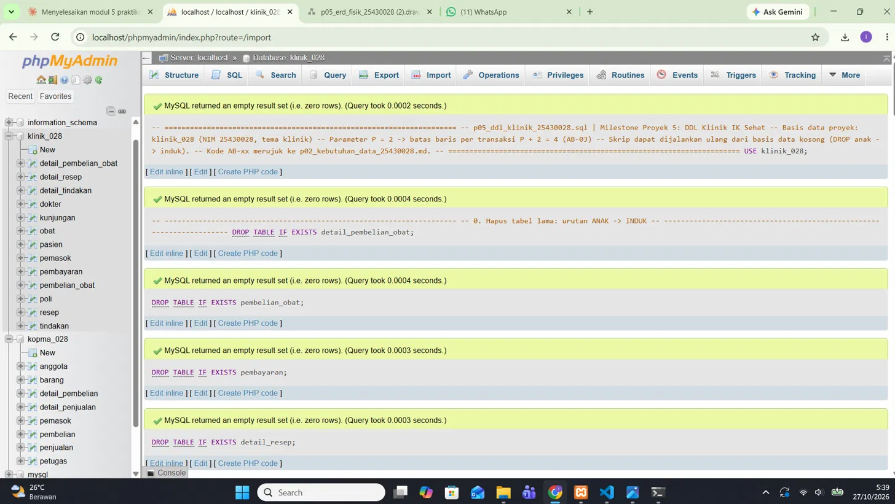

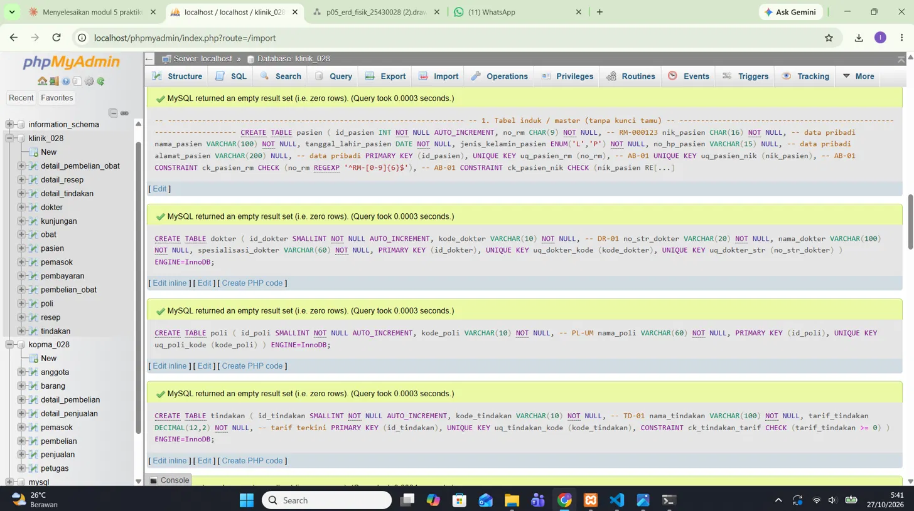

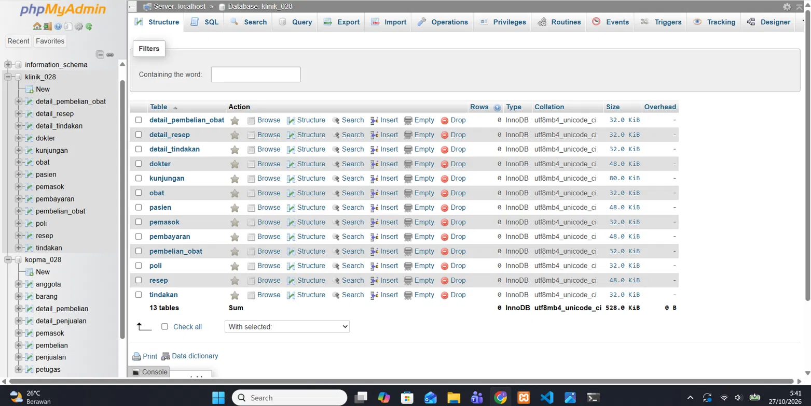

### 6.2 Aturan bisnis menjadi constraint

| Kode | Aturan | Constraint pada skrip |
|---|---|---|
| AB-01 | No. RM dan NIK unik, berformat | `uq_pasien_rm`, `uq_pasien_nik`, `ck_pasien_rm`, `ck_pasien_nik` |
| AB-02 | Kunjungan memiliki satu pasien, dokter, poli; waktu otomatis | `id_pasien`, `id_dokter`, `id_poli` NOT NULL dengan FK; `DEFAULT CURRENT_TIMESTAMP` |
| AB-03 | Maksimal 4 baris per kunjungan dan per resep | tidak dapat dijaga CHECK (lihat 6.4) |
| AB-04 | Tarif dan harga disimpan per baris saat transaksi | `tarif_saat_tindakan`, `harga_satuan_resep`, `harga_beli_obat` |
| AB-05 | Stok tidak boleh negatif | `ck_obat_stok` |
| AB-06 | Obat kedaluwarsa tidak boleh diserahkan | `tanggal_kedaluwarsa_obat` NOT NULL; penyerahan ditandai untuk Modul 14 |
| AB-07 | Satu pembayaran per kunjungan | `uq_pembayaran_kunjungan` |
| AB-08 | Denda per hari keterlambatan | nilai turunan, dihitung saat kueri |
| AB-09 | Data kesehatan dibatasi aksesnya | kolom `keluhan`, `diagnosis` ditandai; diatur lewat hak akses |
| AB-10 | Data kunjungan dan pembayaran tidak dihapus | seluruh FK jalur kunjungan memakai RESTRICT |
| AB-11 | Penerimaan obat menambah stok; harga beli per baris | `ck_dbeliobat_qty`, `ck_dbeliobat_harga`, `harga_beli_obat` |

### 6.3 Pemetaan tipe data

| Jenis data | Tipe | Alasan |
|---|---|---|
| Kunci primer tabel yang terus bertambah (`pasien`, `kunjungan`, `obat`, `resep`, `pembayaran`) | `INT AUTO_INCREMENT` | perkiraan 50 kunjungan per hari; rentang INT lebih dari cukup |
| Kunci primer tabel master kecil (`dokter`, `poli`, `tindakan`) | `SMALLINT AUTO_INCREMENT` | jumlah baris kecil; FK memakai tipe yang sama |
| Kode atau nomor berformat tetap (`no_rm`, `nik_pasien`, `no_kunjungan`) | `CHAR(n)` | panjang tetap, divalidasi CHECK |
| Nama, alamat, kode berpanjang beragam | `VARCHAR(n)` | panjang bervariasi |
| Uang (tarif, harga, jumlah bayar) | `DECIMAL(12,2)` | menghindari kesalahan pembulatan bilangan pecahan |
| Tanggal tanpa jam (lahir, kedaluwarsa, pembelian) | `DATE` | hanya tanggal yang dibutuhkan |
| Waktu kejadian (kunjungan, pembayaran) | `DATETIME DEFAULT CURRENT_TIMESTAMP` | waktu tercatat otomatis |
| Nilai terbatas (jenis kelamin, metode dan status bayar) | `ENUM` | domain nilai kecil dan tetap |
| Jumlah per baris | `SMALLINT` (resep), `INT` (pembelian) | sesuai rentang dan CHECK > 0 |

### 6.4 Analisis aturan batas P + 2 (AB-03)

- **Per baris (dapat dijaga):** jumlah obat pada satu baris resep harus lebih dari nol, diwujudkan sebagai `ck_dresep_qty CHECK (qty_obat_resep > 0)`. Pembelian memakai `ck_dbeliobat_qty`.
- **Jumlah baris per transaksi (tidak dapat dijaga CHECK):** batas 4 baris tindakan per kunjungan dan 4 baris obat per resep menyangkut **banyak baris**. CHECK hanya menilai satu baris pada satu waktu sehingga tidak dapat menghitung jumlah baris lain dengan kunci yang sama. Aturan ini **ditandai untuk Modul 14** (transaksi atau trigger).
- Aturan lain yang ditandai untuk Modul 14: AB-05 (qty melebihi stok, melibatkan dua tabel), AB-06 (kedaluwarsa), AB-07 (jumlah bayar sama dengan total tagihan tambah denda), dan validasi tanggal tidak di masa depan.

### 6.5 Bukti constraint proyek bekerja

```sql
INSERT INTO pasien (no_rm, nik_pasien, nama_pasien, tanggal_lahir_pasien, jenis_kelamin_pasien)
VALUES ('RM-000123', '123', 'Uji', '1990-05-14', 'L');
-- ERROR 4025 (23000): CONSTRAINT `ck_pasien_nik` failed for `klinik_028`.`pasien`
```

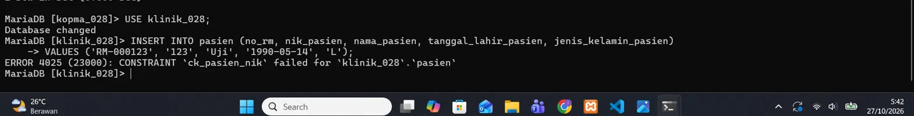

### 6.6 Perbandingan Designer dengan ERD konseptual (Klinik)

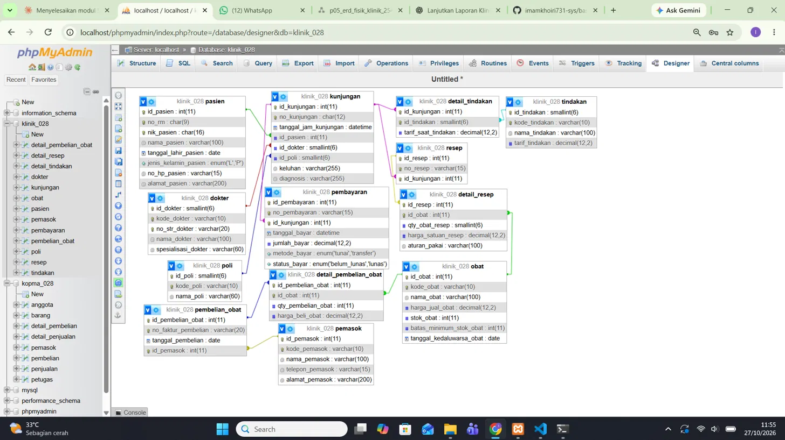

| Aspek | ERD konseptual (Modul 3) | Designer / ERD fisik |
|---|---|---|
| Jumlah tabel dan relasi | 13 tabel, 12 relasi | 13 tabel, 12 garis |
| Tipe data, DEFAULT, CHECK, ENUM | tidak ada | ada |
| Kardinalitas | digambar | tidak tampak di Designer |
| `denda_keterlambatan` | ada, ditandai turunan | tidak dibuat sebagai kolom (AB-08) |
| `no_faktur_pembelian` | UQ tunggal | unik bersama `id_pemasok` (sesuai kamus data) |
| `kunjungan` ke `resep` dan `pembayaran` | 1 ke 0..1 | `UNIQUE (id_kunjungan)` pada kedua tabel |

Berdasarkan perbandingan tersebut, ERD fisik Klinik memiliki 13 tabel dan 12 relasi seperti ERD konseptual pada Modul 3. Perbedaannya, ERD fisik sudah dilengkapi tipe data dan constraint seperti `DEFAULT`, `CHECK`, `ENUM`, serta `UNIQUE`. Kolom `denda_keterlambatan` tidak dibuat karena nilainya dapat dihitung sesuai aturan AB-08. Untuk `no_faktur_pembelian`, ERD konseptual Modul 3 perlu diperbaiki agar aturan uniknya sesuai dengan kamus data, yaitu menggunakan kombinasi `id_pemasok` dan `no_faktur_pembelian`, bukan hanya `no_faktur_pembelian` saja. Hubungan `kunjungan` dengan `resep` dan `pembayaran` juga dijaga menggunakan `UNIQUE (id_kunjungan)` agar satu kunjungan tidak memiliki lebih dari satu resep atau pembayaran.

Dokumen normalisasi pada Modul 4 yang tersedia masih membahas proyek Kopma, sehingga belum secara khusus menjelaskan normalisasi untuk skema Klinik. Oleh karena itu, dokumen normalisasi Klinik perlu dilengkapi secara terpisah agar dokumentasinya sesuai dengan ERD dan kebutuhan data proyek Klinik. Pengerjaannya dapat dilakukan pada tahap berikutnya jika tidak termasuk persyaratan wajib Modul 5.

## 7. Pembahasan dan Kendala

Selama mengerjakan praktikum, saya mengalami beberapa kendala saat menjalankan MariaDB. Awalnya, saya tidak bisa masuk menggunakan akun `root` maupun akun kerja karena muncul galat 1045 yang berkaitan dengan akses atau kata sandi. Untuk mengatasinya, server dijalankan dalam mode pemulihan `skip-grant-tables` agar pengaturan kata sandi bisa diperbaiki.

Setelah itu, ditemukan masalah pada tabel sistem `mysql.db` yang mengalami kerusakan dan menampilkan galat 1030 dengan pesan *wrong checksum* dari engine Aria. Saya memeriksa tabel menggunakan `CHECK TABLE` dan memperbaikinya dengan `REPAIR TABLE`. Namun, setelah perbaikan, hak akses untuk basis data menjadi hilang. Ketika perintah `GRANT` dijalankan, server justru berhenti, sehingga pekerjaan dilanjutkan menggunakan akun `root`. Hal ini dilakukan karena proses pembuatan struktur dan pengolahan data untuk praktikum tidak memerlukan perubahan pada tabel hak akses.

Selain itu, beberapa file sisa kerusakan server, seperti `master-*`, `mysql-relay-bin-*`, `mysqld.dmp`, dan `aria_log*`, perlu dipindahkan agar server dapat berjalan kembali. Dari kendala tersebut, saya belajar bahwa sebelum memperbaiki tabel sistem, folder `data` sebaiknya dicadangkan terlebih dahulu agar data masih bisa dipulihkan jika terjadi masalah. Saya juga perlu berhati-hati saat mengambil tangkapan layar dan tidak menampilkan kata sandi atau informasi akun yang bersifat rahasia.

Bahan kendala yang benar-benar terjadi (ringkas dan sesuaikan):

1. Kata sandi akun `root` dan akun kerja tidak dapat dipakai (galat 1045).
2. Server dijalankan dalam mode pemulihan (`skip-grant-tables`) untuk mengatur ulang kata sandi.
3. Tabel sistem `mysql.db` rusak (galat 1030, "wrong checksum" dari engine Aria); diperiksa dengan `CHECK TABLE`, diperbaiki dengan `REPAIR TABLE`, sehingga hak akses per basis data hilang.
4. Perintah `GRANT` pada basis data membuat server berhenti; pekerjaan dilanjutkan sebagai `root` karena DDL dan DML tidak menyentuh tabel hak akses.
5. File sisa crash (`master-*`, `mysql-relay-bin-*`, `mysqld.dmp`, `aria_log*`) dipindahkan agar server dapat menyala.
6. Pelajaran: buat cadangan folder `data` sebelum memperbaiki tabel sistem; jangan menyimpan kata sandi di tangkapan layar.

## 8. Kesimpulan

Dari praktikum ini, saya memahami bahwa constraint membantu menjaga aturan bisnis langsung di dalam database. Hal ini terlihat saat pengujian, ketika kode barang `ATK-001` yang sudah digunakan ditolak karena melanggar aturan `UNIQUE`, ID petugas yang tidak terdaftar ditolak oleh foreign key, dan stok barang yang bernilai negatif ditolak oleh constraint `CHECK`. Pengujian tersebut menunjukkan bahwa constraint dapat mencegah data yang tidak sesuai aturan masuk ke database.

Namun, aturan yang melibatkan beberapa tabel, seperti memastikan jumlah barang yang dijual tidak melebihi stok yang tersedia, tidak dapat dijaga hanya dengan `CHECK` biasa. Aturan tersebut membutuhkan logika tambahan untuk memeriksa dan mengurangi stok secara konsisten, yang akan dipelajari pada Modul 14.

Saya juga memahami pentingnya membuat skrip DDL yang dapat dijalankan kembali agar struktur database bisa dibuat ulang dengan lebih mudah. ERD fisik melengkapi ERD konseptual dengan informasi teknis seperti tipe data, primary key, foreign key, dan constraint. Selama praktikum, saya juga mengalami kendala akses MariaDB dan kerusakan tabel sistem, sehingga saya belajar pentingnya mencadangkan folder `data` sebelum melakukan perbaikan serta menjaga informasi akun agar tidak terlihat pada tangkapan layar.

## 9. Pernyataan Penggunaan AI

Draf (periksa dan sesuaikan agar sesuai dengan yang benar-benar Anda lakukan):

Saya menggunakan asisten AI (Claude) untuk membantu menyusun draf skrip SQL, berkas ERD fisik (`.drawio`), dan kerangka laporan, serta untuk memandu pemecahan masalah server MariaDB. Seluruh skrip saya jalankan sendiri pada basis data `kopma_028` dan `klinik_028`, seluruh tangkapan layar berasal dari komputer saya, dan analisis serta kesimpulan pada laporan ini saya tulis dengan kata-kata saya sendiri.

## 10. Bukti Git

- Repositori: [TAUTAN REPOSITORI GITHUB]
- Commit `p05: ddl kopma`: `e05bff9`
- Commit `p05: latihan E`: [ISI HASH]
- Commit `p05: milestone proyek 5`: [ISI HASH]

## ChecklistIsi teknis di versi ini umumnya benar, tetapi dokumen ini **belum layak dikumpulkan**. Ada masalah berat yang bukan soal kata-kata.

## Masalah berat

**1. Semua tangkapan layar hilang.** Setiap `` tidak ada lagi, dan yang tersisa hanya baris kosong. Bukti tangkapan layar adalah syarat wajib dan bagian dari nilai, jadi harus dikembalikan.

**2. Ada teks asisten AI yang masih menempel.** Baris pembuka ("Berikut teks lengkap laporan yang sudah saya rapikan...", "Catatan penting...") dan bagian penutup "Sebelum dikumpulkan" adalah komentar AI, bukan bagian laporan. Hapus keduanya. Sisa format rumus juga rusak di bagian 6: `(28 \bmod 9 = 1)`, `(P = 2)`, `(P + 2 = 4)`. Ketik ulang sebagai teks biasa: 28 mod 9 = 1, P = 2, P + 2 = 4.

**3. Soal kepengarangan.** Dari kalimat pembukanya, dokumen ini ditulis ulang oleh asisten AI lain. Artinya Dasar Teori, bagian 3.5, Titik Analisis, diskusi `SET NULL`, tabel 6.3, paragraf 6.4, dan Kesimpulan di versi ini bukan lagi susunan kalimat Anda, padahal buku mensyaratkan bagian-bagian itu dengan bahasa sendiri. Dua dampaknya:
- Titik Analisis 1 yang tadinya Anda tulis sendiri dan lebih lengkap (menyebut `fk_detail_penjualan`, `fk_dbeli_pembelian`, dan contoh Klinik) kini diganti versi pendek. Kembalikan versi Anda.
- Anda harus mampu menjelaskan setiap bagian ini secara lisan kalau ditanya, apa pun siapa yang merangkainya.

**4. Bagian 9 (pernyataan AI) harus mencerminkan semua itu.** Sekarang sudah menyebut Claude dan ChatGPT, tetapi masih umum dan memuat kalimat yang belum tentu benar ("menyesuaikannya dengan hasil praktik dan pemahaman saya"). Tulis apa yang sebenarnya terjadi:
- Claude: menyusun skrip DDL Kopma, DDL Klinik, skrip latihan, berkas ERD fisik `.drawio`, kerangka laporan, dan memandu perbaikan server.
- ChatGPT: **[tulis sendiri bagian mana]**, misalnya merapikan seluruh teks akhir laporan.
- Anda: menjalankan perintah, mengambil tangkapan layar, menulis jawaban pada bagian **[sebutkan yang benar-benar Anda tulis]**.

Pernyataan yang jujur dan spesifik jauh lebih aman daripada yang rapi tetapi tidak cocok dengan kenyataan.

## Hal lain yang perlu dikoreksi
- **Bagian 3.5, kalimat tentang `pembelian.id_petugas`.** Teks menyatakan kolom itu "untuk mencatat petugas gudang yang bertanggung jawab menerima barang" dan terkait AB-10. Saya tidak dapat memverifikasi itu dari dokumen kebutuhan Kopma yang saya lihat, dan AB-10 di proyek Klinik artinya lain. Cek dulu dokumen kebutuhan data Kopma Anda, atau hapus klaim itu.
- **Bagian 5, E.2:** buku meminta pembahasan AB-02 **dan UU PDP**. Versi ini tidak menyebut UU PDP. Tambahkan satu kalimat tentang data pribadi, dengan kata Anda sendiri.
- **Bagian 6.6, normalisasi:** kalimat "apabila menjadi persyaratan proyek" terlalu ragu. Normalisasi proyek adalah syarat Milestone Proyek 4. Periksa folder repositori: kalau ada dokumen normalisasi Klinik, sebut namanya; kalau tidak, tulis bahwa dokumen itu belum dikumpulkan.
- **Bagian 3.3:** pesan galat sekarang dipotong (misalnya `-- Constraint: fk_penjualan_petugas`). Buku meminta hasil kueri **disalin sebagai teks**. Pakai kembali pesan lengkap dari versi sebelumnya.
- **Checklist:** tanda kotak `- [ ]` hilang dan ada instruksi sisa ("pastikan...", "jangan mencentang..."). Pakai kembali daftar kotak dari pesan saya, lalu centang hanya yang benar-benar terpenuhi.
- **Bagian 10:** dua hash commit masih kosong. Isi dari `git log --oneline` setelah push.

## Cara terbaik memperbaikinya
Jangan menimpa seluruh file dengan versi ini. Pakai **versi sebelumnya yang gambarnya lengkap** sebagai dasar, lalu terapkan hanya perbaikan spesifik yang disetujui dari versi ini:
1. Penjelasan baru di 3.5 tentang saldo poin dan `mutasi_poin` (itu memang menyelesaikan kontradiksi lama), setelah klaim petugas gudang diperiksa.
2. Sikap tegas di E.2 (`SET NULL` dipilih, `RESTRICT` sebagai alternatif), ditambah UU PDP.
3. Kesimpulan empat kalimat.
4. Bagian 9 yang baru, jujur, dan spesifik.
5. Titik Analisis 1 versi Anda sendiri yang lebih lengkap.

## Daftar gambar yang harus kembali ke laporan
Tempelkan di posisi masing-masing:

| Bagian | Baris yang ditempel |
|---|---|
| 3.1 | `` |
| 3.2 | `` dan `` |
| 3.3 | `p05_ss4.png` (FK), `p05_ss5.png` (CHECK), `p05_ss6.png` (UNIQUE) |
| 3.4 | `p05_ss7.png` dan `p05_ss8.png` |
| 3.5 | `p05_ss9.png` dan `` |
| 3.6 | `p05_ss12.png`, `p05_ss13.png`, `p05_ss14.png` |
| 4 (TA 3) | `p05_ss11.png` |
| 5 (E.1, E.2) | `p05_ss15.png`, `p05_ss16.png`, `p05_ss17.png` |
| 6.1 | `p05_ss18.png`, `p05_ss19.png`, `p05_ss20.png` |
| 6.5 | `p05_ss21.png` |
| 6.6 | `p05_ss23.png` |

Format: ``, dengan baris kosong di atas dan bawahnya.

## Urutan kerja berikutnya
| # | Langkah | Status |
|---|---|---|
| 1 | Mulai dari versi laporan yang gambarnya lengkap | ⬜ |
| 2 | Terapkan lima perbaikan terpilih di atas | ⬜ |
| 3 | Tulis bagian 9 yang jujur dan spesifik | ⬜ **terpenting** |
| 4 | Pratinjau di VS Code (`Ctrl+Shift+V`), pastikan semua gambar muncul | ⬜ |
| 5 | Commit dan push, lalu isi hash di bagian 10 | ⬜ |
| 6 | Pembersihan server (wajib) | ⬜ |

Setelah Anda menyusun ulang, kirim **bagian 9 dan bagian 3.5** saja, dan saya periksa kejujuran serta kebenaran faktualnya.

**Checklist khusus Pertemuan 5 (Tabel 5.5)**

- [x] Berkas wajib: `p05_ddl_<NIM>.sql` (dapat dijalankan ulang dari basis data kosong) dan ERD fisik `p05_erd_fisik_<NIM>`
- [x] Bukti tangkapan layar: `SHOW CREATE TABLE` tabel utama; galat saat constraint dilanggar (FK, UNIQUE, CHECK)
