# Laporan Praktikum Basis Data - Pertemuan 6

**Nama:** Imam Khoiri
**NIM:** 25430028
**Kelas:** A
**Tanggal pelaksanaan:** 8-9 November 2026
**Dosen/Asisten:** Dedi Irawan, S.Kom., M.T.I.
**Modul:** Mengisi, Mengubah, dan Menguji Data dengan DML

## 1. Tujuan Praktikum

Pada praktikum ini saya belajar mengelola data menggunakan perintah SQL, mulai dari menambahkan, mengubah, sampai menghapus data. Saya juga belajar menggunakan `sql_safe_updates` agar tidak salah mengubah atau menghapus data. Selain itu, saya melakukan pengujian untuk memastikan aturan (constraint) pada database Kopma dan Klinik IK Sehat berjalan dengan baik.

## 2. Ringkasan Dasar Teori

- **DML** adalah perintah SQL yang digunakan untuk mengelola isi tabel, seperti `INSERT` untuk menambah data, `UPDATE` untuk mengubah data, `DELETE` untuk menghapus data, dan `SELECT` untuk menampilkan data.
- **`sql_safe_updates`** digunakan untuk mencegah perubahan atau penghapusan data secara sembarangan. Dengan fitur ini, perintah harus menggunakan kondisi yang sesuai agar tidak memengaruhi semua baris.
- **Pengujian database** dilakukan untuk memastikan aturan yang sudah dibuat berjalan dengan benar. Uji positif memastikan data yang benar bisa masuk, sedangkan uji negatif memastikan data yang salah ditolak oleh database.

## 3. Hasil Langkah Percobaan

  Semua perintah dijalankan di phpMyAdmin dengan akun `mhs_028`. Pada sebagian besar kueri saya mencantumkan komentar `-- akun mhs_028, NIM 25430028` agar terlihat pada tangkapan layar; beberapa tangkapan layar awal (D.1, D.2, D.3, UJ-08 Kopma, dan jumlah baris Klinik) belum memuatnya.

### 3.1 D.1 Data induk Kopma

Berkas `p06_data_kopma_25430028.sql` mengisi `petugas` (5 baris), `barang` (4), `anggota` (4, satu nonaktif), dan `pemasok` (3).

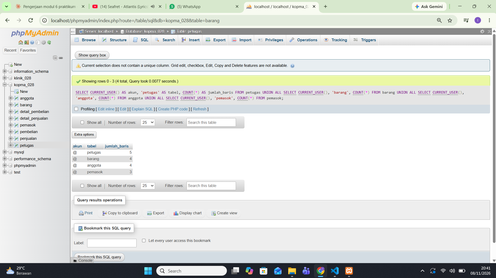

Keterangan: jumlah baris sesuai rencana (petugas 5, barang 4, anggota 4, pemasok 3).

### 3.2 D.2 Nota penjualan PJ-2609-0142

Nota contoh dari Gambar 2.5 buku dicatat dengan `INSERT` dan `INSERT ... SELECT` (harga disalin dari tabel `barang`), lalu stok dikurangi sesuai qty.

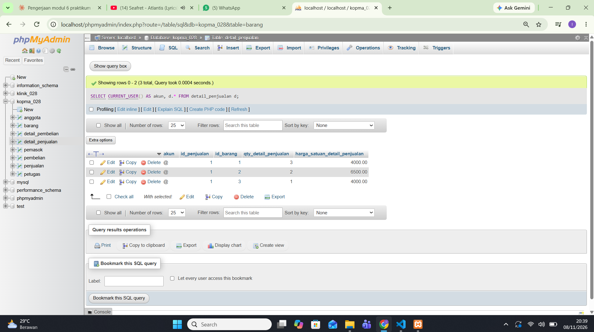

Keterangan: tiga baris detail dengan harga 4000, 6500, dan 4000.

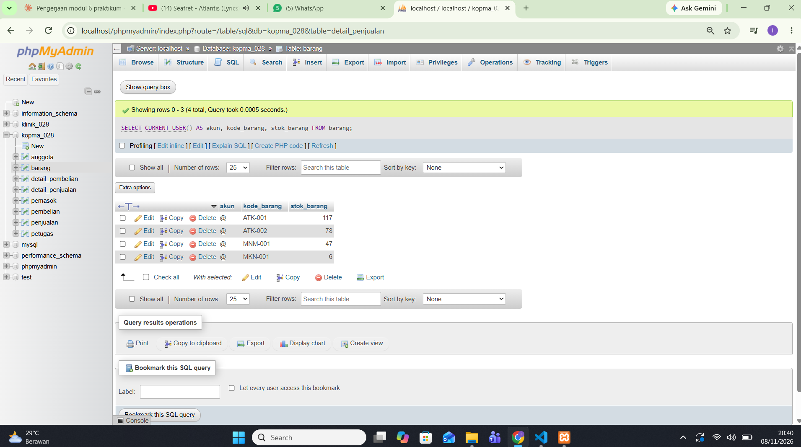

Keterangan: stok menjadi 117, 78, 47, dan 6 (roti tidak terjual pada nota ini).

### 3.3 D.3 Mengubah dan menghapus dengan aman

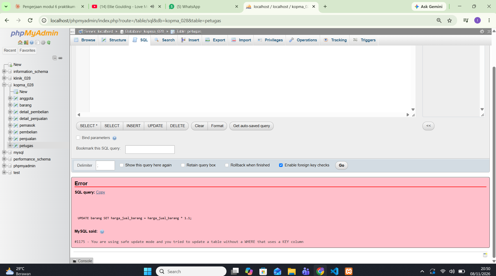

Keterangan: `UPDATE` tanpa `WHERE` ditolak mode aman (`#1175`).

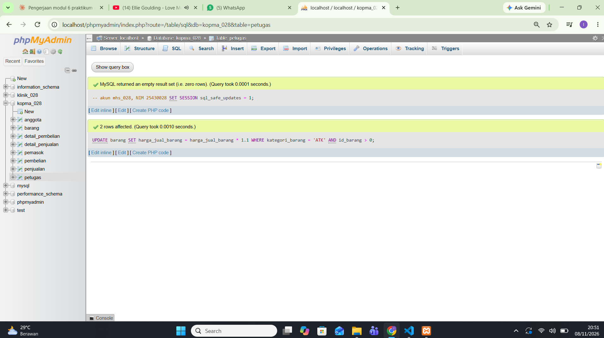

Keterangan: `UPDATE` dengan `WHERE kategori_barang = 'ATK' AND id_barang > 0` diterima, 2 baris berubah.

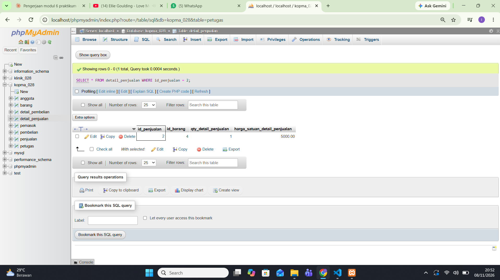
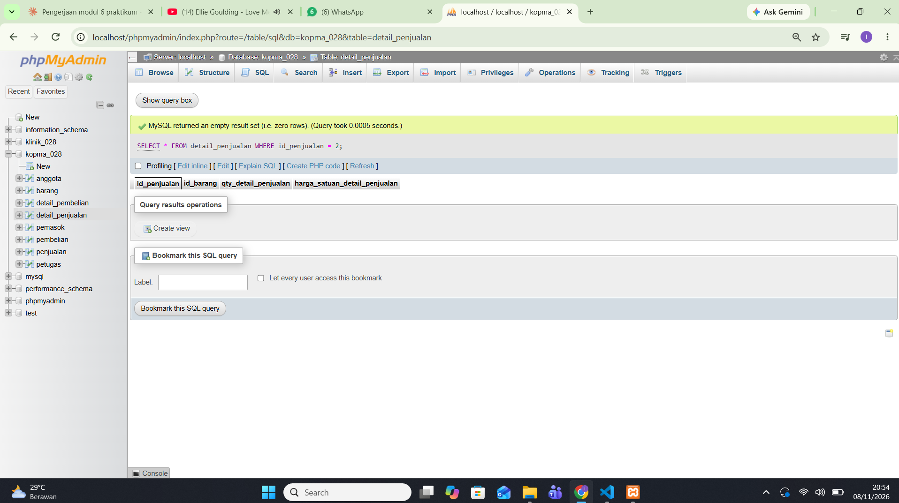

Keterangan: setelah nota uji `PJ-2609-0143` dihapus, baris detailnya ikut hilang karena `ON DELETE CASCADE`.


Keterangan: petugas yang pernah melayani penjualan tidak dapat dihapus (`#1451`, constraint `fk_penjualan_petugas`).

### 3.4 D.4 Skenario uji Kopma

Sembilan skenario dijalankan. Rincian lengkap ada di `p06_uji_kopma_25430028.md`.

| Kode | Masukan | Harapan | Hasil nyata | Status |
|---|---|---|---|---|
| UJ-01 | Nota baru dengan anggota aktif | Diterima | `1 row inserted`, id 3 | LULUS |
| UJ-02 | Nota tanpa anggota (umum) | Diterima, `id_anggota` NULL | `1 row inserted`, id 4, NULL | LULUS |
| UJ-03 | Stok diubah menjadi -5 | Ditolak, ERROR 4025 | `#4025 ck_barang_stok` | LULUS |
| UJ-04 | Nomor nota sudah ada | Ditolak, ERROR 1062 | `#1062 uq_penjualan_nota` | LULUS |
| UJ-05 | Detail dengan qty 0 | Ditolak, ERROR 4025 | `#4025 ck_detail_qty` | LULUS |
| UJ-06 | NIM anggota kembar | Ditolak, ERROR 1062 | `#1062 uq_anggota_nim` | LULUS |
| UJ-07 | Petugas tidak dikenal | Ditolak, ERROR 1452 | `#1452 fk_penjualan_petugas` | LULUS |
| UJ-08 | `UPDATE` tanpa `WHERE`, mode aman | Ditolak, ERROR 1175 | `#1175` | LULUS |
| UJ-09 | Qty 500 padahal stok roti 6 | Seharusnya ditolak | Diterima; stok tetap 6 | **GAGAL** |

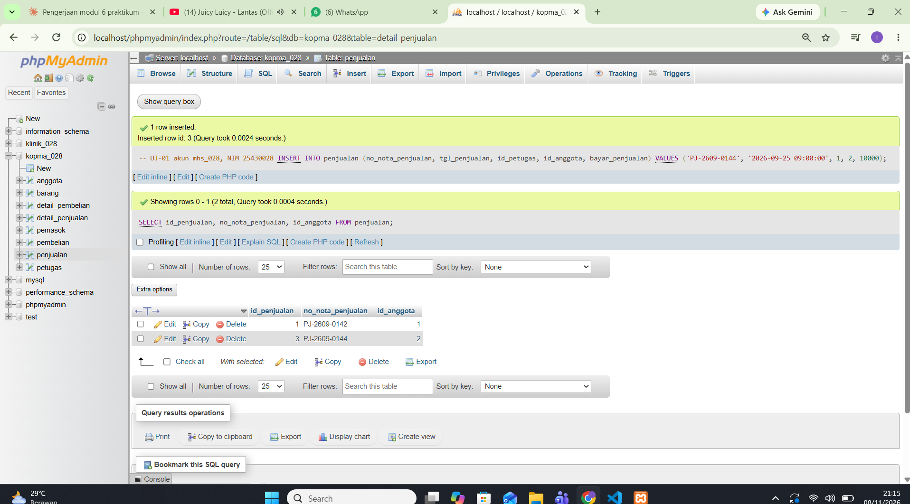 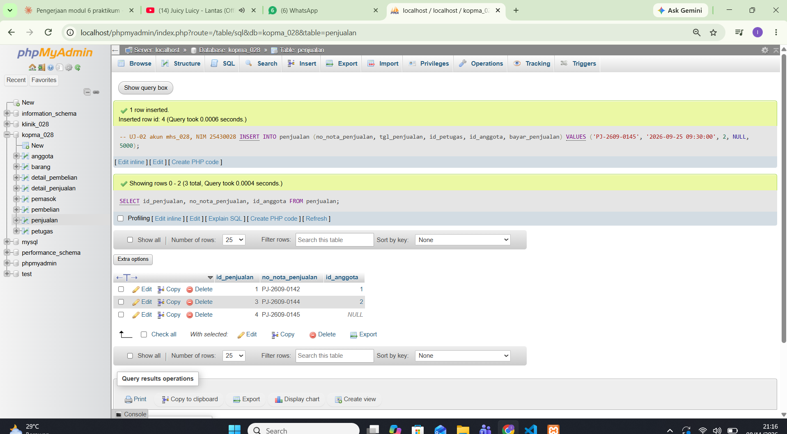 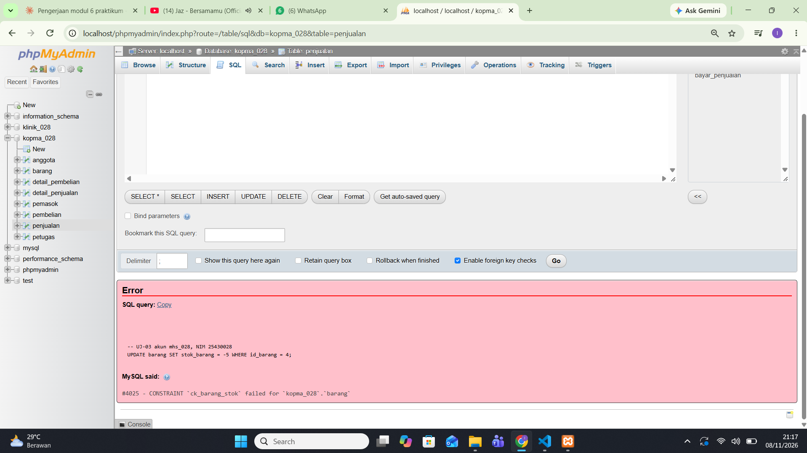
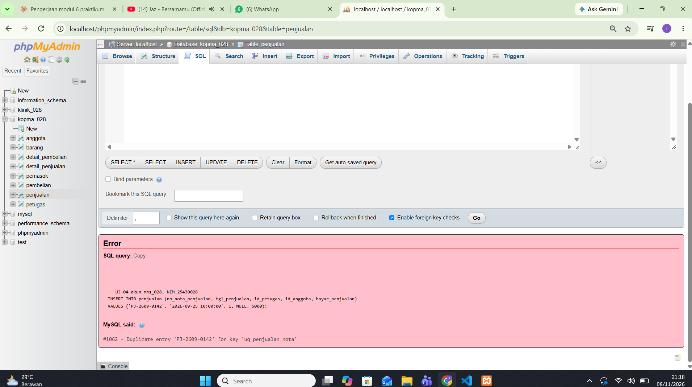 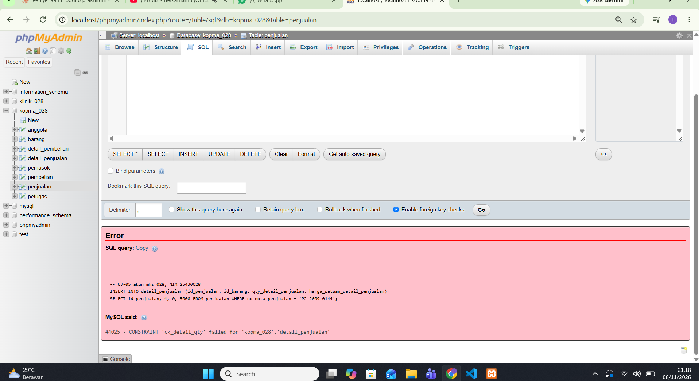 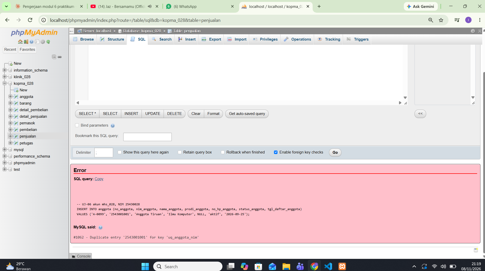
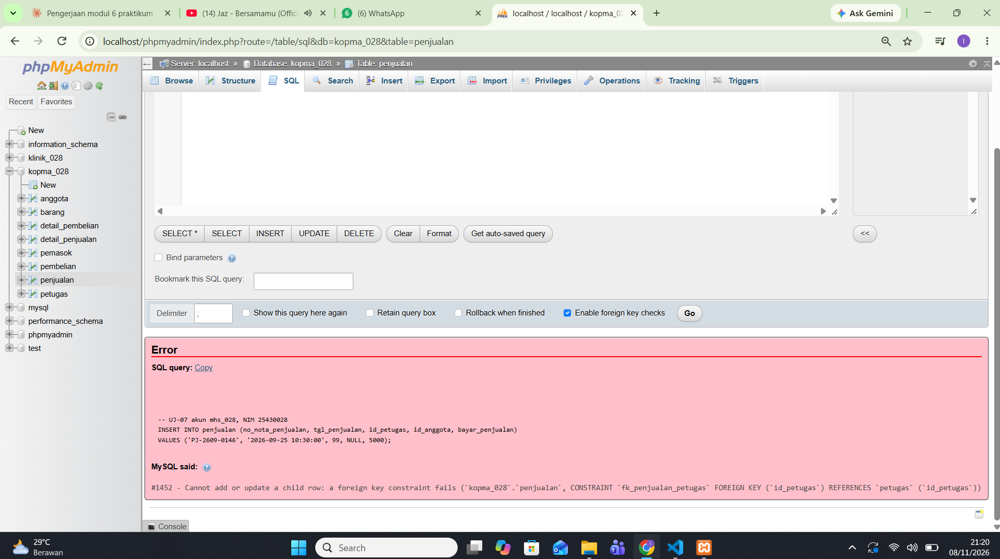 
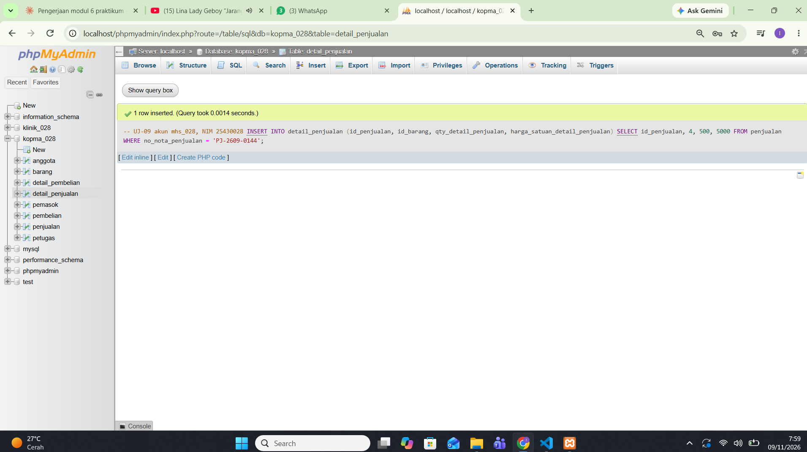 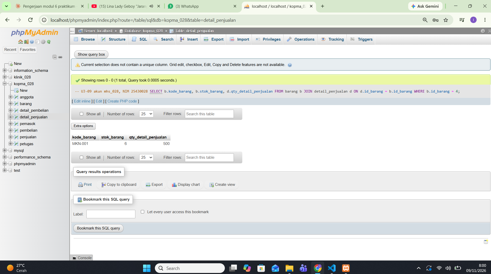

## 4. Jawaban Titik Analisis

**Titik Analisis 1: mengapa `INSERT ... SELECT` lebih aman daripada mengetik 4000, dan apakah nota berubah bila harga naik?**

Alasan keamanan `INSERT ... SELECT`:

`INSERT ... SELECT` lebih aman karena data diambil langsung dari tabel yang sudah ada, sehingga mengurangi kesalahan saat mengetik manual dan memastikan data yang dimasukkan sesuai dengan data sumber.


Hal ini sejalan dengan keluhan ketua koperasi pada wawancara di Modul 2 (`p02_kebutuhan_data_kopma_25430028.md`, bagian 1), yaitu harga barang sering naik sehingga nota lama membingungkan. Keluhan itu dijawab oleh aturan AB-04: karena harga disimpan pada setiap baris `detail_penjualan`, kenaikan harga di tabel `barang` tidak mengubah nota yang sudah tercatat.

**Titik Analisis 2: mengapa menghapus nota menghapus detailnya, tetapi menghapus petugas ditolak?**

Detail penjualan ikut terhapus saat nota dihapus karena menggunakan `ON DELETE CASCADE`. Sedangkan petugas tidak bisa dihapus jika masih digunakan pada nota karena menggunakan aturan bawaan `RESTRICT`. Tujuannya agar riwayat transaksi dan nama petugas yang melayani tetap tersimpan. Jika petugas sudah berhenti, sebaiknya datanya tetap disimpan dan tidak digunakan untuk transaksi baru.

**Titik Analisis 3: uji yang diperkirakan gagal dan alasan `CHECK` tidak mencegahnya**

Uji UJ-09 diperkirakan gagal, tetapi ternyata data dengan qty 500 tetap diterima meskipun stok roti hanya 6. Hal ini terjadi karena `CHECK` hanya memeriksa nilai stok di tabel `barang`, bukan membandingkannya dengan jumlah penjualan di tabel lain. Selain itu, penjualan belum otomatis mengurangi stok karena prosesnya masih dilakukan secara terpisah. Aturan ini nantinya bisa diperbaiki menggunakan transaksi atau pemicu pada Modul 14.
## 5. Hasil Latihan dan Modifikasi

Skrip: `p06_latihan_25430028.sql`.

**E.1 Arsip anggota nonaktif sebelum 2025.** Tabel `anggota_arsip` dibuat dengan `CREATE TABLE ... LIKE`, diisi dengan `INSERT ... SELECT` hanya untuk anggota nonaktif yang mendaftar sebelum 2025 dan tidak punya penjualan, lalu baris tersebut dihapus dari `anggota`. Untuk menguji pengaman, saya menambahkan anggota nonaktif Eka Saputra (daftar 2024) yang masih punya nota `PJ-2503-0007`.

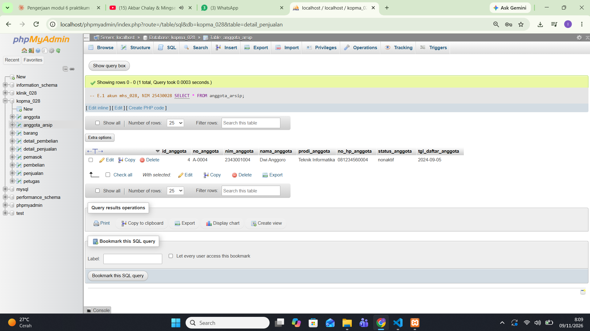
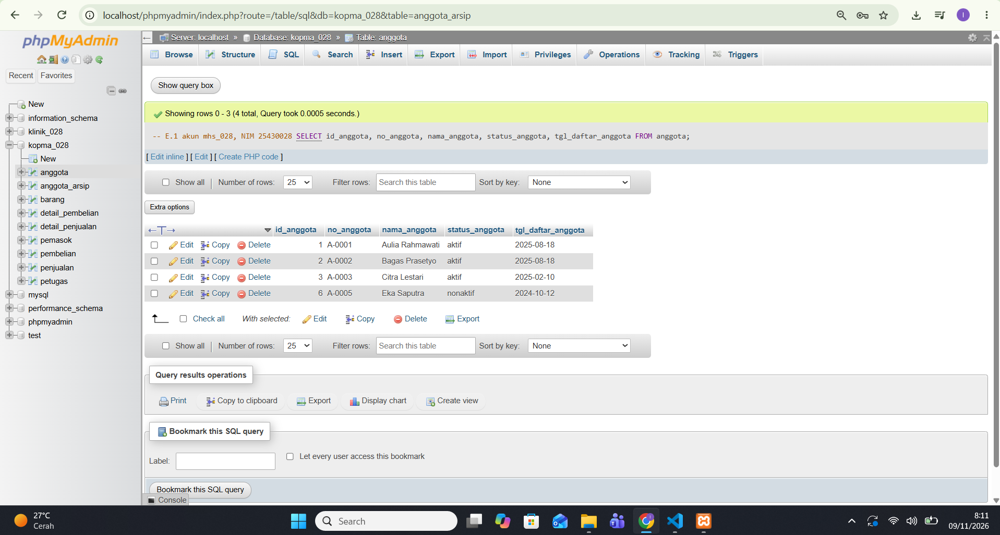

Keterangan: arsip hanya berisi Dwi Anggoro, sedangkan Eka tetap berada di `anggota` karena masih punya penjualan. 

**E.2 Kenaikan harga makanan 5%.**

```sql
UPDATE barang
SET harga_jual_barang = ROUND(harga_jual_barang * 1.05, -2)
WHERE kategori_barang = 'makanan' AND id_barang > 0;
```

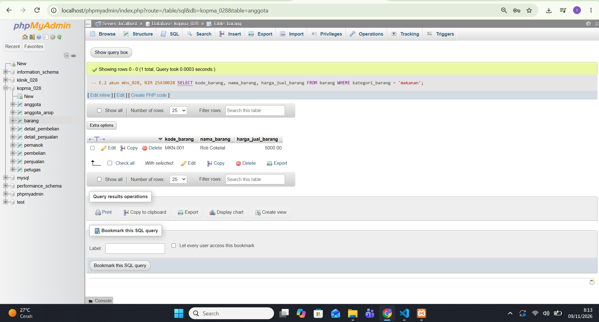
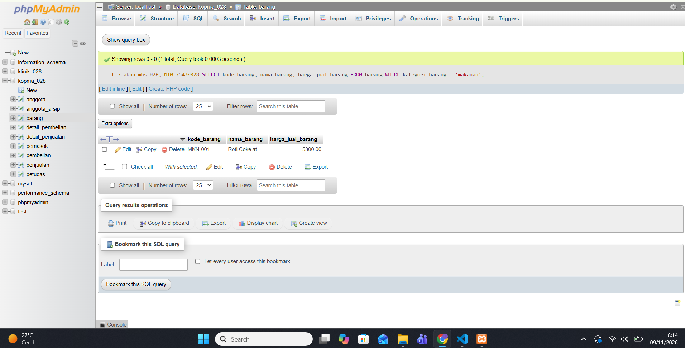

Keterangan: harga Roti Cokelat berubah dari 5000 menjadi 5300. `ROUND(..., -2)` membulatkan ke ratusan terdekat, dan `id_barang > 0` ditambahkan agar `UPDATE` lolos mode aman.

## 6. Tugas Mandiri: Milestone Proyek 6 (Klinik IK Sehat)

Berkas: `p06_data_25430028.sql` dan `p06_uji_25430028.md`. Parameter **P = 2** (NIM 25430028: 28 mod 9 = 1, ditambah 1), sehingga transaksi utama minimal 10 × P = **20 baris** dan batas baris per transaksi P + 2 = **4** (AB-03).

| Tabel | Baris | Ketentuan |
|---|---|---|
| pasien | 8 | induk, minimal 5 |
| dokter | 5 | induk, minimal 5 |
| poli | 5 | induk, minimal 5 |
| tindakan | 7 | induk, minimal 5 |
| obat | 8 | induk, minimal 5 |
| pemasok | 5 | induk, minimal 5 |
| **kunjungan** | **20** | transaksi utama, 4 tanggal (12-15 Oktober 2026) |
| detail_tindakan | 32 | maksimal 4 baris per kunjungan |
| resep | 16 | satu per kunjungan, 4 kunjungan tanpa resep |
| detail_resep | 30 | maksimal 4 baris per resep |
| pembayaran | 20 | 17 lunas, 3 belum lunas |
| pembelian_obat | 5 | 5 faktur dari 4 pemasok |
| detail_pembelian_obat | 10 | harga beli disimpan per baris |

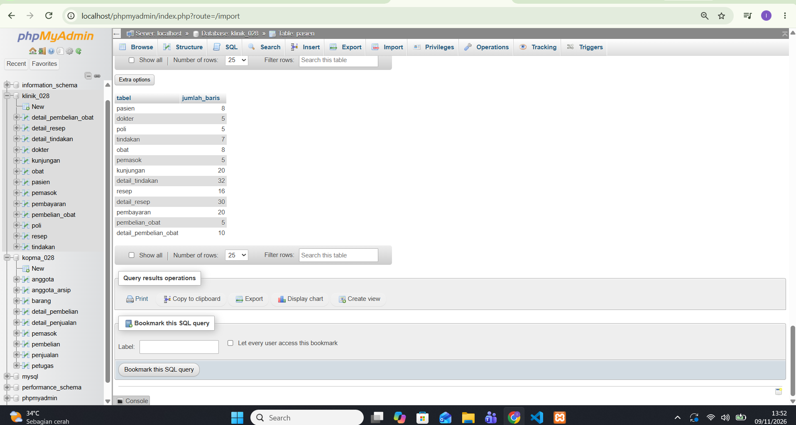
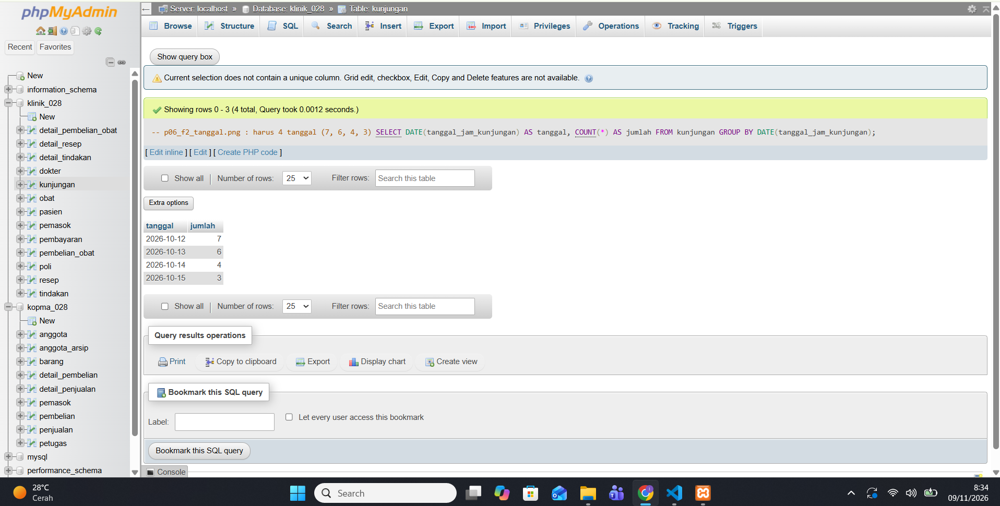
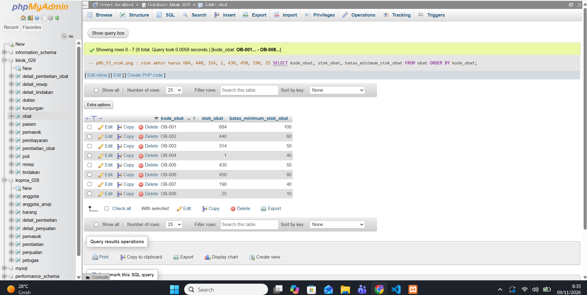

**Keputusan desain data:**
- Semua kunci tamu diisi lewat `INSERT ... SELECT` dengan kode alami (`no_rm`, `kode_dokter`, `kode_obat`, dan seterusnya), bukan menebak nilai id.
- Tarif tindakan dan harga obat disalin dari master pada saat transaksi (AB-04), dan jumlah bayar dihitung dari baris detail.
- Contoh Lembar Kunjungan p02 (`KJ-2610-0007`, Budi Santoso, total Rp85.000, lunas) dimasukkan apa adanya.
- Obat `OB-008` sengaja sudah kedaluwarsa dan `OB-004` sengaja stoknya di bawah batas minimum, sebagai bahan uji dan kueri berikutnya.
- Tiga tagihan sengaja belum lunas (KJ-0004, 0010, 0015) untuk kebutuhan KI-05.
- Stok akhir dihitung: stok awal dikurangi obat yang diserahkan dan ditambah obat yang diterima dari pemasok (AB-05, AB-11).

**Skenario uji Klinik** (rincian di `p06_uji_25430028.md`): 12 skenario, terdiri dari 3 positif, 8 negatif, dan 1 uji gagal.

| Kode | Jenis | Hasil nyata | Status | Rujukan |
|---|---|---|---|---|
| UJ-01 | Positif | Pasien baru diterima (id 9) | LULUS | AB-01 |
| UJ-02 | Positif | Waktu kunjungan terisi otomatis | LULUS | AB-02 |
| UJ-03 | Positif | `tarif_saat_tindakan` = 40000 | LULUS | AB-04 |
| UJ-04 | Negatif | `#1062 uq_pasien_rm` | LULUS | AB-01 |
| UJ-05 | Negatif | `#1062 uq_pasien_nik` | LULUS | AB-01 |
| UJ-06 | Negatif | `#4025 ck_pasien_rm` | LULUS | AB-01 |
| UJ-07 | Negatif | `#4025 ck_pasien_nik` | LULUS | AB-01 |
| UJ-08 | Negatif | `#4025 ck_obat_stok` | LULUS | AB-05 |
| UJ-09 | Negatif | `#1452 fk_kunjungan_dokter` | LULUS | AB-02 |
| UJ-10 | Negatif | `#1451 fk_kunjungan_pasien` | LULUS | AB-10 |
| UJ-11 | Negatif | `#1062 uq_pembayaran_kunjungan` | LULUS | AB-07 |
| UJ-12 | Gagal | Baris tindakan ke-5 diterima; hitungan = 5 | **GAGAL** | AB-03 |

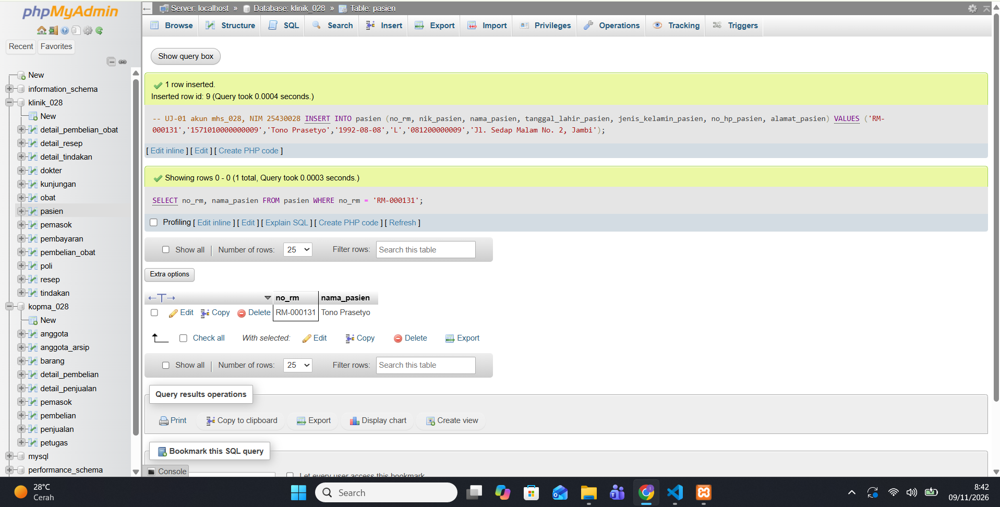 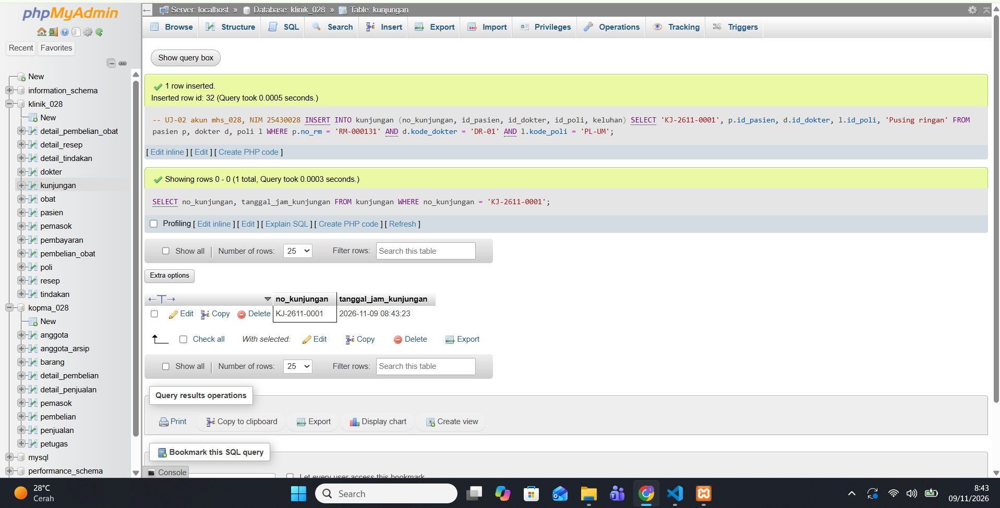 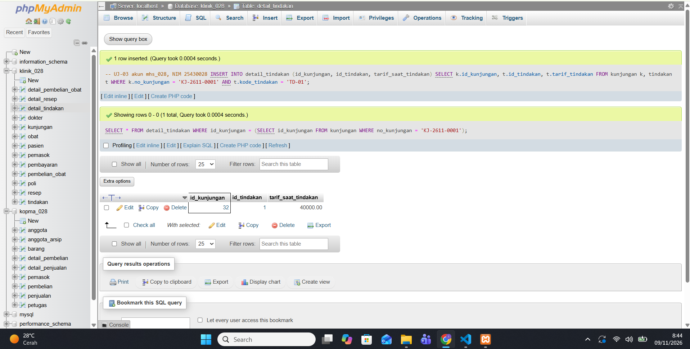
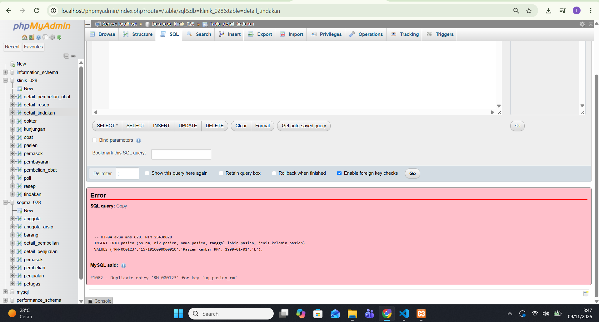 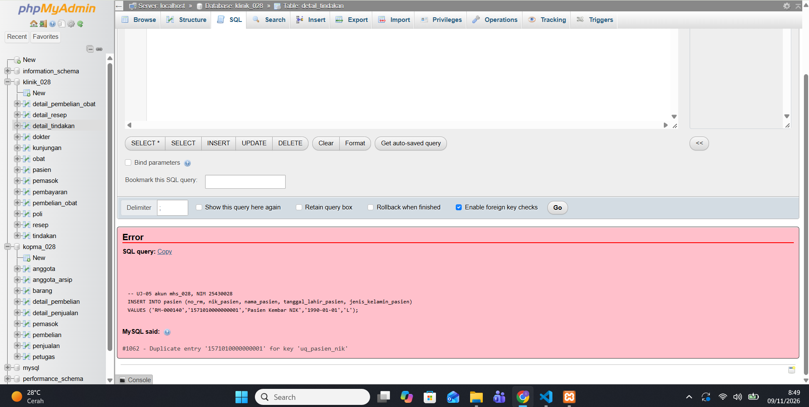 
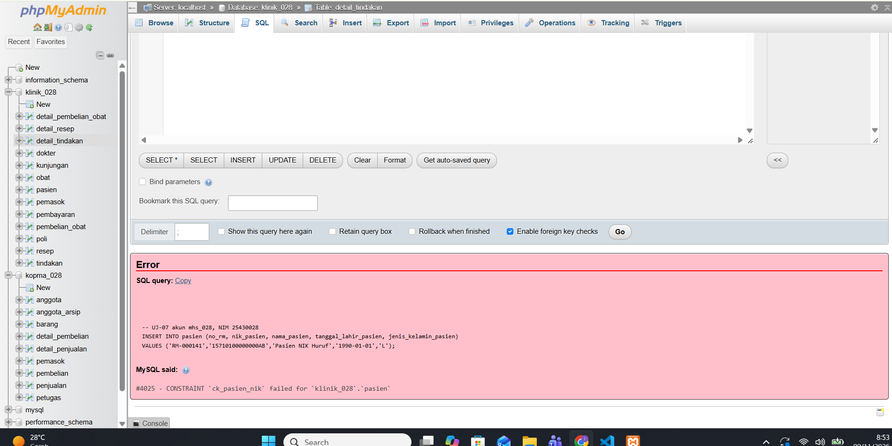  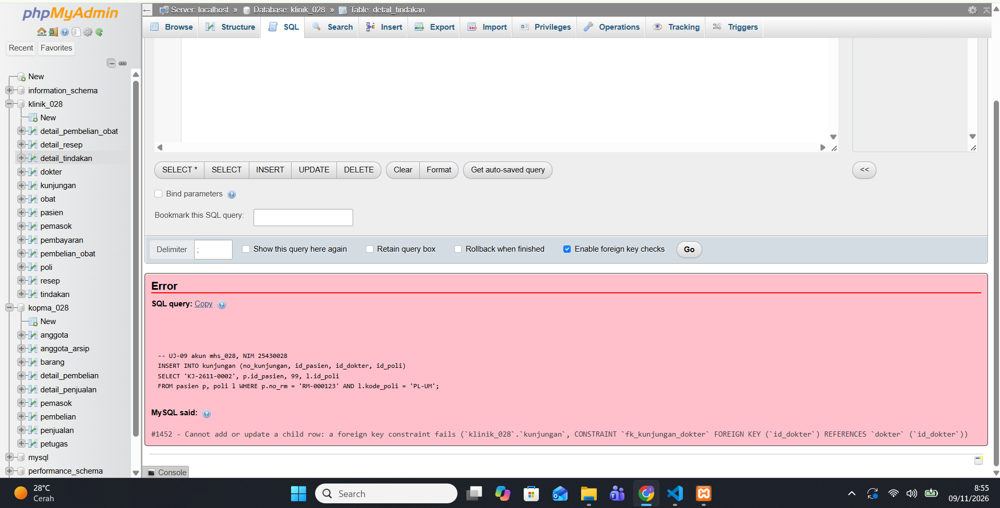
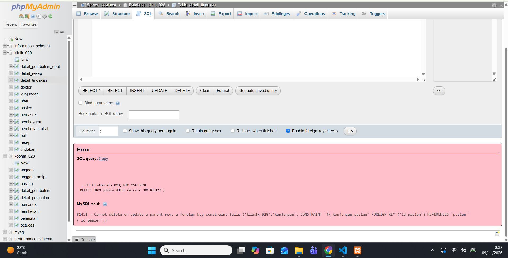 
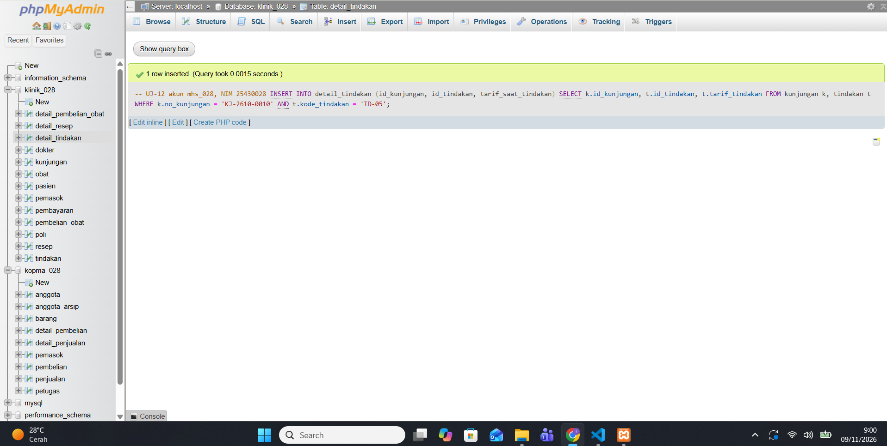 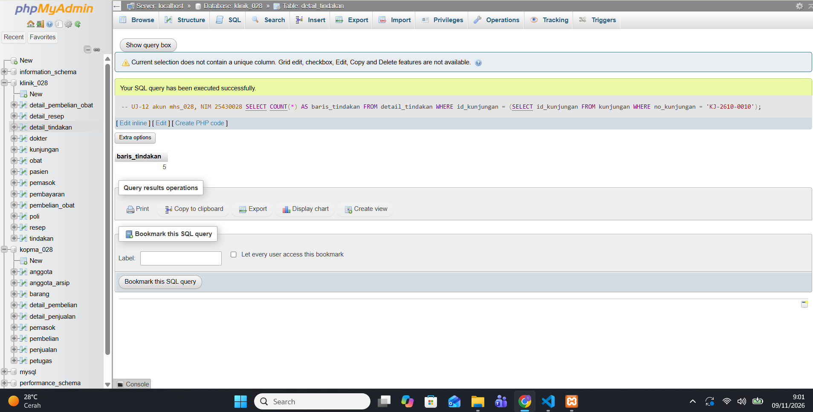

**Utang desain untuk Modul 14 (dari UJ-12).** Aturan AB-03 (maksimal 4 baris tindakan per kunjungan dan 4 baris obat per resep) belum dapat dijaga karena menyangkut jumlah baris per transaksi, sedangkan `CHECK` hanya menilai satu baris. Rencananya dijaga lewat transaksi atau pemicu di Modul 14. Aturan AB-05 (qty melebihi stok), AB-06 (obat kedaluwarsa), dan AB-07 (jumlah bayar sama dengan tagihan ditambah denda) juga ditandai belum dijaga di skrip DDL dan belum diuji di sini.

## 7. Pembahasan dan Kendala

| Galat atau kejadian | Cara membaca | Cara mengatasi |
|---|---|---|
| `#1175` safe update mode | Server menolak `UPDATE` yang `WHERE`-nya tidak memakai kolom kunci. Ini perlindungan | Tambahkan syarat pada kolom kunci (`id_barang > 0`). Pengaturan `SET SESSION` harus dikirim satu kali bersama `UPDATE`-nya, karena phpMyAdmin memulai sesi baru tiap eksekusi |
| `#1062` duplicate entry | Nilai kembar pada kolom `UNIQUE` atau primary key | Pada UJ-09 Kopma percobaan pertama memunculkan `#1062 ... '3-4' for key PRIMARY`, karena baris percobaan sebelumnya belum dihapus. Saya menghapusnya lalu mengulang |
| `#4025` constraint failed | Nilai melanggar `CHECK` | Ini hasil yang diharapkan pada uji negatif |
| `#1451` dan `#1452` | Kunci tamu menolak hapus induk (1451) atau menolak anak tanpa induk (1452) | Hapus anak lebih dulu, atau isi induk lebih dulu |
| `AUTO_INCREMENT` melompat (id kunjungan baru bernomor 32, padahal ada 20 baris) | `INSERT ... SELECT` banyak baris membuat InnoDB menyediakan nomor dalam kelompok | Normal. Karena itu skrip memakai kode alami, dan jika perlu hasil yang identik, bangun ulang dari DDL |
| `id_kunjungan` tidak sama dengan 4 digit akhir `no_kunjungan` (KJ-2610-0007 bernomor id 5) | Urutan id mengikuti urutan pemrosesan penggabungan tabel | Jangan menebak id; gunakan `no_kunjungan` |
| `CURRENT_USER()` mengembalikan `@` | `USER()` menampilkan `mhs_028@`, tetapi `CURRENT_USER()` kosong; kemungkinan koneksi tercatat sebagai akun tanpa nama, belum saya pastikan | Penyebab belum saya selidiki. Saya mencantumkan komentar `-- akun mhs_028, NIM 25430028` pada kueri sebagai penanda akun dan akan mengonfirmasi ke dosen apakah penanda ini cukup | 

## 8. Kesimpulan

Dari praktikum ini saya memahami bahwa pengisian data harus dimulai dari tabel induk, lalu tabel anak. Hasil pengujian menunjukkan bahwa beberapa aturan berjalan dengan baik, seperti `uq_barang_kode` yang menolak kode barang duplikat, `ck_barang_stok` yang menolak stok negatif, dan `fk_penjualan_petugas` yang menolak petugas yang tidak sesuai. Penghapusan petugas yang masih digunakan pada transaksi juga ditolak oleh aturan `RESTRICT` (galat 1451). Namun, pada pengujian UJ-09, penjualan sebanyak 500 roti tetap diterima meskipun stok hanya 6 karena belum ada pengecekan jumlah penjualan terhadap stok. Aturan ini dan batas maksimal 4 detail transaksi masih perlu diperbaiki pada Modul 14.

## 9. Pernyataan Penggunaan AI

Saya menggunakan asisten AI Claude (Anthropic) untuk: (1) membantu membaca dan memetakan tahapan Modul 6 dari buku praktikum; (2) menyusun draf skrip SQL data Klinik (`p06_data_25430028.sql`) dan skrip latihan;(3) menyusun kerangka laporan ini. Semua perintah SQL saya jalankan sendiri di phpMyAdmin, semua tangkapan layar saya ambil sendiri dari hasil nyata, dan galat yang muncul saya baca dan analisis sendiri. 

## 10. Bukti Git

- Repositori: https://github.com/imamkhoiri731-sys/basisdata-25430028
- Commit Kopma: `p06: data dan uji kopma`, hash `17a43dd`
- Commit Milestone: `p06: data dan uji klinik`, hash `4674c73`

## Checklist

**Checklist umum**

- [x] Identitas (nama, NIM, kelas, pertemuan, tanggal, dosen/asisten)
- [x] Tujuan ditulis ulang dengan bahasa sendiri (maksimal 5 baris)
- [x] Ringkasan teori (pemahaman sendiri, maksimal setengah halaman)
- [x] Langkah percobaan (D) dengan tangkapan layar dan keterangan
- [x] Titik Analisis 1, 2, 3 dijawab dengan alasan 
- [x] Latihan (E) dengan skrip dan bukti berjalan
- [x] Tugas Mandiri (F) dengan berkas, bukti, dan keputusan desain
- [x] Pembahasan dan kendala
- [x] Kesimpulan (dua sampai empat kalimat)
- [x] Pernyataan Penggunaan AI
- [x] Bukti Git (tautan dan hash)
- [ ] Keaslian: setiap tangkapan layar memperlihatkan akun ber-NIM dan jam sistem

**Checklist khusus Pertemuan 6**

- [x] Berkas wajib: `p06_data_25430028.sql` dan `p06_uji_25430028.md`
- [x] Bukti tangkapan layar: hasil skenario uji positif dan negatif, jumlah baris per tabel
- [x] Analisis wajib: tabel skenario uji (masukan, harapan, hasil nyata, status)
