# Laporan Praktikum Basis Data - Modul 7
**Nama:** Imam Khoiri
**NIM:** 25430028
**Kelas:** A
**Tanggal pelaksanaan:** 10-11 November 2026
**Dosen/Asisten:** Dedi Irawan, S.Kom., M.T.I.

---

## 1. Tujuan Praktikum
Di modul ketujuh ini, kita belajar cara mengambil data dari tabel menggunakan perintah `SELECT`. Tujuannya agar kita bisa:
- Memilih kolom tertentu dan memberikan nama alias agar mudah dibaca.
- Menyaring baris data menggunakan kondisi (`WHERE`, `BETWEEN`, `IN`, `LIKE`, `IS NULL`).
- Memanfaatkan fungsi-fungsi bawaan (fungsi skalar) seperti manipulasi string (`UPPER`, `CONCAT`), format tanggal (`DATE_FORMAT`), pemformatan angka (`FORMAT`), hingga penanganan nilai kosong (`IFNULL` dan `CASE`).
- Mengurutkan data (`ORDER BY`) dan membatasi jumlah baris hasil kueri (`LIMIT`).

---

## 2. Ringkasan Dasar Teori
Secara konsep, saat kita menjalankan kueri `SELECT`, database mengeksekusinya berdasarkan **urutan evaluasi logis** berikut:
1. **`FROM`**: Menentukan tabel sumber data.
2. **`WHERE`**: Menyaring baris data sesuai kondisi awal.
3. **`SELECT`**: Menampilkan kolom dan mengevaluasi fungsi skalar atau alias.
4. **`ORDER BY`**: Mengurutkan hasil akhir.
5. **`LIMIT`**: Membatasi jumlah baris yang dikeluarkan.

Selain itu, **fungsi skalar** digunakan untuk memproses data per baris (*row-level*), seperti mengubah huruf jadi kapital, merapikan format tanggal, atau membuat kondisi bercabang secara otomatis.

---

## 3. Hasil Langkah Percobaan
Berikut adalah dokumentasi tangkapan layar dari hasil percobaan dasar dan titik analisis di modul:

- **Analisis & Percobaan Dasar A:**  
  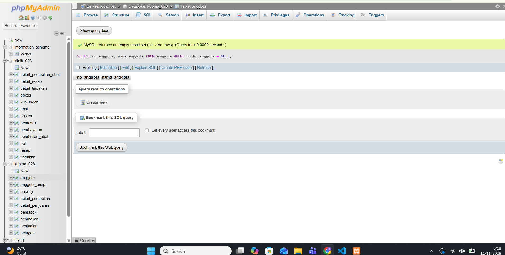
- **Analisis & Percobaan Dasar B:**  
  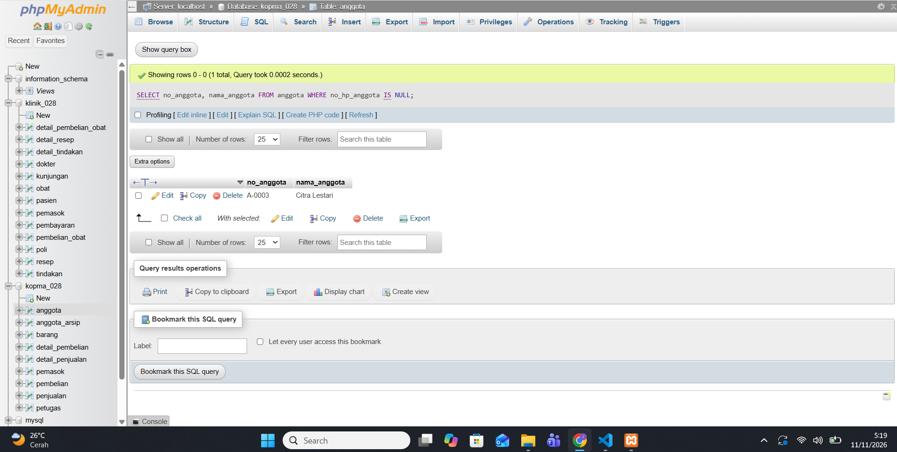
- **Pencarian Data Anggota NULL:**  
  
- **Filter Kategori menggunakan IN:**  
  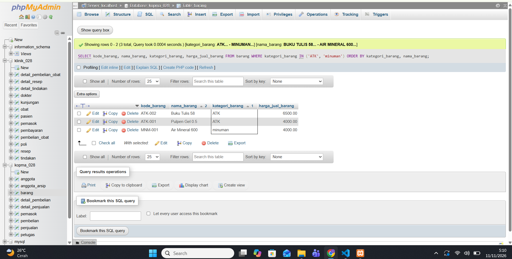
- **Pengecekan Barang Kurang:**  
  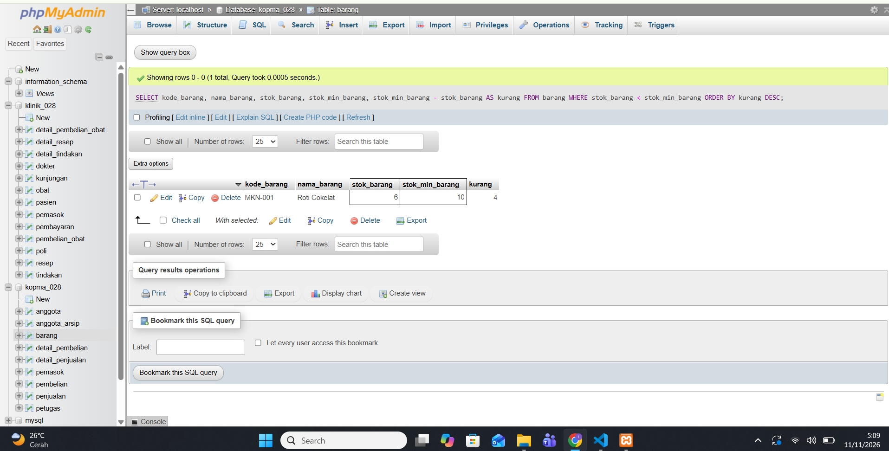
- **Label & Format Data Anggota:**  
  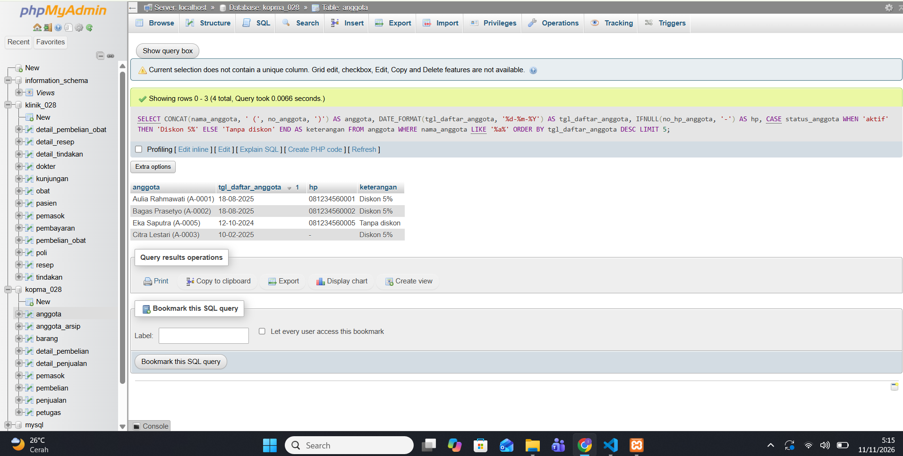
- **Perhitungan Lama Keanggotaan:**  
  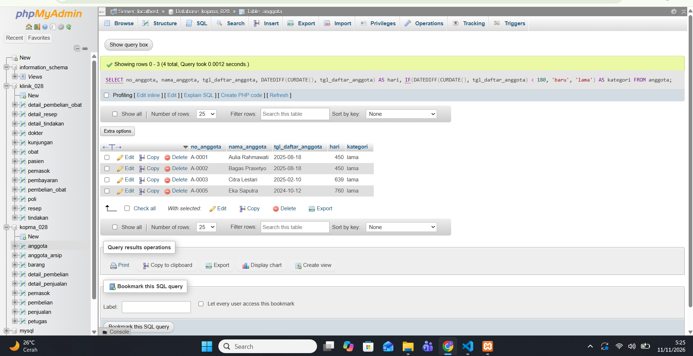
- **Pencarian Nota dengan BETWEEN:**  
  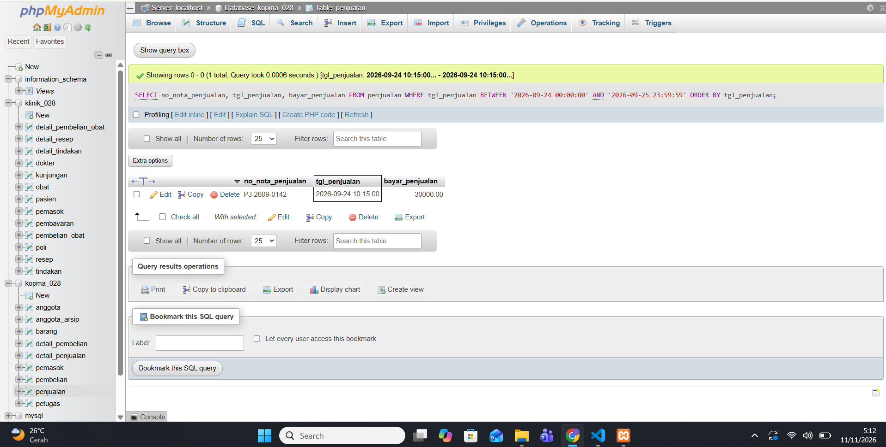
- **Perhitungan Subtotal Nota:**  
  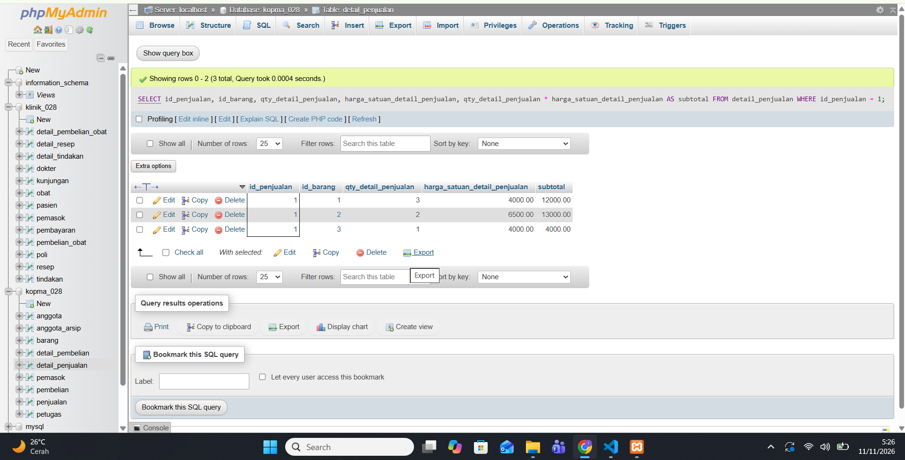

---

## 4. Hasil Latihan dan Modifikasi
Pada sesi latihan, kita menguji format tampilan mata uang/huruf kapital serta menganalisis kesalahan logika (semantik) akibat salah menempatkan tanda kurung pada operator `AND` dan `OR`.

- **Latihan Format Huruf & Rupiah:**  
  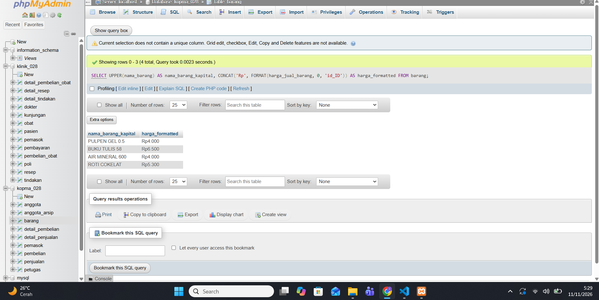
- **Latihan Kesalahan Semantik:**  
  
- **Dokumentasi Tanpa Kurung Semantik:**  
  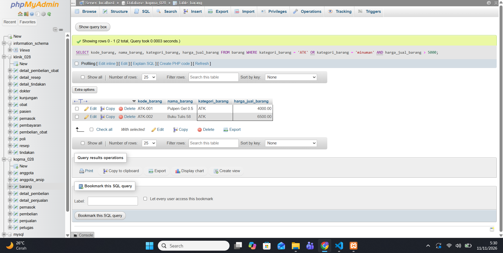

---

## 5. Tugas Mandiri: Milestone Proyek 7 (Sistem Klinik `klinik_028`)
Berikut adalah dokumentasi lengkap 10 kueri `SELECT` satu tabel untuk mendukung Kebutuhan Informasi (KI-01 sampai KI-10) pada proyek sistem informasi Klinik:

- **KI-01 (Format Nama Kapital & Tanggal Lahir Pasien):** Menggunakan fungsi `UPPER()` dan `DATE_FORMAT()`.  
  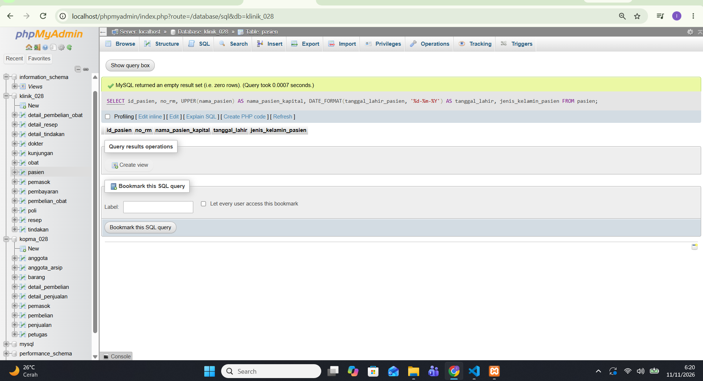

- **KI-02 (Data Dokter - ORDER BY):** Mengurutkan data dokter berdasarkan spesialisasi dan namanya.  
  

- **KI-03 (Daftar Poli Klinik):** Menampilkan seluruh poli yang tersedia di klinik.  
  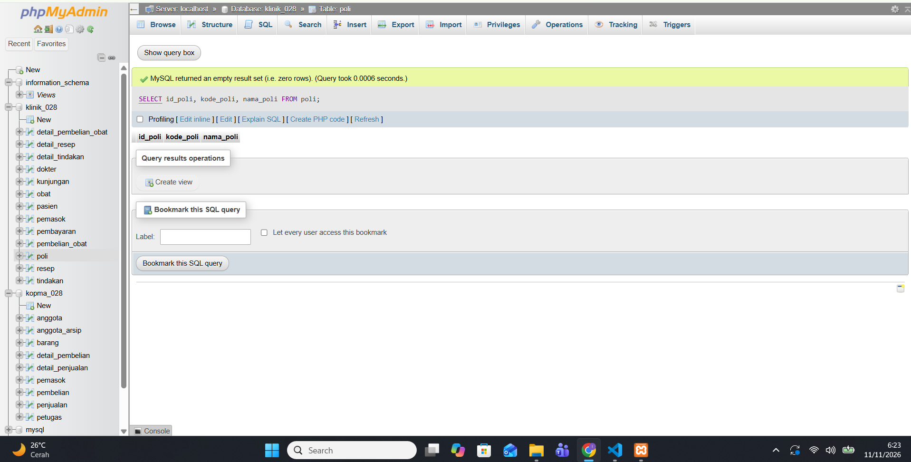

- **KI-04 (Format Rupiah Tindakan):** Menggunakan `CONCAT()` dan `FORMAT()` untuk tarif tindakan di atas 50.000.  
  

- **KI-05 (Stok Obat Menipis):** Mengecek obat dengan stok di bawah batas minimum beserta perhitungan kekurangannya.  
  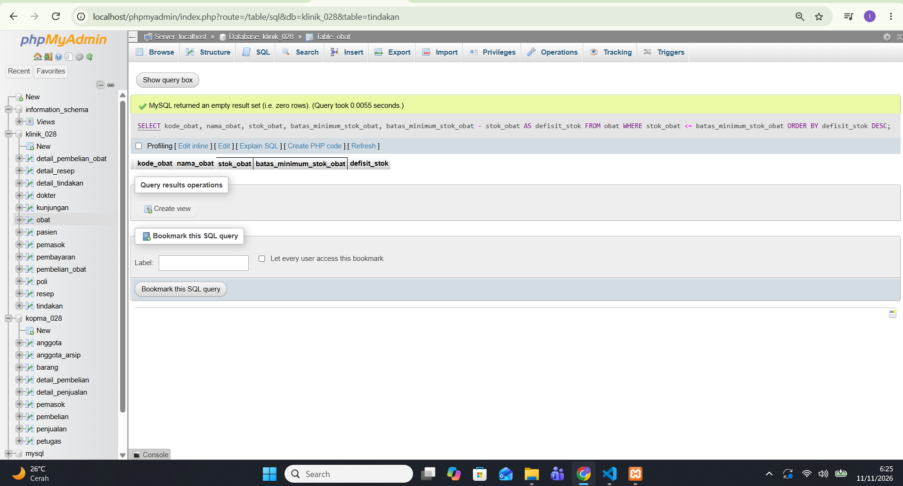

- **KI-06 (Rentang Tanggal Kunjungan - BETWEEN):** Menyaring data kunjungan pasien pada periode waktu tertentu.  
  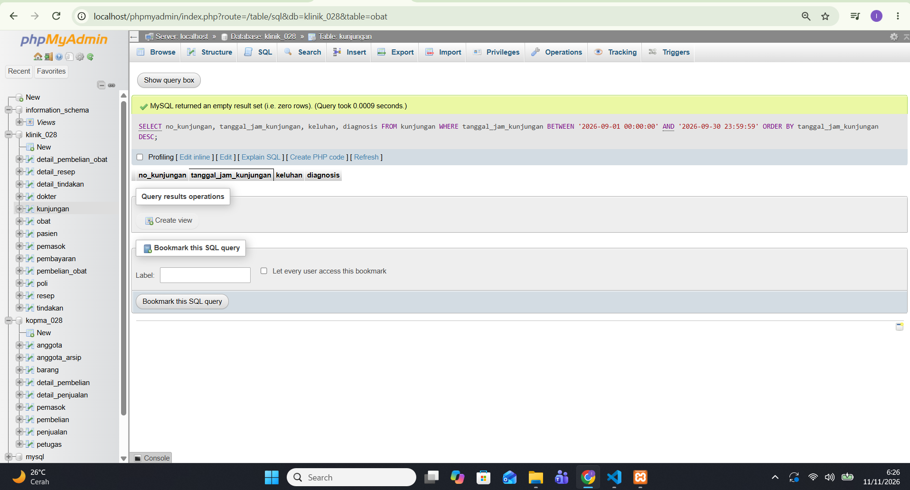

- **KI-07 (Data Resep):** Menampilkan data resep obat dari kunjungan pasien.  
  

- **KI-08 (Status Pembayaran Kondisional - CASE):** Mengelompokkan status pembayaran secara otomatis berdasarkan jumlah bayar.  
  

- **KI-09 (Penanganan Telepon Pemasok - IFNULL):** Menangani nilai kosong (`NULL`) pada nomor telepon pemasok.  
  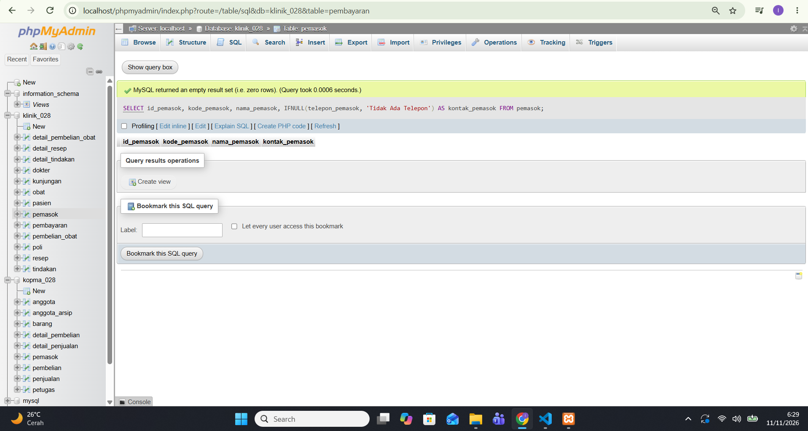

- **KI-10 (Pembelian Obat Terbaru - LIMIT):** Menampilkan 5 transaksi pembelian obat paling baru dengan pengurutan menurun.  
  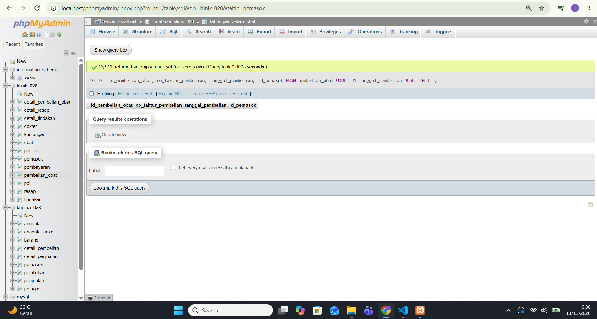

---

## 6. Jawaban Titik Analisis
- **Titik Analisis 1:** Kenapa alias kolom (seperti `AS nama_pasien_kapital`) tidak bisa langsung dipanggil di dalam klausa `WHERE`?  
  *Jawabannya:* Karena database mengeksekusi klausa `WHERE` terlebih dahulu sebelum kolom pada `SELECT` diberi alias.
- **Titik Analisis 2:** Kenapa kalau mencari data kosong tidak boleh menggunakan `= NULL` melainkan harus `IS NULL`?  
  *Jawabannya:* Karena `NULL` merepresentasikan data yang tidak diketahui, sehingga tidak bisa dibandingkan dengan operator kesamaan biasa (`=`).
- **Titik Analisis 3:** Apa perbedaan perhitungan per baris dengan rekapitulasi keseluruhan?  
  *Jawabannya:* Perhitungan per baris (seperti pengurangan stok atau manipulasi string) langsung diproses pada tingkat baris data, sedangkan rekapitulasi keseluruhan memerlukan fungsi agregat dan `GROUP BY`.

---

## 7. Pembahasan dan Kendala
Sempat terjadi sedikit penyesuaian penamaan kolom pada tabel pasien agar selaras dengan DDL Klinik IK Sehat yang digunakan pada basis data `klinik_028`. Kendala tersebut berhasil diselesaikan dengan menyesuaikan sintaks kueri SELECT.

---

## 8. Kesimpulan
Modul 7 memberikan pemahaman mendalam mengenai teknik pengambilan data menggunakan kueri `SELECT`. Kombinasi fungsi skalar, filter baris, dan pengurutan membuat data mentah di sistem klinik dapat disajikan menjadi informasi yang akurat dan mudah dibaca.

---

## 9. Pernyataan Penggunaan AI
- **Alat yang dipakai:** Gemini AI
- **Untuk apa:** Membantu memandu penyesuaian sintaks SQL agar klop dengan DDL klinik serta menyusun struktur laporan praktikum.

---

## 10. Bukti Git
- Repositori: https://github.com/imamkhoiri731-sys/basisdata-25430028
- **Berkas Kueri Utama:** `p07_kueri_25430028.sql`